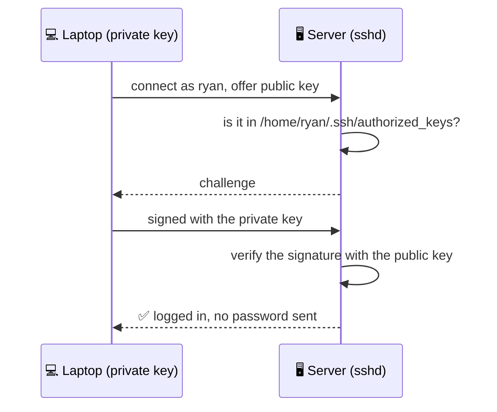
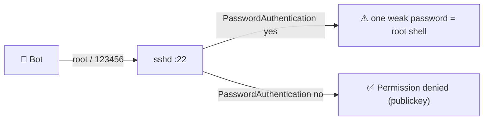

# 🔑 SSH Keys and Hardening

[[Linux/Linux Handbook/0. Linux Handbook|🐧 Linux Handbook]] · Part 4: Network and remote access · ⬅️ [[Linux/Linux Handbook/15. Ports, Sockets, and DNS|15. Ports, Sockets, and DNS]] · ➡️ [[Linux/Linux Handbook/17. Firewalls and Network Exposure|17. Firewalls and Network Exposure]]

How SSH key login works, how to set it up on a new server, and how to harden `sshd` so the bots that attack every public server all day can't get in.

> [!toc]- 📑 Contents
>
> - [[#🧱 ssh and sshd|🧱 ssh and sshd]]
> - [[#🔐 How Key Login Works|🔐 How Key Login Works]]
> - [[#🛠️ Setting Up Key Login|🛠️ Setting Up Key Login]]
> - [[#🎯 Why SSH Is Attacked All Day|🎯 Why SSH Is Attacked All Day]]
> - [[#🧩 How sshd Reads Its Config|🧩 How sshd Reads Its Config]]
> - [[#🔒 Keys Only, No Root|🔒 Keys Only, No Root]]
> - [[#🚧 Reducing the Noise with fail2ban|🚧 Reducing the Noise with fail2ban]]
> - [[#🩺 Common Failures|🩺 Common Failures]]
> - [[#🧪 Interview Q&A|🧪 Interview Q&A]]
> - [[#📚 References|📚 References]]

---

## 🧱 `ssh` and `sshd`

SSH always involves **two programs**, one on each side:

| | `ssh` | `sshd` |
|---|---|---|
| Runs on | our laptop | the server |
| Role | **client**: starts the connection | **server**: listens on port 22 |
| Config | `~/.ssh/config` | `/etc/ssh/sshd_config` |
| Decides | which key to offer, which host | **who may log in, and how** |

The **d** stands for **daemon**. On Ubuntu, systemd runs it as the service **`ssh`** (`sshd` on RHEL), often with **socket activation**: `ssh.socket` holds port 22 and hands connections to `ssh.service`.

```bash
systemctl status ssh
sudo ss -tlnp | grep ':22 '
```

So **hardening SSH means changing `sshd`'s settings on the server.** Nothing on the laptop changes.

---

## 🔐 How Key Login Works

A key pair has a **private** key that never leaves our laptop and a **public** key that goes into `~/.ssh/authorized_keys` on the server.



No secret crosses the network: the server only checks a signature it can verify with the public key.

---

## 🛠️ Setting Up Key Login

1. 🔐 **Create a key pair on the laptop** (skip if you have one).

   ```bash
   ssh-keygen -t ed25519 -C "ryan@laptop"
   ```

   - Creates `~/.ssh/id_ed25519` (private) and `~/.ssh/id_ed25519.pub` (public). Ed25519 keys are short and modern.

2. 📤 **Copy the public key to the server.**

   ```bash
   ssh-copy-id ryan@SERVER_IP
   ```

   - Appends it to `/home/ryan/.ssh/authorized_keys` and sets safe permissions.

   - By hand, as root on the server:

     ```bash
     mkdir -p /home/ryan/.ssh
     echo "<contents of id_ed25519.pub>" >> /home/ryan/.ssh/authorized_keys
     chown -R ryan:ryan /home/ryan/.ssh
     chmod 700 /home/ryan/.ssh
     chmod 600 /home/ryan/.ssh/authorized_keys
     ```

3. ✅ **Test in a new terminal**, keeping the old session open.

   ```bash
   ssh ryan@SERVER_IP
   ssh -t ryan@SERVER_IP 'sudo -v && echo ok'
   ```

   - `-t` gives the remote command a terminal, so `sudo` can ask for ryan's password.

   - No `-i` needed: ssh tries `~/.ssh/id_ed25519` and the other default keys itself. If you pass `-i`, give the **private** key, never the `.pub`.

> ⚠️ `sshd` ignores `authorized_keys` if `~/.ssh` or the file is writable by others (`StrictModes`). Use `700` and `600`; see [[Linux/Linux Handbook/9. Ownership and Permissions#🔑 Permissions That Programs Enforce|9. Permissions]].

---

## 🎯 Why SSH Is Attacked All Day

Every public IPv4 address is scanned within minutes of going online. Bots try common usernames and passwords on port 22, forever.

> 💡 **Real-World Example**
>
> On 2026-11-11 our develop server logged **22,941** failed SSH logins in 24 hours, from 135 IPs.
>
> - 👤 **Most tried:** `root` (8,780), then `user`, `admin`, `debian`, `test`, `deploy`.
>
> - ✅ **Our own logins:** 36 in a week, **all** by SSH key.

Bots can't beat a key. They can only beat a **password**. So the whole defense is: make passwords impossible.



---

## 🧩 How sshd Reads Its Config

`/etc/ssh/sshd_config` starts with `Include /etc/ssh/sshd_config.d/*.conf`. The included files are read in **alphabetical order**, and for each keyword sshd keeps the **first** value it sees.

- 📁 **On our server:**

    - `50-cloud-init.conf` → `PasswordAuthentication yes` ← read first, **wins**

    - `60-cloudimg-settings.conf` → `PasswordAuthentication no` ← ignored

This is the opposite of most programs, where the *last* value wins. That's why a correct-looking `no` did nothing.

To see the **effective** settings:

```bash
sudo sshd -T | grep -E '^(passwordauthentication|permitrootlogin|kbdinteractiveauthentication|maxauthtries) '
```

- `-T` → parse every file and print the final values. `-t` (lowercase) only checks for errors.

---

## 🔒 Keys Only, No Root

1. 🔎 **Prove your key works** for the account you'll use (step 3 above), and that `sudo` works there.

2. ✍️ **Create a drop-in that sorts first.**

   ```bash
   sudo tee /etc/ssh/sshd_config.d/00-hardening.conf >/dev/null <<'EOF'
   PasswordAuthentication no
   KbdInteractiveAuthentication no
   PermitRootLogin prohibit-password
   X11Forwarding no
   MaxAuthTries 3
   LoginGraceTime 30
   EOF
   ```

   - `prohibit-password` → root may log in with a key only. Switch to `no` once you work as `ryan` with `sudo`.

   - `MaxAuthTries 3` → fewer guesses per connection; `LoginGraceTime 30` → drop idle unauthenticated connections sooner.

3. ✅ **Validate, then reload.** Reload doesn't drop open sessions.

   ```bash
   sudo sshd -t && sudo systemctl reload ssh
   ```

4. 🧪 **Test from a NEW terminal**, keeping the old one open.

   ```bash
   ssh -o PubkeyAuthentication=no root@SERVER_IP   # expect: Permission denied (publickey)
   ssh ryan@SERVER_IP                              # expect: works
   ```

> ⚠️ If the new login fails, use the old session to delete `00-hardening.conf` and reload. Never close your last working session during an SSH change; otherwise you need the provider's web console.

💡 `AllowUsers ryan deploy` whitelists exactly who may log in.

---

## 🚧 Reducing the Noise with fail2ban

With passwords off, attacks **can't succeed**, but they still fill the journal (75k lines a day on our server).

| Option | What it does | Worth it? |
|---|---|---|
| **fail2ban** / **CrowdSec** | Bans an IP after N failures | ✅ Cuts log noise and load |
| Provider firewall: port 22 only from your IPs | Bots never reach sshd | ✅✅ Best, with a stable IP |
| Change the port (e.g. 2202) | Fewer dumb bots | 🟡 Noise only, **not** security |

**fail2ban** reads the sshd log, counts failures per IP, and adds a firewall rule that drops an IP that fails too often. The ban is lifted later.


```bash
sudo apt install -y fail2ban python3-systemd
```

`/etc/fail2ban/jail.local` (never edit `jail.conf`; updates overwrite it):

```ini
[DEFAULT]
ignoreip = 127.0.0.1/8 ::1 YOUR_IP
bantime  = 1h
findtime = 10m
maxretry = 5
bantime.increment = true

[sshd]
enabled = true
backend = systemd
mode    = aggressive
```

- `ignoreip` → never ban these; put your own IP here (`echo $SSH_CLIENT` shows it).

- `maxretry` + `findtime` → 5 failures in 10 minutes = ban. `bantime.increment` → repeat bans get longer.

- `mode = aggressive` → with passwords off, bots end at `Connection closed … [preauth]`; aggressive mode counts those too.

```bash
sudo systemctl enable --now fail2ban
sudo fail2ban-client status sshd                  # failures and banned IPs
sudo fail2ban-client set sshd unbanip IP          # unban
```

> ⚠️ Banned yourself? Log in through the provider's web console and `unbanip`.

🔜 **Later:** `ssh-agent`, `~/.ssh/config`, `scp`/`sftp`, tunnels and `-v` debugging (SDGL Ch.13).

---

## 🩺 Common Failures

| Symptom | Likely cause | Fix |
|---|---|---|
| Key ignored, password prompt appears | Key not in `authorized_keys`, or permissions too open | `700` on `~/.ssh`, `600` on the file, owned by the user |
| `Permission denied (publickey)` | Wrong user or key, or passwords already off | `ssh -v user@host` shows which keys were tried |
| A `no` in `sshd_config.d` has no effect | An earlier file set it first | `sudo sshd -T`; use a `00-` drop-in |
| `sudo: a terminal is required` over ssh | No TTY for the remote command | `ssh -t` |

---

### 🧪 Interview Q&A

**Q1:** Which key goes on the server, and where?

**Q2:** Two files in `sshd_config.d` set `PasswordAuthentication` differently. Which wins?

**Q3:** Why is `systemctl reload ssh` safer than `restart` during hardening?

**Q4:** Is moving SSH to port 2202 a security control?

**Q5:** In what order do you set up keys and disable passwords?

**Q6:** What does `PermitRootLogin prohibit-password` allow?

> [!answer]- 📋 Answers
>
> **A1:** The **public** key, appended to `~/.ssh/authorized_keys` in the target user's home.
>
> **A2:** The first one read: files load alphabetically, so `00-…` beats `50-…`.
>
> **A3:** Reload re-reads the config without dropping open sessions, and running `sshd -t` first means a typo never stops the daemon.
>
> **A4:** No. It only reduces noise from dumb bots; real scanners find the new port in seconds.
>
> **A5:** Set up and test key login and `sudo` first, from a second session. Only then disable passwords and root login.
>
> **A6:** Root may log in with a public key only. Passwords for root are refused.

---

## 🔨 Hands-On Practice

> ⚠️ Practice on a VM or keep a second session open.

1. 🔐 **Key login on a VM.**

   ```bash
   ssh-keygen -t ed25519 -C "lab"
   ssh-copy-id alice@VM_IP
   ssh alice@VM_IP
   ```

   ✅ Logs in without the account password.

2. 🔎 **Count today's attacks** (on a public server).

   ```bash
   sudo journalctl -u ssh --since today | grep -cE 'Failed password|Invalid user'
   ```

3. 🔒 **Apply the drop-in** from [[#🔒 Keys Only, No Root|Keys Only, No Root]].

   ✅ `sudo sshd -T | grep passwordauthentication` → `passwordauthentication no`.

---

### 📋 Quick Reference

| Task | Command |
|---|---|
| New key (laptop) | `ssh-keygen -t ed25519 -C "ryan@laptop"` |
| Install key | `ssh-copy-id user@host` |
| Key file permissions | `chmod 700 ~/.ssh` · `chmod 600 ~/.ssh/authorized_keys` |
| Effective config | `sudo sshd -T` |
| Validate and apply | `sudo sshd -t && sudo systemctl reload ssh` |
| Failed / accepted logins | `journalctl -u ssh \| grep -E 'Failed\|Invalid'` · `grep Accepted` |
| Debug a login | `ssh -v user@host` |
| Banned IPs / unban | `sudo fail2ban-client status sshd` · `… set sshd unbanip IP` |

### 🧠 Things to Remember

- Public key → server's `authorized_keys`; private key stays home.

- sshd keeps the **first** value it reads. `sshd -T` shows the truth.

- Bots can't beat keys. Remove passwords, and the risk is gone.

- Test from a **new** session; keep the old one open.

### 💡 Pro Tips

- **Use a separate key for CI** (`deploy`) so you can revoke it alone.

- **Allow port 22 only from your IP** in the provider firewall when your IP is stable.

- **Hardware-backed keys** (`ed25519-sk`) protect against a stolen laptop.

### 🔗 Related Topics

- ⬅️ [[Linux/Linux Handbook/15. Ports, Sockets, and DNS|15. Ports, Sockets, and DNS]] · ➡️ [[Linux/Linux Handbook/17. Firewalls and Network Exposure|17. Firewalls and Network Exposure]]

- [[Linux/Linux Handbook/8. Users, Groups, and sudo|8. Users, Groups, and sudo]]

- [[Linux/Scatterd Learning/SSH|SSH key management (scattered notes)]]

---

## 📚 References

| Source | Where | Status |
|---|---|---|
| 📝 Nana: [[DevOps/NaNa/Linux/7. Server Configuration\|Server Configuration]] | SSH key login (ep 22) | ✅ studied |
| 📝 Server Admin: [[DevOps/Server Administration/2. SSH Hardening and Brute Force\|SSH Hardening and Brute Force]] | whole note | ✅ studied |
| 📝 Server Admin: [[DevOps/Server Administration/1. Develop Server Audit 2026-11-11\|Audit]] | Finding C1 | ✅ studied |
| 📕 SDGL Ch.13 | Crypto primer p. 168 · keys p. 169 · `ssh-agent` p. 175 · `-v` p. 176 · file transfer p. 177 · tunnels p. 181 · config p. 182 | 📖 planned · 🔁 key login is here · 🆕 crypto primer, `ssh-agent`, `-v`, `scp`/`sftp`, `~/.ssh/config` → here; tunnels → note 17 |
| 📗 CompTIA 6th Ch.12 | Secure Shell (SSH), pp. 511–515 [PDF 527–531] | 🔭 optional |
| 📘 Linux Bible Ch.13 | SSH service p. 314 · remote execution p. 318 · `scp`/`rsync` p. 319 · key-based auth p. 322 [PDF 343–351] | 🔭 optional |
| 📘 Linux Bible Ch.23 | Limiting access to the root account, p. 549 [PDF 573] | 📖 planned (Stage D) · 🔁 mostly review: no root logins is already here |
| 🗒️ Scattered: [[Linux/Scatterd Learning/SSH\|SSH]] | Multiple keys, custom ports, config file | 🔭 optional |
