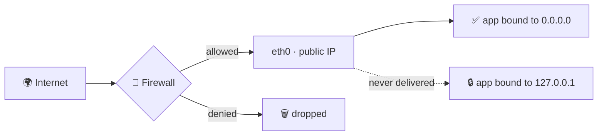
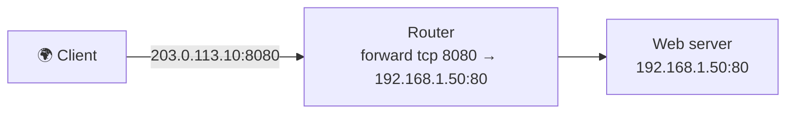
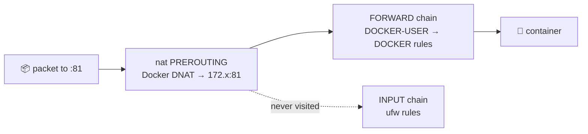

# 🧱 Firewalls and Network Exposure

[[Linux/Linux Handbook/0. Linux Handbook|🐧 Linux Handbook]] · Part 4: Network and remote access · ⬅️ [[Linux/Linux Handbook/16. SSH Keys and Hardening|16. SSH Keys and Hardening]] · ➡️ [[Linux/Linux Handbook/23. Auditing a Server|23. Auditing a Server]]

What can an attacker reach on our server, and how do we close what shouldn't be open? This note covers firewalls, port forwarding, why Docker-published ports bypass `ufw`, and the layers that actually work.

> [!toc]- 📑 Contents
>
> - [[#🚪 Attack Surface|🚪 Attack Surface]]
> - [[#🧱 What a Firewall Does|🧱 What a Firewall Does]]
> - [[#📬 Port Forwarding|📬 Port Forwarding]]
> - [[#🐳 Why Docker Bypasses ufw|🐳 Why Docker Bypasses ufw]]
> - [[#🛡️ Three Layers That Actually Work|🛡️ Three Layers That Actually Work]]
> - [[#🔎 Auditing Exposure|🔎 Auditing Exposure]]
> - [[#🧪 Interview Q&A|🧪 Interview Q&A]]
> - [[#📚 References|📚 References]]

---

## 🚪 Attack Surface

The **attack surface** is everything an attacker can reach. On a server, that's every listening port reachable from outside.

> 💡 **Real-World Example**
>
> Our develop server answered on 22, 80, 443, **81**, 2222, **1884**, 8884 and **8099**, all from the Internet.
>
> - 🔀 **81** → the reverse-proxy admin login.
>
> - 👀 **8099** → a debug viewer with no login at all.
>
> - 📡 **1884** → plaintext MQTT, already probed by scanners.
>
> Only 22, 80/443 and 2222 needed to be public.

A firewall's job: **deny by default, allow on purpose.**

Two separate layers decide exposure:



- 🎯 **Bind address** (set by the program, see [[Linux/Linux Handbook/15. Ports, Sockets, and DNS#🎯 The Bind Address|15. Bind Address]]): `127.0.0.1` is private even with no firewall.

- 🧱 **Firewall:** filters what reaches the public interfaces.

---

## 🧱 What a Firewall Does

A **firewall** allows or drops traffic by rules: source and destination IP, protocol, port, connection state and interface.

```text
Allow tcp 443 from anywhere
Allow tcp 22 from 192.168.1.0/24 only
Deny everything else inbound
```

| NAT | Firewall |
|---|---|
| Translates addresses and ports | Decides whether traffic is allowed |
| Lets private hosts share a public IP | Enforces security policy |

Routers often do both, which is why they get confused. NAT is **not** a security control by itself.

On Ubuntu, **`ufw`** is a simple front end to the Linux firewall (iptables / nftables):

```bash
sudo ufw allow OpenSSH        # ALWAYS allow SSH first
sudo ufw default deny incoming
sudo ufw allow 80,443/tcp
sudo ufw enable
sudo ufw status verbose
```

> ⚠️ When changing a firewall remotely, allow SSH **first** and keep a session open. A default-deny without an SSH rule locks you out, and only the provider's web console gets you back in.

---

## 📬 Port Forwarding

Inbound connections can't reach a private IP directly. **Port forwarding** is a NAT rule: "traffic to my public IP on port X goes to this internal host and port".



`docker run -p 8080:80` is port forwarding on the host: host port `8080` → container port `80`. And that's exactly where the next surprise comes from.

---

## 🐳 Why Docker Bypasses ufw

`ufw` filters the **INPUT** chain: traffic addressed to the host itself. A Docker-published port is different. Docker adds a **DNAT** rule in the `nat` table, so the packet is rewritten to the container's IP and travels the **FORWARD** chain. ufw's INPUT rules never see it.



So `ufw deny 81` would **not** close a Docker-published port 81. People get burned by this constantly.

---

## 🛡️ Three Layers That Actually Work

1. ☁️ **Provider firewall (best first layer).**

   In the hosting panel, set inbound to default **deny**, then allow only the public ports (`22, 80, 443, 2222`). Packets are dropped before they reach the VM, so neither Docker nor a host mistake can open a port.

2. 📌 **Bind internal ports to localhost** in Compose, then use an SSH tunnel.

   ```yaml
   ports:
     - "127.0.0.1:81:81"     # admin UI: reachable only from the host
   ```

   ```bash
   ssh -L 8181:127.0.0.1:81 ryan@SERVER_IP
   ```

   - `-L 8181:127.0.0.1:81` → our laptop's port `8181` is forwarded through SSH to `127.0.0.1:81` **on the server**.

   - Open `http://localhost:8181`: the admin UI is reachable only through our SSH session, which needs our key.

3. 🔗 **The `DOCKER-USER` chain** (host rules for containers).

   Docker checks this chain before its own rules and never overwrites it:

   ```bash
   sudo iptables -I DOCKER-USER -p tcp -m conntrack --ctorigdstport 8099 --ctdir ORIGINAL ! -s 203.0.113.10 -j DROP
   ```

   - `--ctorigdstport` → match the **original** port before DNAT (the port the client used).

   - `! -s 203.0.113.10` → drop everyone except that source IP.

   Rules added with `iptables` are lost at reboot unless persisted (`iptables-persistent`), one more reason to prefer layers 1 and 2.

---

## 🔎 Auditing Exposure

💻 **From the server**, what's listening and who owns it:

```bash
sudo ss -tlnp
docker ps --format '{{.Names}} {{.Ports}}'
```

- `0.0.0.0:81` or `[::]:81` → all interfaces (public).

- `127.0.0.1:18080` → loopback only (private).

💻 **From outside** (our laptop), what an attacker actually sees:

```bash
nmap -Pn -p 1-10000 SERVER_IP
```

- `-Pn` → skip the ping check (many hosts drop ping) and scan anyway.

Compare the two lists. Any port open from outside that isn't meant to be is a finding.

---

### 🧪 Interview Q&A

**Q1:** Why doesn't `ufw deny 81` block a Docker-published port 81?

**Q2:** What's the safest way to keep an admin UI usable but private?

**Q3:** `ss` shows `127.0.0.1:18080`. Can the Internet reach it?

**Q4:** Why is a provider firewall the strongest first layer?

**Q5:** What's the difference between NAT and a firewall?

> [!answer]- 📋 Answers
>
> **A1:** Docker rewrites the destination (DNAT) to the container, so the packet goes through FORWARD, not INPUT, where ufw's rules live.
>
> **A2:** Bind it to `127.0.0.1` and reach it through an SSH tunnel (`ssh -L`). Nothing is published, and access needs an SSH key.
>
> **A3:** No. It listens only on loopback.
>
> **A4:** It drops packets before they reach the VM, so neither Docker nor a host mistake can open a port by accident.
>
> **A5:** NAT rewrites addresses so private hosts share a public IP. A firewall decides which traffic is allowed.

---

## 🔨 Hands-On Practice

1. 🔎 **List your server's doors.**

   ```bash
   sudo ss -tlnp
   docker ps --format '{{.Names}} {{.Ports}}'
   ```

   ✅ Mark each port as public (`0.0.0.0`, `[::]`) or private (`127.0.0.1`).

2. 🌍 **Scan it from outside** (your laptop):

   ```bash
   nmap -Pn -p 1-10000 SERVER_IP
   ```

   ✅ Every open port in the result is one you meant to publish.

3. 🚇 **Reach a loopback-only port through a tunnel.**

   ```bash
   ssh -L 8181:127.0.0.1:81 ryan@SERVER_IP
   curl -sI http://localhost:8181
   ```

   ✅ The admin UI answers through the tunnel.

---

### 📋 Quick Reference

| Task | Command |
|---|---|
| Listening sockets | `sudo ss -tlnp` |
| Docker-published ports | `docker ps --format '{{.Names}} {{.Ports}}'` |
| External scan | `nmap -Pn -p 1-10000 <ip>` |
| ufw status | `sudo ufw status verbose` |
| DOCKER-USER rules | `sudo iptables -L DOCKER-USER -n -v` |
| SSH tunnel | `ssh -L 8181:127.0.0.1:81 user@host` |

### 🧠 Things to Remember

- **Deny by default, allow on purpose.**

- Bind address and firewall are **separate layers**.

- Docker-published ports **bypass ufw**.

- `127.0.0.1:` in Compose `ports:` is the simplest private binding.

- NAT translates; the firewall decides.

### 💡 Pro Tips

- **Review `ports:` in every compose file**: exposing a database is a one-line mistake.

- **Keep an "expected open ports" list** in the repo and compare `nmap` against it monthly.

### 🔗 Related Topics

- ⬅️ [[Linux/Linux Handbook/16. SSH Keys and Hardening|16. SSH Keys and Hardening]] · ➡️ [[Linux/Linux Handbook/23. Auditing a Server|23. Auditing a Server]]

- [[Linux/Linux Handbook/15. Ports, Sockets, and DNS|15. Ports, Sockets, and DNS]]

- [[DevOps/NaNa/Docker/9. Docker Networking|Docker Networking]] · [[DevOps/NaNa/Docker/5. Docker Compose|Docker Compose]]

- [[DevOps/Server Administration/10. TLS HTTPS and Reverse Proxy Exposure|TLS and Reverse Proxy Exposure]] (🛠️ apply)

---

## 📚 References

| Source | Where | Status |
|---|---|---|
| 📝 Server Admin: [[DevOps/Server Administration/3. Firewalls and Docker Port Publishing\|Firewalls and Docker Port Publishing]] | whole note | ✅ studied |
| 📝 Nana: [[DevOps/NaNa/Linux/6. Networking Fundamentals\|Networking Fundamentals]] | Firewall and port forwarding, binding vs. firewall | ✅ studied |
| 📝 Server Admin: [[DevOps/Server Administration/1. Develop Server Audit 2026-11-11\|Audit]] | Findings H2, H3 | ✅ studied |
| 📕 SDGL Ch.13 | SSH tunnels: local forwarding, proxying, p. 181 | 📖 planned · 🔁 `ssh -L` is here · 🆕 proxying → here |
| 📘 Linux Bible Ch.26 | nmap p. 642 · firewalls p. 649 · UFW p. 651 · firewalld [PDF 664–680] | 🔭 optional |
| 📘 Linux Bible Ch.21 | Troubleshooting incoming connections, p. 523 [PDF 549] | 📖 planned (Stage B) · 🔁 mostly review: `ss` and firewall checks are here |
| 📗 CompTIA 6th Ch.14 | Protecting against network attacks, p. 591 [PDF 607] | 🔭 optional |
