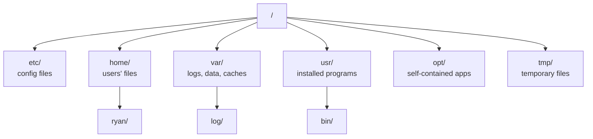
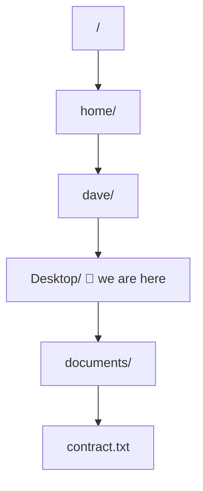

# 📁 Files and Directories

[[Linux/Linux Handbook/0. Linux Handbook|🐧 Linux Handbook]] · Part 1: Shell basics · ⬅️ [[Linux/Linux Handbook/1. The Shell and How Commands Run|1. The Shell]] · ➡️ [[Linux/Linux Handbook/3. Editing Files with Vim|3. Editing Files with Vim]]

How the Linux filesystem is laid out, how paths work, and the everyday commands to look around, find files, and create, move and delete them.

> [!toc]- 📑 Contents
>
> - [[#🌳 The Filesystem Tree|🌳 The Filesystem Tree]]
> - [[#📍 Absolute vs. Relative Paths|📍 Absolute vs. Relative Paths]]
> - [[#🧭 Looking Around and Moving|🧭 Looking Around and Moving]]
> - [[#🔍 Finding and Reading Files|🔍 Finding and Reading Files]]
> - [[#✏️ Creating, Copying, Moving, Deleting|✏️ Creating, Copying, Moving, Deleting]]
> - [[#🧪 Interview Q&A|🧪 Interview Q&A]]
> - [[#🔨 Hands-On Practice|🔨 Hands-On Practice]]
> - [[#📚 References|📚 References]]

---

## 🌳 The Filesystem Tree

Linux has **one tree** that starts at the root, `/`. There are no drive letters: disks, USB sticks and network shares are all attached somewhere inside this tree.



The layout follows the **Filesystem Hierarchy Standard (FHS)**, so every distro puts things in roughly the same place.

| Directory | Holds | Example |
|---|---|---|
| `/etc` | System-wide configuration | `/etc/ssh/sshd_config` |
| `/home/<user>` | Each user's files; `~` points here | `/home/ryan/.bashrc` |
| `/root` | The root user's home | `/root/.ssh/authorized_keys` |
| `/usr/bin`, `/bin` | Programs for everyone | `/usr/bin/ls` |
| `/usr/sbin`, `/sbin` | Admin programs | `/usr/sbin/sshd` |
| `/usr/local` | Software we install by hand | `/usr/local/go/bin/go` |
| `/opt` | Self-contained apps | `/opt/gitea/` |
| `/var/log` | Log files | `/var/log/auth.log` |
| `/var/lib` | Programs' data | `/var/lib/docker/` |
| `/tmp` | Temporary files, cleared on reboot | `/tmp/build-123` |
| `/dev` | Devices as files | `/dev/sda`, `/dev/null` |
| `/proc`, `/sys` | Live kernel and process data, not on disk | `/proc/1/status` |
| `/boot` | Kernel and boot loader | `/boot/vmlinuz-…` |

💡 On modern distros `/bin` is a link to `/usr/bin`, so both paths work.

🔜 **Later:** mounts and disks in [[Linux/Linux Handbook/0. Linux Handbook|note 19 (planned)]]; `/proc` in detail in [[Linux/Linux Handbook/10. Processes and Signals|note 10]].

---

## 📍 Absolute vs. Relative Paths

Most "No such file or directory" errors come from mixing these up.

- 📍 **Absolute path:** starts with `/`. Works from anywhere.

    - `/home/dave/Desktop/documents/contract.txt`

- 🧭 **Relative path:** no leading `/`. Starts from the **current directory**.

    - `documents/contract.txt`

A relative path is the absolute path with the current directory cut off the front.



From `/home/dave/Desktop`, both list the same file:

```bash
ls /home/dave/Desktop/documents/contract.txt   # absolute: works from anywhere
ls documents/contract.txt                      # relative: only from Desktop
```

After `cd ..`, the relative path points to `/home/dave/documents/contract.txt`, which doesn't exist.

- 🔤 **Shortcuts:** `.` = current directory, `..` = parent, `~` = our home, `-` (with `cd`) = previous directory.

---

## 🧭 Looking Around and Moving

```bash
pwd                # where am I?  → /home/dave
ls                 # what's here?
ls -lah /var/log   # long, all (incl. hidden), human-readable sizes
cd /etc/ssl        # absolute
cd certs           # relative → /etc/ssl/certs
cd ..              # up one level
cd                 # home
cd -               # back to the previous directory
```

- 🙈 **Hidden files** start with a dot (`.bashrc`, `.ssh/`). `ls -a` shows them.

- 🆕 **New shells start in the home directory**: `/home/<user>` on Linux, `/Users/<user>` on macOS.

A **long listing** (`-l`) shows one file per line:

```text
-rw-r--r--  1 dave  wheel  0 Jul  5 09:27 foobar.txt
```

- 🔐 **`-rw-r--r--`** → file type + permissions. Explained in [[Linux/Linux Handbook/9. Ownership and Permissions|9. Ownership and Permissions]].

- 🔗 **`1`** → hard-link count.

- 👤 **`dave`** / 👥 **`wheel`** → owning user / group.

- 📦 **`0`** → size in bytes (`-h` shows `4.0K`, `12M`).

- 🕒 **`Jul 5 09:27`** → last modification time.

---

## 🔍 Finding and Reading Files

### 💻 `find`: search by name or type

```bash
find / -type d -name home 2>/dev/null
```

- 📁 **`/`** → where to start (here, the whole system).

- 🗂️ **`-type d`** → directories only; `f` = regular files.

- 🔤 **`-name home`** → exact name.

- 🔇 **`2>/dev/null`** → hide `Permission denied` noise (see [[Linux/Linux Handbook/4. Streams, Pipes, and Redirection|4. Streams]]).

`find`'s long options use **one dash** (`-name`, not `--name`).

| Pattern | Finds |
|---|---|
| `find . -name "*.log"` | Names ending in `.log` |
| `find . -iname readme.md` | Case-insensitive |
| `find / -uid 1001` | Files owned by UID 1001 |

Quote the pattern so the shell doesn't expand `*` before `find` sees it.

**Run a command on each result:**

```bash
find . -name "*.log" -exec ls -lh {} \;   # once per file
find . -name "*.log" -exec ls -lh {} +    # once, with all files as arguments (faster)
```

- `{}` → replaced by the found path.

### 💻 Reading files

```bash
cat app.conf          # print a short file
less /var/log/syslog  # page through a long one: / search, n next, q quit
head -n 20 app.log    # first 20 lines
tail -f app.log       # follow new lines as they arrive
```

`less` and searching inside files (`grep`) are covered in [[Linux/Linux Handbook/4. Streams, Pipes, and Redirection|4. Streams, Pipes, and Redirection]].

---

## ✏️ Creating, Copying, Moving, Deleting

```bash
touch notes.txt                   # create empty, or update its timestamp
mkdir -p ~/lab/logs/error         # create missing parents too
cp app.conf app.conf.bak          # copy a file
cp -r config/ config-backup/      # copy a directory tree
mv old.log archive/2026.log       # move and rename in one step
rmdir emptydir                    # remove an EMPTY directory
rm file.txt                       # remove a file
rm -r olddir                      # remove a directory and everything in it
```

- 🔁 **`mkdir -p` is idempotent**: it doesn't fail if the directory exists, so scripts and Dockerfiles use it.

- ✂️ **`mv` is both move and rename.** `mv a.txt b.txt` renames in place.

- ⚠️ **`mv` and `cp` silently overwrite** a file with the target name. `-i` asks first.

> ⚠️ `rm` has no trash bin. `rm -rf` with a wrong path, or with an empty variable like `rm -rf "$DIR/"`, deletes far more than intended. Check the path with `ls` first.

🔜 **Later:** symlinks, hard links, inodes, `rsync` and advanced `find` come with SDGL Ch.5.

---

### 🧪 Interview Q&A

**Q1:** Where would you look for nginx's config, its logs, and its program file?

**Q2:** We're in `/home/dave` and run `cat Desktop/notes.txt`. What absolute path is used?

**Q3:** Why is `mkdir -p` preferred in scripts and Dockerfiles?

**Q4:** What's the difference between `find … -exec cmd {} \;` and `-exec cmd {} +`?

**Q5:** Why is `rm -rf "$DIR/"` dangerous in a script?

> [!answer]- 📋 Answers
>
> **A1:** Config in `/etc/nginx/`, logs in `/var/log/nginx/`, and the program in `/usr/sbin/nginx`.
>
> **A2:** `/home/dave/Desktop/notes.txt`: the current directory plus the relative path.
>
> **A3:** It creates missing parents and doesn't fail if the directory already exists, so the script can run any number of times.
>
> **A4:** `\;` runs the command once per file. `+` passes many files to one run, which is faster.
>
> **A5:** If `DIR` is empty, the command becomes `rm -rf /`. Guard it with `${DIR:?}` or check it first.

---

## 🔨 Hands-On Practice

1. 🌳 **Tour the tree.**

   ```bash
   ls /
   ls /etc | head
   ls -lah ~
   ```

   ✅ You recognize `etc`, `home`, `var`, `usr`, and see hidden dotfiles in your home.

2. 🧭 **Absolute vs. relative.**

   ```bash
   mkdir -p ~/lab/documents && cd ~/lab
   touch documents/contract.txt
   cd ~ && ls documents/contract.txt
   ls ~/lab/documents/contract.txt
   ```

   ✅ The relative path fails from `~`; the absolute one works.

3. ✏️ **Create, copy, move, find.**

   ```bash
   cd ~/lab
   touch app.log && cp app.log app.log.bak
   mkdir archive && mv app.log archive/2026.log
   find . -name "*.log*"
   ```

   ✅ `find` prints `./app.log.bak` and `./archive/2026.log`.

4. 🧹 Clean up: `rm -r ~/lab`.

---

### 📋 Quick Reference

| Command | Purpose |
|---|---|
| `pwd` | Current directory |
| `ls -lah [dir]` | Long listing, hidden files, readable sizes |
| `cd dir` · `cd ..` · `cd -` · `cd` | Move · up · previous · home |
| `find dir -type f -name "*.go"` | Find files by name |
| `cat` · `less` · `head` · `tail -f` | Read files |
| `touch file` | Create empty / update time |
| `mkdir -p a/b/c` | Nested directories, safely |
| `cp -r src dst` | Copy (directories need `-r`) |
| `mv src dst` | Move or rename |
| `rm -r dir` | Delete a directory tree |

### 🧠 Things to Remember

- One tree from `/`. Config in `/etc`, logs in `/var/log`, users in `/home`.

- **Absolute** paths start with `/`; **relative** paths start from the current directory.

- `mkdir -p` is safe to repeat.

- `rm`, `mv` and `cp` don't ask before deleting or overwriting.

### 💡 Pro Tips

- **Use `cd -`** to jump between two places, such as a project and `/var/log`.

- **Run `ls` with the exact path before `rm -r`** to see what you're about to delete.

- **Keep `cp file file.bak`** before editing anything in `/etc`.

### 🔗 Related Topics

- ⬅️ [[Linux/Linux Handbook/1. The Shell and How Commands Run|1. The Shell and How Commands Run]] · ➡️ [[Linux/Linux Handbook/3. Editing Files with Vim|3. Editing Files with Vim]]

- [[Linux/Linux Handbook/9. Ownership and Permissions|9. Ownership and Permissions]] (reading `ls -l`)

- [[Linux/File & Directory/File & Directory Commands|File & Directory Commands]] · [[Linux/File & Directory/Search|Search]]

---

## 📚 References

| Source | Where | Status |
|---|---|---|
| 📝 SDGL note: [[Linux/The Software Developer’s Guide to Linux/1. How the Command Line Works\|1. How the Command Line Works]] | Paths → making changes | ✅ studied |
| 📕 SDGL Ch.1 | Filesystem basics p. 7 · paths p. 8 · `pwd`/`ls` pp. 10–11 · `cd`/`find` pp. 12–13 · `less` p. 14 · `touch` → `mv` pp. 14–16 | ✅ studied |
| 📝 Nana | ep 9 Linux File System · ep 11 Basic Commands | ✅ studied |
| 📕 SDGL Ch.5 | Files, links, `find`, `rsync`: pp. 51–53, 59–69 | 📖 planned · 🆕 symlinks, hard links, inodes, `file`, line endings, advanced `find`, `rsync`, FUSE → here |
| 📗 CompTIA 6th Ch.3 | Directory structure p. 72 · listing p. 77 · wildcards p. 83 · viewing files p. 83 [PDF 88–99] | 🔭 optional |
| 📗 CompTIA 6th Ch.4 | FHS p. 116 · managing files p. 117 · finding files p. 122 [PDF 132–141] | 🔭 optional |
| 📘 Linux Bible Ch.4 | Basic filesystem commands p. 94 · listing p. 99 · moving, copying, removing p. 107 [PDF 126–141] | 🔭 optional |
| 📘 Linux Bible Ch.5 | Finding files with `find` pp. 121–125 [PDF 153–157] | 🔭 optional |
