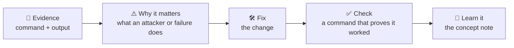
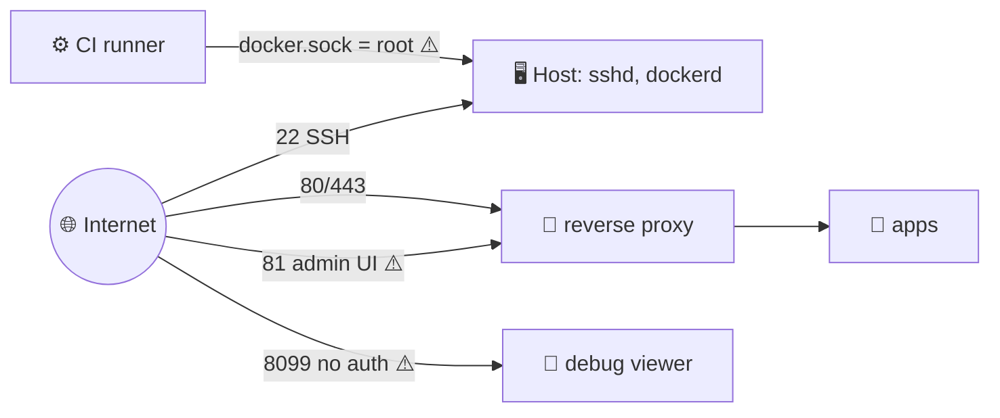
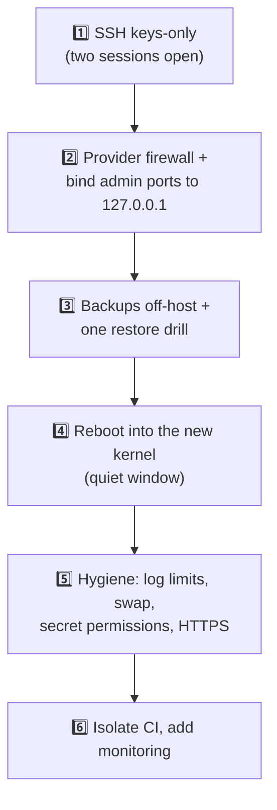

# 🩺 Auditing a Server

[[Linux/Linux Handbook/0. Linux Handbook|🐧 Linux Handbook]] · Part 5: Server operations · ⬅️ [[Linux/Linux Handbook/17. Firewalls and Network Exposure|17. Firewalls and Network Exposure]]

How to look at a running server, find what's wrong, decide what matters most, and fix it in an order that can't lock you out. Every earlier note feeds into this one.

> [!toc]- 📑 Contents
>
> - [[#🎯 What an Audit Is|🎯 What an Audit Is]]
> - [[#🧾 The Shape of a Finding|🧾 The Shape of a Finding]]
> - [[#🚦 Severity|🚦 Severity]]
> - [[#🗺️ Drawing the Doors|🗺️ Drawing the Doors]]
> - [[#🔎 What to Check|🔎 What to Check]]
> - [[#🛠️ Safe Fix Order|🛠️ Safe Fix Order]]
> - [[#📋 Worked Example: Our Develop Server|📋 Worked Example: Our Develop Server]]
> - [[#🧪 Interview Q&A|🧪 Interview Q&A]]
> - [[#📚 References|📚 References]]

---

## 🎯 What an Audit Is

An **audit** is a **read-only** inspection: we collect evidence, change nothing, and write down what we find. Fixing comes later, in a planned order.

- 🔍 **Read-only first.** Changing things while inspecting mixes "what was" with "what we did".

- 📏 **Grade against the production standard**, even on a dev server. A broken-into dev server still leaks source code, CI tokens and `.env` files, and attackers use it to reach other systems. Practise there so production is a repeat, not a first try.

- ✅ **Record what's already right** too, so a fix doesn't undo it.

---

## 🧾 The Shape of a Finding

Every finding has the same five parts:

> 💡 **Real-World Example**
>
> **C1 — SSH accepts passwords while being brute-forced**
>
> - 🔎 **Evidence:** `sshd -T` → `passwordauthentication yes`; 22,941 failed logins in 24 h; `root` has a usable password.
>
> - ⚠️ **Why:** attackers need one right guess, and get a million tries a month. All our real logins use keys.
>
> - 🛠️ **Fix:** a `00-hardening.conf` drop-in, with a second session open.
>
> - ✅ **Check:** `ssh -o PubkeyAuthentication=no root@SERVER_IP` → `Permission denied (publickey)`.
>
> - 📘 **Learn:** [[Linux/Linux Handbook/16. SSH Keys and Hardening|16. SSH Keys and Hardening]].

The **Check** is what makes a finding closeable: without it, "fixed" is an opinion.

---

## 🚦 Severity

| Level | Meaning | Example |
|---|---|---|
| 🔴 **Critical** | Exploitable now, or data loss waiting to happen | Password SSH under attack; no backups |
| 🟠 **High** | One mistake or one bad dependency from compromise | CI runner with `docker.sock`; public admin pages; no firewall |
| 🟡 **Medium** | Fails under load or over time | Unbounded logs; no memory limits; world-readable secrets |
| 🔵 **Low** | Hygiene | Leftover keys and accounts; build cache |

Severity is **likelihood × impact**, not how hard the fix is. A 10-minute fix can be Critical.

---

## 🗺️ Drawing the Doors

Draw every way in from the Internet. Each arrow is a door; a hardened host has as few as possible.

The diagram turns a list of ports into a story: which doors lead where, and which ones bypass the front door.

---

## 🔎 What to Check

Each area maps to a Handbook note. The commands are read-only.

| Area | Read-only checks | Learn it in |
|---|---|---|
| 🔐 **Access** | `sudo sshd -T`, `journalctl -u ssh`, `passwd -S root`, `getent group sudo` | [[Linux/Linux Handbook/16. SSH Keys and Hardening\|16]] · [[Linux/Linux Handbook/8. Users, Groups, and sudo\|8]] |
| 🧱 **Exposure** | `sudo ss -tlnp`, `docker ps` ports, `nmap -Pn` from outside, `ufw status` | [[Linux/Linux Handbook/17. Firewalls and Network Exposure\|17]] · [[Linux/Linux Handbook/15. Ports, Sockets, and DNS\|15]] |
| 🔑 **Secrets** | `find /opt -name '.env*' -perm -o=r`, `ls -l ~/.ssh` | [[Linux/Linux Handbook/9. Ownership and Permissions\|9]] |
| ⚙️ **Services** | `systemctl --failed`, `docker ps` health, restart policies | [[Linux/Linux Handbook/11. systemd, Services, and Timers\|11]] |
| 🧠 **Resources** | `free -m`, `docker stats --no-stream`, OOM kills in `journalctl -k` | [[Linux/Linux Handbook/10. Processes and Signals\|10]] |
| 🩹 **Patching** | `uname -r` vs. `/boot`, `/var/run/reboot-required` | 📖 later (12) |
| 📜 **Logs and disk** | `df -h`, `journalctl --disk-usage`, Docker log options | 📖 later (13, 19) |
| 💾 **Backups** | What's backed up, where to, and when a restore was last tested | 📖 later (22) |

---

## 🛠️ Safe Fix Order

Order matters: some fixes build the safety net the risky ones need.

1. 🔐 **SSH first:** the open door being hammered right now, and a 10-minute fix.

2. 🧱 **Firewall second:** closes every other accidental door in one place.

3. 💾 **Backups before the first risky change**, so there's a way back.

4. 🔁 **Then the reboot:** the first change that can fail badly. Afterwards, check every container came back.

5. 🧹 **Then the hygiene items:** low risk, independent of each other.

> ⚠️ Any change to SSH or the firewall: keep a working session open and know how to reach the provider's web console.

---

## 📋 Worked Example: Our Develop Server

The full audit, with evidence for every line, is [[DevOps/Server Administration/1. Develop Server Audit 2026-11-11|Develop Server Audit 2026-11-11]].

| # | Severity | Finding | 🛠️ Fix guide |
|---|---|---|---|
| C1 | 🔴 | SSH accepts passwords; ~23k attacks a day | [[DevOps/Server Administration/2. SSH Hardening and Brute Force\|SSH Hardening]] |
| C2 | 🔴 | No automated or off-host backups | [[DevOps/Server Administration/8. Backups and Restore\|Backups]] |
| H1 | 🟠 | CI runner holds `docker.sock`: any job is root on the host | [[DevOps/Server Administration/4. Docker Daemon and Container Hardening\|Docker hardening]] |
| H2 | 🟠 | Admin and debug pages public | [[DevOps/Server Administration/3. Firewalls and Docker Port Publishing\|Firewalls]] |
| H3 | 🟠 | No firewall layer, and Docker bypasses ufw | [[DevOps/Server Administration/3. Firewalls and Docker Port Publishing\|Firewalls]] |
| H4 | 🟠 | Kernel and libc fixes installed but not running (72 days up) | [[DevOps/Server Administration/5. Patching Reboots and Kernel Updates\|Patching]] |
| M1–M6 | 🟡 | Unbounded logs, no memory limits or swap, unnoticed unhealthy container, world-readable `.env`, optional HTTPS, unhardened containers | Notes 4–11 |

What was already right: AppArmor enforcing, daily unattended security upgrades, NTP in sync, databases not published, every real login by key.

---

### 🧪 Interview Q&A

**Q1:** Why keep an audit read-only?

**Q2:** What makes a finding "closeable"?

**Q3:** Why fix backups before rebooting into a new kernel?

**Q4:** Why did `unattended-upgrades` not fully protect the server?

**Q5:** A container is "unhealthy" but still serves traffic. Is it up or down?

> [!answer]- 📋 Answers
>
> **A1:** So the evidence shows the server as it was. Changes made while inspecting blur what was wrong with what we did.
>
> **A2:** A **Check**: a command whose output proves the fix worked.
>
> **A3:** The reboot is the first change that can fail badly, such as a container that doesn't come back. A tested backup turns that into an inconvenience instead of data loss.
>
> **A4:** It installs new packages, but the running kernel and processes that loaded the old libc keep using the old code until a reboot or restart.
>
> **A5:** Both, depending on who asks. Clients can connect, but the automated view says down, and anything that acts on health (a restart policy, a load balancer) treats it as down.

---

## 🔨 Hands-On Practice

1. 🗺️ **Draw your own server's doors.** Run `sudo ss -tlnp` on it and `nmap -Pn -p 1-10000 SERVER_IP` from your laptop, then draw one arrow per open port.

2. 🧾 **Write one finding** in the five-part shape, with a real Check command.

3. 🔁 **Re-run the Checks** for C1 and H3 after applying their fixes.

   ✅ Each Check prints the expected result.

---

### 📋 Quick Reference

| Step | What |
|---|---|
| 1 | Collect evidence, read-only |
| 2 | Write findings: evidence → why → fix → check → learn |
| 3 | Grade: 🔴 🟠 🟡 🔵 by likelihood × impact |
| 4 | Draw the doors |
| 5 | Fix in safe order: SSH → firewall → backups → reboot → hygiene |
| 6 | Re-run every Check |

### 🧠 Things to Remember

- Audit **read-only**; fix later, in order.

- A finding without a **Check** isn't closeable.

- Grade dev servers by the production standard.

- Safety nets (SSH access, backups) come before risky changes.

### 💡 Pro Tips

- **Save raw command output** next to the audit, so findings can be re-verified later.

- **Re-audit after big changes**, such as adding a new Compose project or a CI runner.

### 🔗 Related Topics

- ⬅️ [[Linux/Linux Handbook/17. Firewalls and Network Exposure|17. Firewalls and Network Exposure]]

- [[DevOps/Server Administration/0. Server Administration Learning Path|Server Administration Learning Path]]

- [[DevOps/Server Administration/12. Production Readiness Checklist|Production Readiness Checklist]] (🛠️ capstone)

---

## 📚 References

| Source | Where | Status |
|---|---|---|
| 📝 Server Admin: [[DevOps/Server Administration/1. Develop Server Audit 2026-11-11\|Develop Server Audit]] | whole note | ✅ studied |
| 📝 Server Admin: [[DevOps/Server Administration/12. Production Readiness Checklist\|Production Readiness Checklist]] | Capstone after Stages A–D | 📖 planned · 🆕 the full production checklist → here and note 22 |
| 📘 Linux Bible Ch.13 | Secure the server p. 311 · monitor the server p. 312 [PDF 340–343] | 🔭 optional |
| 📘 Linux Bible Ch.23 | Monitoring your systems p. 563 · auditing and reviewing Linux p. 575 [PDF 587–599] | 📖 planned (Stage D) · 🆕 log and file-integrity monitoring, rootkit scans, security reviews → here and note 22 |
| 📗 CompTIA 6th Ch.14 | Securing the local computer p. 583 · troubleshooting methodology p. 609 [PDF 599–625] | 🔭 optional |
