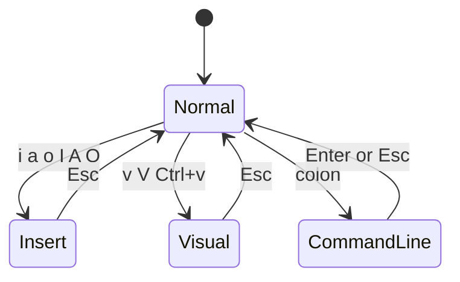

# 📝 Editing Files with Vim

[[Linux/Linux Handbook/0. Linux Handbook|🐧 Linux Handbook]] · Part 1: Shell basics · ⬅️ [[Linux/Linux Handbook/2. Files and Directories|2. Files and Directories]] · ➡️ [[Linux/Linux Handbook/4. Streams, Pipes, and Redirection|4. Streams, Pipes, and Redirection]]

On a server, Vim (or plain `vi`) is often the only editor available. This note covers enough to edit config files quickly and safely.

> [!toc]- 📑 Contents
>
> - [[#🎛️ Modes|🎛️ Modes]]
> - [[#🚪 Open, Save, and Quit|🚪 Open, Save, and Quit]]
> - [[#🧭 Movement|🧭 Movement]]
> - [[#✏️ Edit, Delete, and Undo|✏️ Edit, Delete, and Undo]]
> - [[#✂️ Copy and Paste|✂️ Copy and Paste]]
> - [[#🔍 Search and Replace|🔍 Search and Replace]]
> - [[#🧩 Visual Mode, Splits, and Shell Commands|🧩 Visual Mode, Splits, and Shell Commands]]
> - [[#⚙️ A Basic vimrc|⚙️ A Basic vimrc]]
> - [[#🧪 Interview Q&A|🧪 Interview Q&A]]
> - [[#📚 References|📚 References]]

---

## 🎛️ Modes

Vim is a **modal** editor: the same key does different things depending on the mode.

- 🧭 **Normal mode** → move, copy, delete, paste. Vim starts here, and `Esc` always returns here.

- ✍️ **Insert mode** → type text.

- 🧩 **Visual mode** → select text: `v` characters, `V` lines, `Ctrl+v` a block.

- 💻 **Command-line mode** → commands that start with `:`, such as `:w` or `:%s/a/b/g`.



> ⚠️ **The `:` rule:** only command-line commands start with `:` (`:w`, `:q`, `:set number`). Normal-mode keys like `yy`, `dd` and `p` are typed directly. When in doubt, press `Esc` first.

| Key | Enters Insert mode… |
|---|---|
| `i` / `a` | Before / after the cursor |
| `I` / `A` | At the start / end of the line |
| `o` / `O` | On a new line below / above |

---

## 🚪 Open, Save, and Quit

```bash
vim /etc/ssh/sshd_config
```

| Command | Action |
|---|---|
| `:w` | Save |
| `:q` | Quit (fails if there are unsaved changes) |
| `:wq` or `:x` | Save and quit |
| `:q!` | Quit and discard changes |
| `:w newname` | Save as another file |

💡 Opened a root-owned file without `sudo`? `:w !sudo tee %` saves it anyway, then `:q!`.

---

## 🧭 Movement

| Key | Moves to |
|---|---|
| `h` `j` `k` `l` | Left, down, up, right |
| `w` / `b` / `e` | Next word / previous word / end of word |
| `0` / `^` / `$` | Line start / first non-blank / line end |
| `gg` / `G` | First / last line |
| `42G` or `:42` | Line 42 |
| `Ctrl+d` / `Ctrl+u` | Half page down / up |
| `%` | Matching `()`, `{}` or `[]` |

🔢 **Counts work with most commands:** `5j` moves down 5 lines, `3w` jumps 3 words.

---

## ✏️ Edit, Delete, and Undo

Vim commands are **count + operator + motion**: `d` (delete), `c` (change) or `y` (yank, copy), then where to act. `3dw` deletes three words.

- 🗑️ **Delete**

    - `x` → one character

    - `dd` → whole line; `5dd` → five lines

    - `dw` → to the next word; `D` → to end of line

    - `dG` / `dgg` → to end / start of file

- ✏️ **Change** (delete, then Insert mode)

    - `cw` → word; `cc` → whole line; `C` → to end of line

    - `r` → replace one character

- ↩️ **Undo, redo, repeat**

    - `u` → undo; `Ctrl+r` → redo

    - `.` → **repeat the last change**, one of Vim's most useful keys

---

## ✂️ Copy and Paste

| Key | Action |
|---|---|
| `yy` / `3yy` | Copy the current line / 3 lines |
| `yw` | Copy a word |
| `p` / `P` | Paste after / before the cursor |

`d` also cuts: `dd` then `p` moves a line.

🖥️ **System clipboard:** the `+` register. `"+yy` copies the line to the clipboard, `"+p` pastes from it (needs a Vim built with clipboard support, such as `vim-gtk3`). Add `set clipboard=unnamedplus` to `~/.vimrc` to make `yy` and `p` use it automatically.

---

## 🔍 Search and Replace

- 🔎 **Search**

    - `/text` forward, `?text` backward

    - `n` / `N` → next / previous match

    - `*` → search for the word under the cursor

    - `:noh` → clear the highlight

- 🔄 **Replace** with `:s/old/new/flags`

    ```vim
    :s/old/new/       " first match on this line
    :%s/old/new/g     " every match in the file
    :%s/old/new/gc    " ask before each one: y / n / a (all) / q
    ```

    - `%` → whole file instead of the current line.

    - `g` → every match on a line, not only the first.

    - `c` → confirm each one.

> 💡 **Real-World Example**
>
> Disable root login in `sshd_config`:
>
> ```vim
> :%s/^PermitRootLogin yes/PermitRootLogin no/
> ```
>
> `^` anchors the match to the start of the line, so the commented `#PermitRootLogin yes` is left alone.

---

## 🧩 Visual Mode, Splits, and Shell Commands

- 🧩 **Visual mode:** select with `v`, `V` or `Ctrl+v`, then `y` copy, `d` delete, `>` / `<` indent / unindent. Without a selection, `>>` indents a line and `gg=G` re-indents the whole file.

- 🪟 **Several files**

    | Command | Action |
    |---|---|
    | `:e file` | Open another file |
    | `:sp file` / `:vsp file` | Horizontal / vertical split |
    | `Ctrl+w` then `h` `j` `k` `l` | Move between splits |

- 💻 **Shell from Vim:** `:!git status` runs a command; `:r !date` inserts its output into the file.

---

## ⚙️ A Basic `vimrc`

`~/.vimrc` is read every time Vim starts:

```vim
set number relativenumber   " line numbers; relative ones make 7j easy
set tabstop=4 shiftwidth=4 expandtab autoindent
set ignorecase smartcase    " case-insensitive unless the search has a capital
set hlsearch incsearch      " highlight matches, search while typing
syntax on
```

- ⌨️ **`expandtab`** inserts spaces instead of tabs. That matters for YAML: Compose files, CI pipelines and Kubernetes manifests break on tabs.

---

### 🧪 Interview Q&A

**Q1:** You opened a file and typed, but text appears in odd places. What happened?

**Q2:** When do you type `:` and when don't you?

**Q3:** How do you quit without saving?

**Q4:** What does `:%s/8080/9090/g` do?

**Q5:** Why use `sudoedit /etc/file` instead of `sudo vim /etc/file`?

> [!answer]- 📋 Answers
>
> **A1:** Vim starts in Normal mode, so the keys ran as commands. Press `Esc`, `u` to undo, then `i` to insert.
>
> **A2:** `:` is for command-line commands like `:w`, `:q`, `:%s`. Normal-mode keys like `dd`, `yy`, `p` are typed directly.
>
> **A3:** `:q!`
>
> **A4:** Replaces every `8080` with `9090` on every line of the file.
>
> **A5:** `sudoedit` lets you edit a copy as yourself, with your own `vimrc`, and only the final write runs as root. The editor itself never runs as root.

---

## 🔨 Hands-On Practice

Run `vimtutor` for a full 30-minute guided lesson. For a quick drill:

1. 📝 **Create a practice file.**

   ```bash
   printf "server_port=8080\nlog_level=debug\nuser=root\n" > app.conf
   vim app.conf
   ```

2. 🔄 **Replace the port:** `:%s/8080/9090/g`.

3. ✏️ **Change a word:** `/debug`, then `cw` → `info` → `Esc`.

4. ✂️ **Duplicate a line:** on `user=root`, press `yy` then `p`. Undo it with `u`.

5. 💾 **Save and quit:** `:wq`.

   ✅ `cat app.conf` shows `server_port=9090`, `log_level=info`, and one `user=root` line.

6. 🧹 Clean up: `rm app.conf`.

---

### 📋 Quick Reference

```text
Esc          Normal mode           i / a / o    Insert
h j k l      Move                  w / b        Word forward / back
0 / $        Line start / end      gg / G       File start / end
yy / dd / p  Copy / cut / paste    u / Ctrl+r   Undo / redo
/text  n N   Search, next, prev    .            Repeat last change
:%s/a/b/g    Replace all           :noh         Clear highlight
:w  :q  :wq  Save / quit / both    :q!          Quit, discard changes
```

### 🧠 Things to Remember

- Vim starts in **Normal mode**; `Esc` always brings you back.

- Only command-line commands start with `:`.

- **count + operator + motion**: `3dw` deletes three words.

- `.` repeats the last change.

### 💡 Pro Tips

- **Use `:%s/…/gc` on config files** so you approve each change.

- **Use `sudoedit`** for files in `/etc`.

- **Set `expandtab` before editing YAML.**

### 🔗 Related Topics

- ⬅️ [[Linux/Linux Handbook/2. Files and Directories|2. Files and Directories]] · ➡️ [[Linux/Linux Handbook/4. Streams, Pipes, and Redirection|4. Streams, Pipes, and Redirection]]

- [[Linux/Scatterd Learning/Vim|Vim cheatsheet (scattered notes)]]: text objects, macros, registers

---

## 📚 References

| Source | Where | Status |
|---|---|---|
| 📝 Nana: [[DevOps/NaNa/Linux/2. Vim Cheat Sheet\|Vim Cheat Sheet]] | whole note (ep 13) | ✅ studied |
| 🗒️ Scattered: [[Linux/Scatterd Learning/Vim\|Vim Cheatsheet]] | Text objects, macros, registers | 🔭 optional |
| 📕 SDGL Ch.6 | `sudoedit` and `$EDITOR`: pp. 79–80 | 📖 planned · 🔁 `sudoedit` is here · 🆕 `$EDITOR` (used by `kubectl edit`) → here and note 6 |
| 📕 SDGL Ch.6 | Vim modes and tips: pp. 73–79 | ⏭️ skipped (covered here) |
| 📗 CompTIA 6th Ch.3 | The vi editor, pp. 93–101 [PDF 109–117] | 🔭 optional |
| 📘 Linux Bible Ch.5 | Editing files with vim and vi, pp. 111–118 [PDF 143–150] | 🔭 optional |
