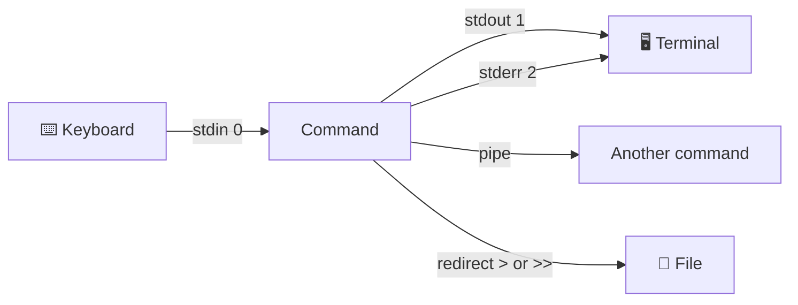

# 🔗 Streams, Pipes, and Redirection

[[Linux/Linux Handbook/0. Linux Handbook|🐧 Linux Handbook]] · Part 1: Shell basics · ⬅️ [[Linux/Linux Handbook/3. Editing Files with Vim|3. Editing Files with Vim]] · ➡️ [[Linux/Linux Handbook/6. Environment Variables and Shell Startup|6. Environment Variables]]

Every command reads from one stream and writes to two. Pipes and redirection change where those streams go, which is how small tools combine into useful one-liners.

> [!toc]- 📑 Contents
>
> - [[#🌊 Standard Streams|🌊 Standard Streams]]
> - [[#🔗 Pipes|🔗 Pipes]]
> - [[#📖 Reading Long Output with less|📖 Reading Long Output with less]]
> - [[#🔍 Searching Text with grep|🔍 Searching Text with grep]]
> - [[#➡️ Redirecting Output to a File|➡️ Redirecting Output to a File]]
> - [[#🗂️ Streams Are File Descriptors|🗂️ Streams Are File Descriptors]]
> - [[#🌍 Real-World Patterns|🌍 Real-World Patterns]]
> - [[#🧪 Interview Q&A|🧪 Interview Q&A]]
> - [[#📚 References|📚 References]]

---

## 🌊 Standard Streams

Every process starts with three open streams, numbered 0, 1 and 2:

- ⌨️ **`stdin` (0)** → input. Normally the keyboard.

- 📤 **`stdout` (1)** → normal output. Normally the terminal.

- ⚠️ **`stderr` (2)** → error messages. Also the terminal by default, but a separate stream.



Because almost every Linux tool reads and writes plain text, small commands chain together.

---

## 🔗 Pipes

A **pipe** `|` connects the `stdout` of the left command to the `stdin` of the right one.

```bash
history | grep sudo | less
```


- 📦 **`history` produces** the data, **`grep` filters** it, **`less` displays** it.

- 🧱 **Build pipelines one step at a time:** run `history`, then add `| grep sudo`, and only add more once the output looks right.

---

## 📖 Reading Long Output with `less`

`less` is a **pager**: it shows text one screen at a time, with scrolling and search.

```bash
less /var/log/syslog
journalctl -u nginx | less
```

| Key | Action |
|---|---|
| `Space` / `b` | Next / previous page |
| `j` / `k` or arrows | Line down / up |
| `g` / `G` | Start / end |
| `/error` then `n` / `N` | Search, next / previous match |
| `q` | Quit |

`man` pages open in `less`, so the same keys work there.

💡 For a file, `less file` is enough. `cat file | less` adds a needless process.

---

## 🔍 Searching Text with `grep`

`grep` prints the lines that match a pattern. It reads files directly or filters piped input.

```bash
grep [options] "pattern" [file...]
```

```bash
grep port config.txt              # search a file
ps aux | grep nginx               # filter another command's output
history | grep "sudo chmod"       # quote patterns with spaces
```

- 💬 **Quote multi-word patterns.** Without quotes, `grep sudo chmod` searches for `sudo` inside a file named `chmod`.

- 📄 **Skip `cat`:** `grep port config.txt` does the same as `cat config.txt | grep port`.

| Option | Effect | Example |
|---|---|---|
| `-i` | Ignore case | `grep -i error app.log` |
| `-n` | Show line numbers | `grep -n error app.log` → `34:Database error` |
| `-v` | Lines that do **not** match | `grep -v debug app.log` |
| `-r` | Search a directory tree | `grep -r "192.168.1.10" /etc` |
| `-c` | Count matching lines | `grep -c error app.log` |
| `-E` | Extended regex, e.g. alternatives | `grep -E "error\|fail" app.log` |

Short options combine: `grep -rin "error" ./project`.

🔜 **Later:** regular expressions, `cut`, `sort`, `uniq`, `awk`, `sed` and `xargs` go in **5. Text Processing** (SDGL Ch.11).

---

## ➡️ Redirecting Output to a File

- 📄 **`>` overwrites** the file, creating it if needed.

- ➕ **`>>` appends**, keeping what's already there.

```bash
history | grep sudo > sudo-commands.txt
history | grep chmod >> sudo-commands.txt
```

> ⚠️ `>` empties the file **before** the command runs. `grep error app.log > app.log` destroys `app.log`.

### 🚨 Redirecting errors

`>` only redirects `stdout`. Errors still reach the terminal unless we redirect stream `2`.

```bash
find / -name "*.conf" 2> /dev/null        # hide permission-denied errors
./deploy.sh > deploy.log 2>&1             # stdout and stderr into one file
```

- `2>` → redirect `stderr`.

- `2>&1` → send `stderr` wherever `stdout` goes **right now**. Put it **after** `> file`.

- `/dev/null` → a sink that discards everything.

| Operator | Sends output to | Existing file |
|---|---|---|
| `\|` | Another command | — |
| `>` | File | Replaced |
| `>>` | File | Kept, new output appended |
| `2>` | File, errors only | Replaced |
| `> f 2>&1` | File, both streams | Replaced |

---

## 🗂️ Streams Are File Descriptors

The numbers 0, 1 and 2 are **file descriptors**: a process's handles to open files. The kernel shows them under `/proc`:

```bash
ls -l /proc/$$/fd      # $$ = PID of the current shell
```

Illustrative output:

```text
lrwx------ 1 ryan ryan 64 Nov 17 09:20 0 -> /dev/pts/0
lrwx------ 1 ryan ryan 64 Nov 17 09:20 1 -> /dev/pts/0
lrwx------ 1 ryan ryan 64 Nov 17 09:20 2 -> /dev/pts/0
```

All three point at our terminal. Redirection just makes 1 or 2 point somewhere else before the program starts. Network sockets are file descriptors too, so `lsof` lists both (see [[Linux/Linux Handbook/10. Processes and Signals|10. Processes and Signals]]).

---

## 🌍 Real-World Patterns

- 📜 **Search a big log, then browse or save the result**

    ```bash
    grep -i "database error" app.log | less
    grep -i "database error" app.log > db-errors.txt
    grep -i "connection failed" app.log >> db-errors.txt
    ```

- 🕘 **Find a command you ran before**

    ```bash
    history | grep "sudo chmod"
    ```

- ⚙️ **Is a process running?**

    ```bash
    pgrep -a nginx       # better than: ps aux | grep nginx (which also matches grep itself)
    ```

- 🤖 **Capture everything a CI step prints**

    ```bash
    ./deploy.sh > deploy.log 2>&1
    ```

---

### 🧪 Interview Q&A

**Q1:** What does the pipe `|` connect?

**Q2:** What is the difference between `>` and `>>`?

**Q3:** Why doesn't `./script.sh > out.log` capture error messages?

**Q4:** Why does `cmd 2>&1 > file` still print errors to the terminal?

**Q5:** Why is `grep port config.txt` preferred over `cat config.txt | grep port`?

> [!answer]- 📋 Answers
>
> **A1:** The `stdout` of the left command to the `stdin` of the right command.
>
> **A2:** `>` replaces the file's contents; `>>` adds to the end.
>
> **A3:** Errors go to `stderr`, and `>` redirects only `stdout`. Add `2>&1` after it.
>
> **A4:** Redirections are applied left to right. `2>&1` copies stderr to where stdout points *at that moment*, which is still the terminal; then `> file` moves only stdout.
>
> **A5:** `grep` reads files directly, so `cat` is an extra process for nothing.

---

## 🔨 Hands-On Practice

1. 📝 **Create a test file.**

   ```bash
   printf "HTTP port 80\nHTTPS port 443\nSSH port 22\ndebug: skip me\n" > ports.txt
   ```

2. 🔍 **Search it.**

   ```bash
   grep -n port ports.txt
   grep -v debug ports.txt
   ```

   ✅ Three numbered lines, then everything except the `debug` line.

3. ➡️ **Overwrite, then append.**

   ```bash
   grep SSH ports.txt > result.txt
   grep HTTPS ports.txt >> result.txt
   cat result.txt
   ```

   ✅ The SSH line, then the HTTPS line.

4. 🚨 **Split output and errors.**

   ```bash
   ls ports.txt missing.txt > out.txt 2> err.txt
   cat out.txt err.txt
   ```

   ✅ `out.txt` lists `ports.txt`; `err.txt` holds the "No such file" error.

5. 🧹 Clean up: `rm ports.txt result.txt out.txt err.txt`.

---

### 📋 Quick Reference

| Task | Command |
|---|---|
| Pipe into another command | `cmd1 \| cmd2` |
| Page through output | `cmd \| less` |
| Search a file / output | `grep pattern file` / `cmd \| grep pattern` |
| Case-insensitive + line numbers | `grep -in pattern file` |
| Search a tree | `grep -r pattern dir` |
| Overwrite / append | `cmd > file` / `cmd >> file` |
| Errors only | `cmd 2> err.log` |
| Both streams | `cmd > all.log 2>&1` |
| Discard errors | `cmd 2> /dev/null` |
| See a process's streams | `ls -l /proc/PID/fd` |

### 🧠 Things to Remember

- `|` → command, `>` → file (replace), `>>` → file (append).

- `>` and `>>` redirect only `stdout`; use `2>` or `2>&1` for errors.

- `>` truncates the file before the command runs.

- stdin, stdout, stderr are file descriptors 0, 1, 2.

### 💡 Pro Tips

- **Add `| less`** to any command whose output scrolls off the screen.

- **`set -o noclobber`** makes `>` refuse to overwrite existing files; `>|` forces it.

- **Use `pgrep` or `ss -ltnp`** instead of `ps aux | grep` when checking services.

### 🔗 Related Topics

- ⬅️ [[Linux/Linux Handbook/3. Editing Files with Vim|3. Editing Files with Vim]] · ➡️ [[Linux/Linux Handbook/6. Environment Variables and Shell Startup|6. Environment Variables and Shell Startup]]

- [[Linux/Linux Handbook/10. Processes and Signals|10. Processes and Signals]] (`/proc` and `lsof`)

- [[DevOps/Server Administration/7. Logs and Disk Space|Logs and Disk Space]]

---

## 📚 References

| Source | Where | Status |
|---|---|---|
| 📝 Nana: [[DevOps/NaNa/Linux/1. Linux Pipes, `grep`, `less`, and Output Redirection\|Pipes, grep, less, and Output Redirection]] | whole note (ep 16) | ✅ studied |
| 📝 SDGL notes: [[Linux/The Software Developer’s Guide to Linux/1. How the Command Line Works\|Ch.1]] · [[Linux/The Software Developer’s Guide to Linux/2. Working with Processes\|Ch.2]] | `less` · `/proc/PID/fd` and `lsof` | ✅ studied |
| 📕 SDGL Ch.11 | File descriptors p. 128 · redirection pp. 129–132 · pipes p. 133 · inspecting fds p. 147 | 📖 planned · 🔁 streams, redirection, pipes are here · 🆕 `cut`, `sort`, `uniq`, `wc`, `tee`, `awk`, `sed`, `xargs` → note 5 |
| 📗 CompTIA 6th Ch.7 | Redirection p. 259 · pipes p. 263 [PDF 275–288] | 📖 planned (pipes) · 🔁 redirection is here · 🆕 more `sed`, `awk`, `tr`, `xargs` examples → note 5 |
| 📗 CompTIA 6th Ch.3 | Regular expressions and `grep`, pp. 90–93 [PDF 106–109] | 📖 planned · 🔁 `grep` options are here · 🆕 regular expressions → note 5 |
| 📘 Linux Bible Ch.3 | Piping between commands p. 76 [PDF 109] | 🔭 optional |
| 📘 Linux Bible Ch.4 | File-redirection metacharacters p. 97 [PDF 129] | 🔭 optional |
| 📘 Linux Bible Ch.5 | Searching in files with `grep` p. 126 [PDF 158] | 🔭 optional |
