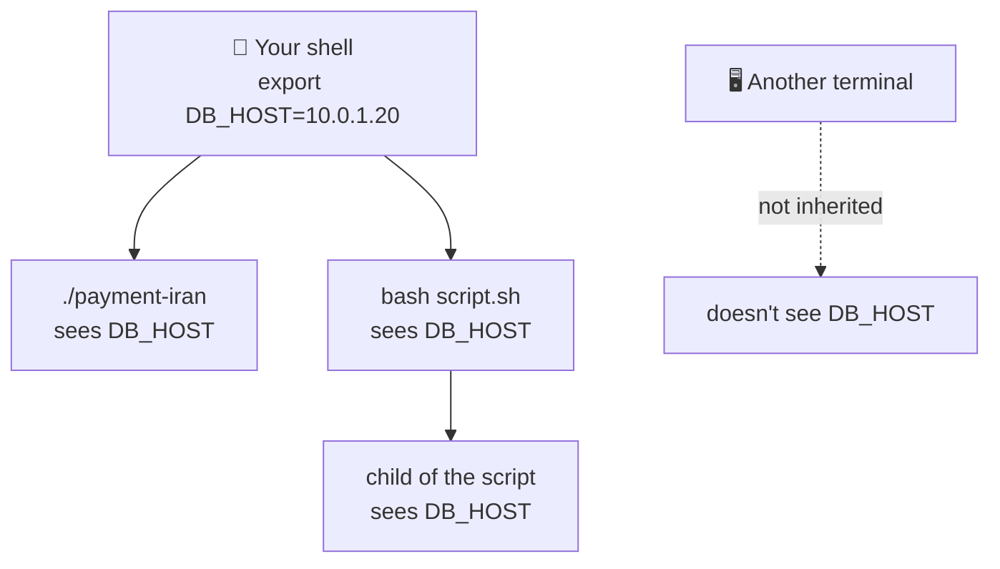
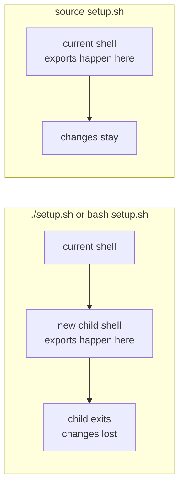

# 🌱 Environment Variables and Shell Startup

[[Linux/Linux Handbook/0. Linux Handbook|🐧 Linux Handbook]] · Part 1: Shell basics · ⬅️ [[Linux/Linux Handbook/4. Streams, Pipes, and Redirection|4. Streams, Pipes, and Redirection]] · ➡️ [[Linux/Linux Handbook/8. Users, Groups, and sudo|8. Users, Groups, and sudo]]

How programs get their configuration from the environment, how variables flow from parent to child processes, and how the shell sets itself up every time it starts.

> [!toc]- 📑 Contents
>
> - [[#🌱 What an Environment Variable Is|🌱 What an Environment Variable Is]]
> - [[#📤 Setting Variables with export|📤 Setting Variables with export]]
> - [[#🔎 Viewing Variables|🔎 Viewing Variables]]
> - [[#💾 Startup Files: Making It Permanent|💾 Startup Files: Making It Permanent]]
> - [[#🔄 source vs. Running a Script|🔄 source vs. Running a Script]]
> - [[#📜 Shell History|📜 Shell History]]
> - [[#🛣️ PATH|🛣️ PATH]]
> - [[#🩺 Common Failures|🩺 Common Failures]]
> - [[#🧪 Interview Q&A|🧪 Interview Q&A]]
> - [[#📚 References|📚 References]]

---

## 🌱 What an Environment Variable Is

An **environment variable** is a named value that every process carries and passes down to the programs it starts. Tools read them as configuration: `HOME`, `PATH`, `EDITOR`, or our own `DB_HOST`.

> 💡 **Real-World Example**
>
> Our Go service `payment-iran` reads its database host from the environment:
>
> - 🧪 **Laptop:** `DB_HOST=localhost`
>
> - 🚀 **Server:** `DB_HOST=10.0.1.20`
>
> Same binary, different configuration. Docker, Compose, systemd and Jenkins all pass settings to apps this way.

```go
host := os.Getenv("DB_HOST")
```

Every process has its own copy of the environment, set when it starts. It's one of the [[Linux/Linux Handbook/10. Processes and Signals#🧬 Process Attributes|process attributes]], alongside the PID, user and working directory.



Variables flow **down** to child processes only. Never up to the parent, never sideways to other terminals.

---

## 📤 Setting Variables with `export`

```bash
export DB_HOST=10.0.1.20
export GREETING="Hello, World"          # quote values with spaces
export PROJECT_HOME="$HOME/projects/app" # build from other variables
```

- ⚠️ **No spaces around `=`.** `export A = 1` is an error.

- 🔤 **`UPPER_SNAKE_CASE`** is a convention that separates environment variables from lowercase script variables.

| Command | Current shell | Child processes | After the terminal closes |
|---|---|---|---|
| `VAR=value` | ✅ | ❌ | ❌ |
| `export VAR=value` | ✅ | ✅ | ❌ |
| `export` line in `~/.bashrc` / `~/.zshrc` | ✅ | ✅ | ✅ set again in every new shell |
| `VAR=value ./app` | ❌ | ✅ only `./app` | ❌ |

The last row is a one-off override: `LOG_LEVEL=debug ./payment-iran` changes the level for that single run.

Remove a variable with `unset DB_HOST`.

> ⚠️ Inheritance cuts both ways: **secrets in environment variables are passed to every child**, including any script or installer we run from that shell.

---

## 🔎 Viewing Variables

```bash
printenv              # all environment variables
printenv PATH         # one variable
echo "$PATH"          # same, through shell expansion
printenv | grep -i db # search
```

- 📋 **`printenv` / `env`** → only exported variables.

- 📚 **`set`** → every shell variable, exported or not, plus functions.

- 🔎 **In `set` but not in `printenv`?** It was never exported.

To see the environment of a **running process**:

```bash
tr '\0' '\n' < /proc/<PID>/environ
```

---

## 💾 Startup Files: Making It Permanent

`export` lasts only for the current terminal. To set something in **every** new shell, put it in the shell's **startup file**.

| File | Shell | Runs for |
|---|---|---|
| `~/.bashrc` | Bash | Each new interactive shell (a new terminal tab) |
| `~/.profile` or `~/.bash_profile` | Bash | Login shells, such as an SSH session |
| `~/.zshrc` | zsh | Each new interactive shell |

```bash
# ~/.bashrc or ~/.zshrc
export EDITOR=vim
export PATH="$HOME/bin:$PATH"
alias ll='ls -lh'
```

- 💡 **On Ubuntu, `~/.profile` already sources `~/.bashrc`**, so `~/.bashrc` covers terminals and SSH.

- 🧩 **Aliases** go in the same file, so they exist in every shell.

> ⚠️ Startup files apply to **your interactive shells only**. systemd services and cron jobs never read them. Give services their variables with `Environment=` or `EnvironmentFile=` in the unit file (see [[Linux/Linux Handbook/11. systemd, Services, and Timers#🛠️ Running Your Own App as a Service|11. systemd]]) or `environment:` in Compose.

🔜 **Later:** the full config hierarchy, defaults → config file → env vars → flags (SDGL Ch.10).

---

## 🔄 `source` vs. Running a Script

Editing `~/.bashrc` doesn't change shells that are already open. `source` runs a file **inside the current shell**, so its exports stick.

```bash
source ~/.bashrc     # or: . ~/.bashrc
```



That's why `source venv/bin/activate` must be sourced: running it would only change a throwaway child shell.

---

## 📜 Shell History

The shell remembers what we typed, so long commands (`ssh`, `docker compose …`, `kubectl …`) don't have to be retyped. History is set up in the same startup files.

### 💾 Where it lives

While the shell runs, history is a list **in memory**. It's saved to **`$HISTFILE`** (`~/.bash_history`, `~/.zsh_history`) so the next session can load it.

| Limit | Bash | zsh |
|---|---|---|
| Entries kept **in memory** | `HISTSIZE` | `HISTSIZE` |
| Entries kept **in the file** | `HISTFILESIZE` | `SAVEHIST` |

Both count **entries**, not bytes. In zsh, `echo $HISTFILESIZE` prints nothing: that name is Bash-only.


- 🐚 **Bash overwrites the file on exit by default**, so with two terminals open, the last one closed wins. Add `shopt -s histappend` to `~/.bashrc`.

- 🐚 **oh-my-zsh** sets `HISTSIZE=50000`, `SAVEHIST=10000`, and the options `share_history`, `hist_ignore_space`, and `hist_verify`.

### 🔎 Finding and reusing commands

| Key | Does |
|---|---|
| ⬆️ ⬇️ | Previous / next command. An edited recall is saved as a **new** entry |
| `Ctrl-R` | Search backward for text anywhere in a past command. Press again for older matches |
| `Ctrl-S` | Search forward. Needs `stty -ixon` first, or the terminal freezes (`Ctrl-Q` unfreezes) |
| `Ctrl-A` · `Ctrl-E` | Jump to start · end of the line |
| `Ctrl-W` · `Ctrl-U` | Delete the previous word · everything before the cursor |
| `Alt-.` | Insert the last argument of the previous command, as we type |

### ❗ History expansion

`!` is expanded **before the command runs**, like `$VAR` and `*` (see [[Linux/Linux Handbook/1. The Shell and How Commands Run|1. The Shell]]):

| Type | Becomes |
|---|---|
| `!!` | The whole last command, as in `sudo !!` |
| `!ssh` | The last command starting with `ssh` |
| `!$` | The last argument of the last command: `mkdir -p /opt/app` then `cd !$` |

- 🐚 **Bash** prints the expanded line and runs it. **zsh with `hist_verify`** puts it on the line and waits for Enter, so we can check it first.

> ⚠️ `sudo !!` is fast but blind. Know why a command needs root before giving it root.

### 🙈 Keeping commands out of history

A command starting with a **space** isn't saved when Bash has `HISTCONTROL=ignorespace` (Ubuntu's `ignoreboth` includes it) or zsh has `hist_ignore_space`. Use it for anything containing a secret:

```bash
 export GITHUB_TOKEN=ghp_xxx    # leading space → not saved
```

> 🔒 **History is not an audit log.** It's a file the user owns and can clear (`history -c`, `unset HISTFILE`). Accountability comes from places the user can't edit: `sudo` logs (`journalctl _COMM=sudo`), `auditd`, and remote log shipping.

---

## 🛣️ PATH

`PATH` is the colon-separated list of directories the shell searches for commands, **left to right**, first match wins (the full lookup order is in [[Linux/Linux Handbook/1. The Shell and How Commands Run#🔎 How the Shell Finds a Command|1. The Shell]]).

```bash
echo "$PATH"
```

```text
/usr/local/bin:/usr/bin:/bin:/home/deploy/.local/bin
```

**Add your own scripts directory** so its scripts run from anywhere:

1. 📁 **Create the directory and a script.**

   ```bash
   mkdir -p ~/bin
   printf '#!/usr/bin/env bash\necho "Deploying..."\n' > ~/bin/deploy
   chmod +x ~/bin/deploy
   ```

   - Without `chmod +x`, the shell finds the file but says `Permission denied`.

2. 🛣️ **Prepend it to `PATH` in `~/.bashrc`.**

   ```bash
   export PATH="$HOME/bin:$PATH"
   ```

   - **Prepend** (`$HOME/bin:` first) → your version wins over a system command with the same name.

   - **Append** (`$PATH:$HOME/bin`) → system commands win.

3. 🔄 **Reload and check.**

   ```bash
   source ~/.bashrc
   command -v deploy
   ```

   ✅ Prints `/home/<user>/bin/deploy`, and `deploy` runs from any directory.

> ⚠️ Always include `$PATH` in the new value. `export PATH="$HOME/bin"` replaces the whole list, and `ls` stops working until you open a new shell.

---

## 🩺 Common Failures

| Symptom | Cause | Fix |
|---|---|---|
| Variable empty in a script | Set without `export` | `export VAR=...` |
| Variable gone in a new terminal | Exported only in the old one | Add it to `~/.bashrc` / `~/.zshrc` |
| `.bashrc` edit has no effect | Not reloaded | `source ~/.bashrc` or a new terminal |
| Works in the terminal, not as a service | Services don't read startup files | `Environment=`, `EnvironmentFile=`, or Compose |
| Script in `~/bin` → `Permission denied` | No execute bit | `chmod +x ~/bin/script` |
| Wrong version of a tool runs | An earlier `PATH` entry wins | `type -a tool`, reorder `PATH` |
| Alias missing after `ssh` | Laptop-only alias, or the login file (`~/.profile`) doesn't source `~/.bashrc` | Add it on the server; source `~/.bashrc` from `~/.profile` |
| Bash history lost between terminals | Each shell overwrites the file on exit | `shopt -s histappend` |

---

### 🧪 Interview Q&A

**Q1:** What's the difference between `VAR=value` and `export VAR=value`?

**Q2:** You added an `export` to `~/.bashrc`, but `printenv` doesn't show it. Why?

**Q3:** Why doesn't `./setup.sh` keep the variables it exports?

**Q4:** Your app works when started by hand but not as a systemd service. What do you check first?

**Q5:** Why is putting a cloud API key in your shell's environment risky?

**Q6:** You ran `ls /var/log`, then `cd !$`, and zsh showed `cd /var/log` without running it. Why?

**Q7:** Commands starting with a space aren't saved to history. Is that a security hole?

> [!answer]- 📋 Answers
>
> **A1:** Without `export`, only the current shell sees it. With `export`, child processes inherit it too.
>
> **A2:** The current shell started before the edit. Run `source ~/.bashrc` or open a new terminal.
>
> **A3:** It runs in a child shell, and variables never flow back up to the parent. Use `source ./setup.sh`.
>
> **A4:** Whether the variables it needs are set for the service: systemd doesn't read `~/.bashrc`. Add `Environment=` or `EnvironmentFile=` to the unit.
>
> **A5:** Every process started from that shell inherits it, including scripts and installers you didn't write.
>
> **A6:** `!$` is history expansion to the last argument of the previous command. With `hist_verify` on (oh-my-zsh), zsh shows the expanded line and waits for Enter.
>
> **A7:** No. History is a convenience file the user owns and can already clear. Auditing comes from `sudo` logs, `auditd`, and remote logging. The space trick keeps secrets out of a plaintext file.

---

## 🔨 Hands-On Practice

1. 📤 **See inheritance.**

   ```bash
   MSG=hello
   bash -c 'echo "child sees: $MSG"'
   export MSG
   bash -c 'echo "child sees: $MSG"'
   ```

   ✅ First `child sees: `, then `child sees: hello`.

2. ⏱️ **One-off override.**

   ```bash
   MSG=override bash -c 'echo $MSG'
   echo $MSG
   ```

   ✅ `override`, then `hello`.

3. 🛣️ **Add `~/bin` to `PATH`** with the three steps in [[#🛣️ PATH|PATH]].

4. 🧹 Clean up: `unset MSG`; remove `~/bin/deploy` and its `PATH` line if you don't want them.

---

### 📋 Quick Reference

| Task | Command |
|---|---|
| Set for this shell and children | `export VAR=value` |
| Set for one command | `VAR=value cmd` |
| Remove | `unset VAR` |
| Show one / all | `printenv VAR` / `printenv` |
| A process's environment | `tr '\0' '\n' < /proc/PID/environ` |
| Persist | `export` line in `~/.bashrc` / `~/.zshrc` |
| Reload | `source ~/.bashrc` |
| Add to `PATH` | `export PATH="$HOME/bin:$PATH"` |
| Search history | `Ctrl-R` |
| Rerun last command as root | `sudo !!` |
| Last argument | `!$` · `Alt-.` |
| Don't save this command | Start it with a space |
| History file and limits | `$HISTFILE` · `HISTSIZE` · `HISTFILESIZE` (Bash) / `SAVEHIST` (zsh) |

### 🧠 Things to Remember

- Environment variables pass **down** to child processes only.

- `export` lasts until the terminal closes; startup files recreate it each session.

- `source` runs a file in the current shell; `./file` runs it in a child.

- Services don't read your startup files.

- History lives in memory and is saved to `$HISTFILE`. `!` expands before the command runs. It isn't an audit log.

### 💡 Pro Tips

- **Fail fast in scripts** when a variable is missing: `: "${DB_HOST:?DB_HOST is not set}"`.

- **Keep secrets out of `~/.bashrc`** if you sync dotfiles to Git. Source a separate `chmod 600` file instead.

- **Run `bash -n ~/.bashrc`** to syntax-check before sourcing, and keep one working terminal open.

### 🔗 Related Topics

- ⬅️ [[Linux/Linux Handbook/4. Streams, Pipes, and Redirection|4. Streams, Pipes, and Redirection]] · ➡️ [[Linux/Linux Handbook/8. Users, Groups, and sudo|8. Users, Groups, and sudo]]

- [[Linux/Linux Handbook/1. The Shell and How Commands Run|1. The Shell and How Commands Run]] (`PATH` lookup)

- [[Linux/Linux Handbook/11. systemd, Services, and Timers|11. systemd, Services, and Timers]] (`EnvironmentFile=`)

- [[DevOps/NaNa/Docker/5. Docker Compose|Docker Compose]]

---

## 📚 References

| Source | Where | Status |
|---|---|---|
| 📝 Nana: [[DevOps/NaNa/Linux/3. Environment Variables\|Environment Variables]] | whole note (ep 20) | ✅ studied |
| 📝 SDGL note: [[Linux/The Software Developer’s Guide to Linux/2. Working with Processes\|2. Working with Processes]] | Environment variables, inheritance | ✅ studied |
| 📕 SDGL Ch.2 | Environment variables p. 25 · inheritance p. 33 | ✅ studied |
| 📝 SDGL note: [[Linux/The Software Developer’s Guide to Linux/4. Using Shell History\|4. Using Shell History]] | whole note | ✅ studied |
| 📕 SDGL Ch.4 | pp. 45–49 | ✅ studied |
| 📕 SDGL Ch.10 | Config hierarchy p. 116 · environment variables p. 119 | 📖 planned · 🔁 env vars are here · 🆕 config layers (defaults → file → env → flags), `/etc` vs. `~/.config` → here |
| 📗 CompTIA 6th Ch.7 | Environment variables p. 272 · user-defined p. 276 · environment files p. 279 [PDF 288–296] | 🔭 optional |
| 📘 Linux Bible Ch.3 | Shell variables p. 79 · aliases p. 81 · shell environment pp. 82–86 [PDF 112–119] | 🔭 optional |
| 🗒️ Scattered: [[Linux/Scatterd Learning/Alias\|Alias]] | Permanent aliases | 🔭 optional |
