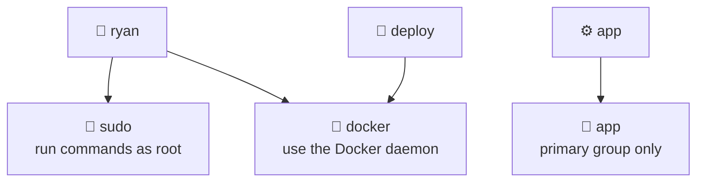
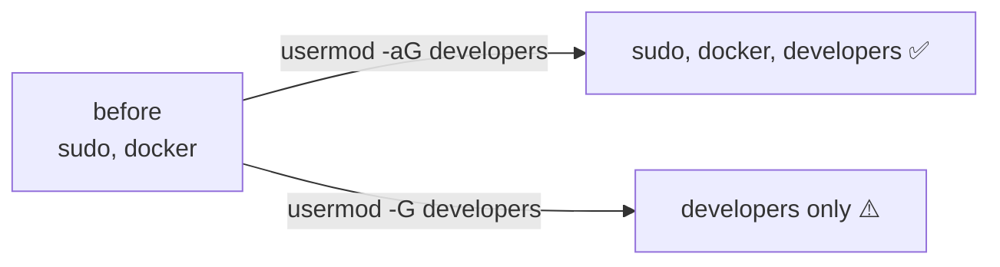
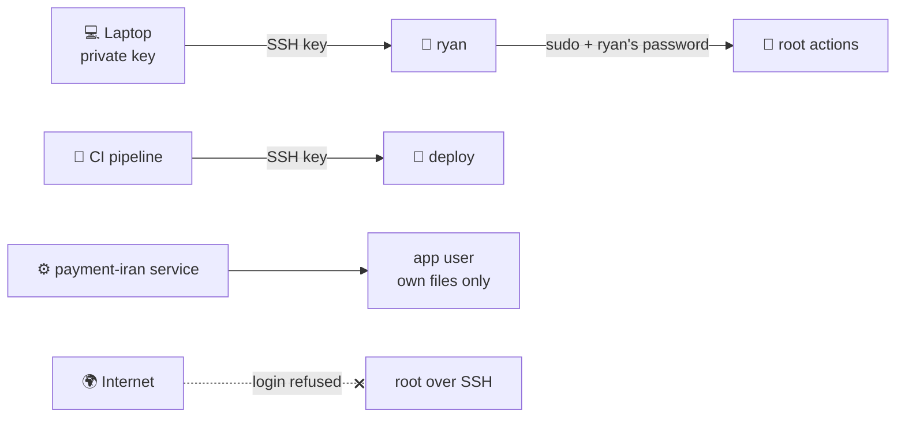

# 👥 Users, Groups, and sudo

[[Linux/Linux Handbook/0. Linux Handbook|🐧 Linux Handbook]] · Part 2: Access · ⬅️ [[Linux/Linux Handbook/6. Environment Variables and Shell Startup|6. Environment Variables]] · ➡️ [[Linux/Linux Handbook/9. Ownership and Permissions|9. Ownership and Permissions]]

Who a process runs as decides what it can do. This note covers users and groups, where accounts are stored, how to manage them, and how to set up a server so nobody works as root.

> [!toc]- 📑 Contents
>
> - [[#👤 Users and Groups|👤 Users and Groups]]
> - [[#🔢 A User Is a Number|🔢 A User Is a Number]]
> - [[#📁 Where Accounts Are Stored|📁 Where Accounts Are Stored]]
> - [[#➕ Creating Users|➕ Creating Users]]
> - [[#👥 Groups and Membership|👥 Groups and Membership]]
> - [[#🔄 su and sudo|🔄 su and sudo]]
> - [[#🛠️ Modifying and Deleting|🛠️ Modifying and Deleting]]
> - [[#🖥️ Setting Up a Server's Accounts|🖥️ Setting Up a Server's Accounts]]
> - [[#🧪 Interview Q&A|🧪 Interview Q&A]]
> - [[#📚 References|📚 References]]

---

## 👤 Users and Groups

Every process and every file belongs to a **user**. A **group** is a named set of users that share access. When a process opens a file, Linux compares the process's user and groups with the file's owner and group (see [[Linux/Linux Handbook/9. Ownership and Permissions|9. Ownership and Permissions]]).

- 👑 **root** (UID `0`) → can do anything. Avoid working as root.

- ⚙️ **System users** (UID below `1000` on Debian/Ubuntu) → run services such as `www-data` or `jenkins`; usually can't log in.

- 👤 **Regular users** (UID `1000`+) → real people.

Each user has one **primary group** (it owns the files the user creates) and any number of **secondary groups** (extra access).



The user a process runs as is its **effective UID (EUID)**, shown in the `USER` column of `ps`. If permissions are a lock, the process's user and groups are the key.

---

## 🔢 A User Is a Number

The kernel stores only numbers: a **UID** for the user and a **GID** for each group. Names like `ryan` are a lookup in `/etc/passwd`, done by tools like `ls` and `ps`.

> 💡 **Real-World Example**
>
> The MQTT broker on our develop server shows as **`10001`** in `ps` on the host, but as **`app`** inside its container.
>
> - The container's own `/etc/passwd` has `app:x:10001:…`.
>
> - The host's `/etc/passwd` has no entry for 10001, so `ps` prints the bare number.
>
> Same process, same UID; only the name lookup differs.

This is why file ownership "follows the number": a container running as UID 1000 can write to a host directory owned by UID 1000, whatever the names are.

---

## 📁 Where Accounts Are Stored

- 📄 **`/etc/passwd`** → one line per user, readable by everyone.

    ```text
    deploy:x:1001:1001:Deploy user:/home/deploy:/bin/bash
    ```

    `name : x (password is in shadow) : UID : primary GID : comment : home : shell`

- 🔐 **`/etc/shadow`** → password hashes and expiry. Root only.

- 👥 **`/etc/group`** → groups and their secondary members.

    ```text
    docker:x:998:ryan,deploy
    ```

Query them with `getent` (it also covers LDAP and other account sources) and `id`:

```bash
getent passwd deploy
id deploy
```

```text
uid=1001(deploy) gid=1001(deploy) groups=1001(deploy),998(docker)
```

`id` is the quickest check: UID, primary group and every group in one line.

---

## ➕ Creating Users

| | `adduser` | `useradd` |
|---|---|---|
| Style | Interactive, friendly | Flags only, scriptable |
| Home directory | Created automatically | Needs `-m` |
| Password | Prompts for it | Set separately with `passwd` |
| Default shell | `/bin/bash` (from `/etc/adduser.conf`) | `/bin/sh` unless `-s` |
| Best for | A person, by hand | Scripts, Ansible, Dockerfiles |

```bash
sudo adduser deploy                                         # interactive
sudo useradd -m -s /bin/bash -c "Deploy user" -G docker deploy   # scripted
sudo useradd -r -s /usr/sbin/nologin app                    # service account
```

- `-m` → create `/home/deploy`. `-s` → login shell. `-c` → comment. `-G` → secondary groups.

- `-r` → system user (UID below 1000, no home by default).

- `/usr/sbin/nologin` → login attempts are refused with "This account is currently not available."

### 🔑 Passwords

```bash
passwd                  # change your own
sudo passwd deploy      # set another user's
sudo passwd -l deploy   # lock password login
sudo passwd -S root     # status: P = usable password, L = locked
```

💡 `passwd -l` blocks **password** login only; SSH keys still work. To block everything, expire the account: `sudo usermod -e 1 deploy`.

---

## 👥 Groups and Membership

```bash
sudo groupadd developers
sudo usermod -aG docker,developers deploy   # add to groups
sudo gpasswd -d deploy developers           # remove from one group
groups deploy                               # verify
```

- `-G` → the list of secondary groups. `-a` → **append** to the existing list.

> ⚠️ Without `-a`, `usermod -G docker deploy` **replaces** every secondary group with only `docker`. On an admin account, that removes `sudo` and locks you out of root.



> ⚠️ Group membership is read **at login**. An already-logged-in user must log out and back in (or run `newgrp docker`) before `docker ps` works without `sudo`.

> ⚠️ Membership in **`docker`** is effectively root on the host: anyone in it can run `docker run -v /:/host …`.

---

## 🔄 `su` and `sudo`

- 🔄 **`su - deploy`** → become `deploy`, asking for **deploy's** password. The `-` starts a login shell with deploy's `HOME`, `PATH` and startup files.

- 👑 **`sudo command`** → run one command as root, asking for **your own** password. Requires membership in `sudo` (Ubuntu) or `wheel` (RHEL).

- 🔁 **`sudo -iu deploy`** → become `deploy` without knowing its password.

    - For a `nologin` service account, `-i` fails because it uses the account's shell. Use `sudo -u app -s` for a shell, or `sudo -u app <command>` for one command.

| | `su -` | `sudo command` |
|---|---|---|
| Password asked | Target user's (root's) | Your own |
| Scope | A full shell | One command |
| Audit trail | "root did it" | "ryan ran X as root" |

Every `sudo` command is logged under the real user's name (`/var/log/auth.log` or `journalctl`), and root's password never needs to be shared.

> ⚠️ Child processes inherit the user. Anything an installer started with `sudo` downloads and runs also runs as root.

---

## 🛠️ Modifying and Deleting

| Change | Command |
|---|---|
| Login shell | `sudo usermod -s /bin/zsh deploy` |
| Primary group | `sudo usermod -g developers deploy` |
| Rename | `sudo usermod -l deployer deploy` |
| Lock / unlock | `sudo usermod -L deploy` / `-U` |
| Expire on a date | `sudo usermod -e 2027-01-31 deploy` |
| Delete, keep home | `sudo userdel deploy` |
| Delete with home | `sudo userdel -r deploy` |
| Delete a group | `sudo groupdel developers` |

- 📦 **Files outside the home survive deletion** and show a bare UID as owner. Find them with `sudo find / -uid 1001 2>/dev/null`.

- 🚫 **A group can't be deleted** while it's someone's primary group.

> ⚠️ `userdel -r` permanently deletes the home directory. Back it up first: `sudo tar -czf deploy-home.tar.gz /home/deploy`.

---

## 🖥️ Setting Up a Server's Accounts

A fresh server often gives you only `root`. Working as root means every typo and every compromised process has full control. Give each **person** and each **service** its own account with only the access it needs.



1. 👑 **Create an admin with `sudo`.** As root on the new server:

   ```bash
   adduser ryan
   usermod -aG sudo ryan        # wheel on RHEL
   ```

2. ⚙️ **One system user per service.**

   ```bash
   sudo useradd -r -s /usr/sbin/nologin app
   sudo mkdir -p /srv/app && sudo chown -R app:app /srv/app
   ```

   - If the service is compromised, the attacker gets `app`'s limited access, not the whole server.

   - Packages often do this for you: nginx, PostgreSQL and Jenkins create `www-data`, `postgres` and `jenkins`.

3. 🔑 **SSH keys, then no root login.** Covered in [[Linux/Linux Handbook/16. SSH Keys and Hardening|16. SSH Keys and Hardening]].

---

### 🧪 Interview Q&A

**Q1:** What's the difference between a primary and a secondary group?

**Q2:** Why is `usermod -G docker ryan` dangerous on an admin account?

**Q3:** You added `deploy` to `docker`, but `docker ps` still says permission denied. Why?

**Q4:** `su` vs. `sudo`: whose password does each ask for, and why does that matter?

**Q5:** `ps` on the host shows a container process owned by `10001` instead of a name. Why?

**Q6:** How do you create an account for a service that must never log in?

> [!answer]- 📋 Answers
>
> **A1:** The primary group owns new files the user creates; each user has exactly one. Secondary groups grant extra access, and there can be many.
>
> **A2:** Without `-a`, it replaces every secondary group with only `docker`, removing `sudo` and therefore root access.
>
> **A3:** Group membership is read at login. Log out and back in, or run `newgrp docker`.
>
> **A4:** `su` asks for the target user's password; `sudo` asks for yours and checks the sudoers rules. With `sudo`, root's password is never shared and each command is logged under the real user.
>
> **A5:** The kernel stores only the UID. The host's `/etc/passwd` has no name for 10001; the container's own `/etc/passwd` does.
>
> **A6:** `sudo useradd -r -s /usr/sbin/nologin app`: a system user with no login shell.

---

## 🔨 Hands-On Practice

Use a VM or test machine.

1. ➕ **Create a user and a group.**

   ```bash
   sudo useradd -m -s /bin/bash alice
   sudo groupadd devteam
   sudo usermod -aG devteam alice
   id alice
   ```

   ✅ `groups=` lists `alice` and `devteam`.

2. ⚠️ **See `-G` replace groups.**

   ```bash
   sudo groupadd qa
   sudo usermod -G qa alice
   id alice
   ```

   ✅ `devteam` is gone; only `alice` and `qa` remain.

3. ⚙️ **A service user can't log in.**

   ```bash
   sudo useradd -r -s /usr/sbin/nologin demo-svc
   sudo su - demo-svc
   sudo -u demo-svc whoami
   ```

   ✅ `su` prints "This account is currently not available.", but `sudo -u` can still run a single command as that user and prints `demo-svc`.

4. 🧹 **Clean up.**

   ```bash
   sudo userdel -r alice
   sudo userdel demo-svc
   sudo groupdel devteam; sudo groupdel qa
   ```

---

### 📋 Quick Reference

| Task | Command |
|---|---|
| Show IDs and groups | `id user` |
| Look up an account | `getent passwd user` |
| Create (interactive / scripted) | `sudo adduser user` / `sudo useradd -m -s /bin/bash user` |
| Create a service user | `sudo useradd -r -s /usr/sbin/nologin svc` |
| Set a password | `sudo passwd user` |
| Grant admin | `sudo usermod -aG sudo user` |
| Add to groups | `sudo usermod -aG g1,g2 user` |
| Remove from a group | `sudo gpasswd -d user grp` |
| Become another user | `su - user` · `sudo -iu user` |
| Delete user + home | `sudo userdel -r user` |

### 🧠 Things to Remember

- The kernel knows only **UIDs and GIDs**; names come from `/etc/passwd` and `/etc/group`.

- Always `usermod -aG`, never plain `-G`.

- Group changes need a new login session.

- `sudo` asks for **your** password; `su` asks for the target's.

- One system user per service, with `nologin`. `docker` group = root.

### 💡 Pro Tips

- **Use `useradd` with flags** in scripts and Ansible; `adduser`'s prompts hang automation.

- **Check existence first** in scripts: `getent passwd app >/dev/null || sudo useradd -r …`.

- **Before removing someone from `sudo`,** confirm another admin works in a second session.

### 🔗 Related Topics

- ⬅️ [[Linux/Linux Handbook/6. Environment Variables and Shell Startup|6. Environment Variables]] · ➡️ [[Linux/Linux Handbook/9. Ownership and Permissions|9. Ownership and Permissions]]

- [[Linux/Linux Handbook/16. SSH Keys and Hardening|16. SSH Keys and Hardening]]

- [[DevOps/Server Administration/4. Docker Daemon and Container Hardening|Docker Daemon and Container Hardening]]

---

## 📚 References

| Source | Where | Status |
|---|---|---|
| 📝 Nana: [[DevOps/NaNa/Linux/4. Users and Groups\|Users and Groups]] | whole note (ep 14) | ✅ studied |
| 📝 Nana: [[DevOps/NaNa/Linux/7. Server Configuration\|Server Configuration]] | No root, sudo admin, one user per service | ✅ studied |
| 📝 SDGL notes: [[Linux/The Software Developer’s Guide to Linux/2. Working with Processes\|Ch.2]] · [[Linux/The Software Developer’s Guide to Linux/3. Service Management with systemd\|Ch.3]] | EUID p. 25 · inheritance p. 33 · users are numbers | ✅ studied |
| 📕 SDGL Ch.7 | What is a user, really? pp. 88–90 | 📖 planned · 🔁 mostly review: the UID model and `/etc/passwd` are already here |
| 📕 SDGL Ch.7 | User basics and mini project, pp. 81–87 | ⏭️ skipped (covered here) |
| 📗 CompTIA 6th Ch.10 | Administering users and groups, pp. 408–419 [PDF 424–435] | 🔭 optional |
| 📘 Linux Bible Ch.11 | Creating users p. 247 · `useradd` p. 250 · `usermod` p. 255 · groups p. 257 [PDF 278–290] | 🔭 optional |
| 📘 Linux Bible Ch.23 | Securing user accounts, limiting root, pp. 549–551 [PDF 573–575] | 📖 planned (Stage D) · 🆕 account expiry, removing unused accounts, password rules → note 22 |
