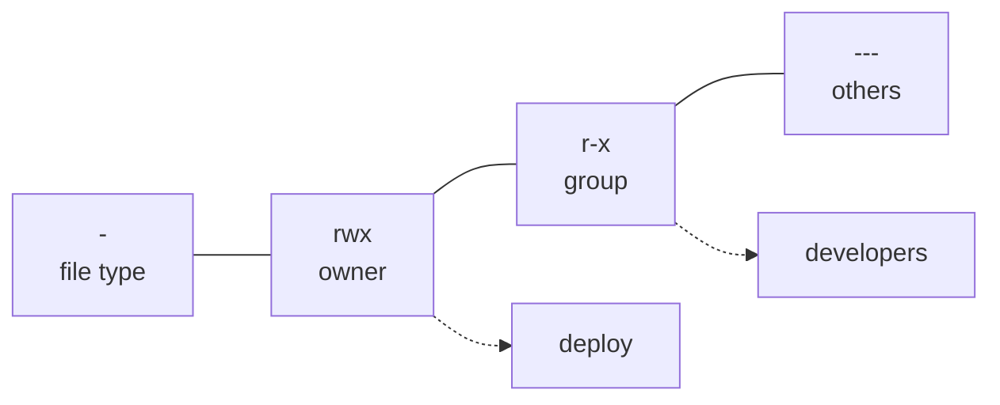
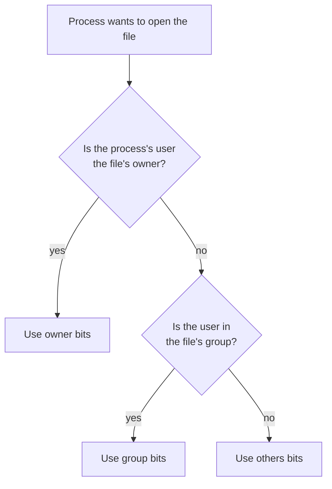

# 🔐 Ownership and Permissions

[[Linux/Linux Handbook/0. Linux Handbook|🐧 Linux Handbook]] · Part 2: Access · ⬅️ [[Linux/Linux Handbook/8. Users, Groups, and sudo|8. Users, Groups, and sudo]] · ➡️ [[Linux/Linux Handbook/10. Processes and Signals|10. Processes and Signals]]

Every file has an owner, a group, and three sets of permissions. This note covers how to read them, how Linux decides which set applies, and how to change them safely.

> [!toc]- 📑 Contents
>
> - [[#🔎 Reading ls -l|🔎 Reading ls -l]]
> - [[#🧭 Which Set Applies|🧭 Which Set Applies]]
> - [[#🔤 What r, w, and x Mean|🔤 What r, w, and x Mean]]
> - [[#👤 Changing Ownership|👤 Changing Ownership]]
> - [[#✏️ chmod Symbolic Mode|✏️ chmod Symbolic Mode]]
> - [[#🔢 chmod Numeric Mode|🔢 chmod Numeric Mode]]
> - [[#🛡️ umask and Special Bits|🛡️ umask and Special Bits]]
> - [[#🔑 Permissions That Programs Enforce|🔑 Permissions That Programs Enforce]]
> - [[#🩺 Common Failures|🩺 Common Failures]]
> - [[#🧪 Interview Q&A|🧪 Interview Q&A]]
> - [[#📚 References|📚 References]]

---

## 🔎 Reading `ls -l`

```bash
ls -l deploy.sh
```

```text
-rwxr-x--- 1 deploy developers 4096 Jan 15 10:30 deploy.sh
```



- 📄 **Type `-`** → regular file. `d` = directory, `l` = symlink.

- 👤 **Owner `deploy`: `rwx`** → read, write, run.

- 👥 **Group `developers`: `r-x`** → read and run, no changes.

- 🔒 **Others: `---`** → no access.

Then the hard-link count `1`, the size, the modification time and the name. `ls -ld dir` shows a directory itself instead of its contents; `stat -c '%a %A %U:%G' file` prints the numeric mode too.

---

## 🧭 Which Set Applies

Linux checks **one** set, in order, and stops at the first match:



- 👤 **It's the process's user that counts**, not yours. A service running as `www-data` can only read what `www-data` may read. (See [[Linux/Linux Handbook/8. Users, Groups, and sudo|8. Users]] and [[Linux/Linux Handbook/10. Processes and Signals|10. Processes]].)

- 👑 **root bypasses** the read and write checks.

---

## 🔤 What `r`, `w`, and `x` Mean

The letters mean different things on files and directories:

| | File | Directory |
|---|---|---|
| `r` | Read the contents | List names inside (`ls`) |
| `w` | Change the contents | Create, delete, rename entries inside |
| `x` | Run as a program | Enter it (`cd`) and reach files inside |

- 📁 **Directory `x` is needed to reach anything inside**, even a file you may read.

- 🗑️ **Deleting a file depends on the directory's `w`**, not the file's. You can delete a read-only file in a directory you can write to.

---

## 👤 Changing Ownership

```bash
sudo chown deploy file.txt                  # owner only
sudo chown deploy:developers file.txt       # owner and group
sudo chown :developers file.txt             # group only
sudo chown -R app:app /srv/app              # whole tree
```

- 👑 **Changing the owner needs root**, otherwise anyone could hand files to someone else.

- 👥 **A regular user may change the group** of their own files, but only to a group they belong to.

> 💡 **Real-World Example**
>
> A container runs as UID `1000` and writes to a bind-mounted `/srv/app/data`. If the directory is owned by root, writes fail with `Permission denied`.
>
> ```bash
> sudo chown -R 1000:1000 /srv/app/data
> ```
>
> Ownership is stored as numbers, so the UID inside and outside the container must match.

---

## ✏️ `chmod` Symbolic Mode

**Who** + **operator** + **permissions**. It changes only the bits you name.

- 👥 **Who:** `u` owner, `g` group, `o` others, `a` all

- ➕ **Operator:** `+` add, `-` remove, `=` set exactly

```bash
chmod u+x deploy.sh          # owner may run it
chmod g-w report.txt         # group can no longer edit
chmod o-rwx secrets.env      # others get nothing
chmod u=rw,g=r,o= app.conf   # set all three exactly → rw-r-----
chmod -R g+rX /srv/shared    # capital X: execute only on directories (and already-executable files)
```

💡 `g=r` sets the group to exactly read-only, removing any `w` and `x`. `g+r` only adds read.

---

## 🔢 `chmod` Numeric Mode

`r` = **4**, `w` = **2**, `x` = **1**. Each digit is the sum for one class: owner, group, others.

```text
chmod 750 deploy.sh

  7          5          0
 rwx        r-x        ---
4+2+1      4+0+1      0+0+0
owner      group      others
```

| Mode | Result | Typical use |
|---|---|---|
| `755` | `rwxr-xr-x` | Scripts, binaries, directories |
| `644` | `rw-r--r--` | Normal files, configs |
| `750` | `rwxr-x---` | Group-shared app directory |
| `640` | `rw-r-----` | Config readable by the service's group |
| `700` | `rwx------` | `~/.ssh`, private directories |
| `600` | `rw-------` | Private keys, `authorized_keys`, `.env` |
| `777` | `rwxrwxrwx` | ⚠️ Anyone may change it; avoid |

Numeric mode sets **all** bits at once; symbolic mode is better for one bit.

---

## 🛡️ umask and Special Bits

### 🎭 umask

New files start from `666` and directories from `777`. The **umask** removes bits from that.

```bash
umask        # → 0022 for root; often 0002 for Ubuntu users
```

```text
files:       666 masked by 022 → 644  (rw-r--r--)
directories: 777 masked by 022 → 755  (rwxr-xr-x)
```

It masks bits rather than subtracting, but with common values the result is the same.

### ⭐ Special bits

| Bit | Numeric | Shows as | Effect |
|---|---|---|---|
| **setuid** | `4xxx` | `rws------` | The file runs as its **owner** (`/usr/bin/passwd` runs as root) |
| **setgid** | `2xxx` | `---rws---` | On a directory, new files inherit the directory's **group** |
| **sticky** | `1xxx` | `--------t` | In a shared directory, only a file's owner may delete it (`/tmp`) |

A shared team directory:

```bash
sudo mkdir /srv/shared
sudo chown root:developers /srv/shared
sudo chmod 2775 /srv/shared
```

- `2` → setgid: every new file belongs to `developers`.

- `775` → owner and group can create files; others can only read.

---

## 🔑 Permissions That Programs Enforce

Some programs refuse files whose permissions are **too open**, even when they could read them. The best-known is `sshd`'s **`StrictModes`** (on by default):

| Path | Required |
|---|---|
| `~/.ssh/` | `700` |
| `~/.ssh/authorized_keys` | `600` (no group or other write) |

If another user could write to `authorized_keys`, they could add their own key and log in as you, so sshd ignores the file and falls back to a password prompt.

> 💡 **Real-World Example**
>
> On our develop server, `ryan`'s `authorized_keys` was `664` and key login **still worked**. OpenSSH tolerates group-write when the group is the user's own private group (`ryan:ryan`) with no other members. That exception disappears as soon as anyone joins the group, so set `600` anyway.

The same idea applies to `.env` files and private keys: `600`, owned by the user that needs them. See [[Linux/Linux Handbook/16. SSH Keys and Hardening|16. SSH Keys and Hardening]].

---

## 🩺 Common Failures

| Symptom | Likely cause | Fix |
|---|---|---|
| `./script.sh: Permission denied` | No `x` bit | `chmod u+x script.sh` |
| Readable file, still `Permission denied` | A parent directory lacks `x` | `namei -l /full/path` |
| SSH key ignored, password prompt appears | `~/.ssh` or `authorized_keys` too open | `chmod 700 ~/.ssh`, `chmod 600 ~/.ssh/authorized_keys` |
| Container can't write to a bind mount | UID mismatch | `chown` the host directory to the container's UID |
| `chown: Operation not permitted` | Not root | `sudo` |

---

### 🧪 Interview Q&A

**Q1:** What does `chmod 640 app.conf` give each class?

**Q2:** A user may read `/srv/app/config.yml` by its permissions but gets `Permission denied`. Where do you look?

**Q3:** Why is `chmod 777` a bad fix?

**Q4:** Can you delete a file you have no write permission on?

**Q5:** Why must `~/.ssh/authorized_keys` not be group-writable?

> [!answer]- 📋 Answers
>
> **A1:** Owner `rw-`, group `r--`, others nothing.
>
> **A2:** The parent directories. `/srv` and `/srv/app` both need `x` for that user, or the file can't be reached.
>
> **A3:** Anyone on the system can then modify or replace the file, and it hides the real problem, usually the wrong owner. Fix the owner or group instead.
>
> **A4:** Yes, if you have `w` and `x` on the directory. Deleting changes the directory, not the file.
>
> **A5:** Another user could add their own key and log in as you, so sshd refuses the file (`StrictModes`).

---

## 🔨 Hands-On Practice

1. 📝 **New files aren't executable.**

   ```bash
   printf '#!/bin/bash\necho ok\n' > hello.sh
   ./hello.sh
   chmod u+x hello.sh && ./hello.sh
   ```

   ✅ First `Permission denied`, then `ok`.

2. 📁 **Directory `x` controls access.**

   ```bash
   mkdir box && echo hi > box/note.txt
   chmod u-x box
   cat box/note.txt
   chmod u+x box
   ```

   ✅ `cat` fails while the directory lacks `x`.

3. 🔢 **Numeric modes.**

   ```bash
   chmod 600 hello.sh
   stat -c '%a %A' hello.sh
   umask
   ```

   ✅ Prints `600 -rw-------`, then your umask.

4. 🧹 Clean up: `rm -r hello.sh box`.

---

### 📋 Quick Reference

| Task | Command |
|---|---|
| Show permissions | `ls -l file` · `ls -ld dir` |
| Numeric mode and owner | `stat -c '%a %A %U:%G' file` |
| Every parent on a path | `namei -l /full/path` |
| Change owner and group | `sudo chown user:group file` |
| Recursively | `sudo chown -R user:group dir` |
| Add / remove a bit | `chmod u+x file` · `chmod o-rwx file` |
| Set exactly | `chmod 640 file` |
| Directories traversable, recursively | `chmod -R g+rX dir` |
| Shared group directory | `chmod 2775 dir` |
| Default mask | `umask` |

### 🧠 Things to Remember

- Owner → group → others: only the first match is used.

- `r=4`, `w=2`, `x=1`; each digit is one class.

- Directory `x` = can enter; directory `w` = can create and delete inside.

- Only root changes owners. Ownership is stored as numbers.

- `600` for keys and secrets, `700` for `~/.ssh`.

### 💡 Pro Tips

- **On `Permission denied`, check the parents too**: `namei -l` shows every directory on the path.

- **Share through a group and `chmod 2775`**, not by widening "others".

- **Never `chmod -R 777` an app.** Find its user with `ps -o user= -p <pid>` and `chown` to it.

### 🔗 Related Topics

- ⬅️ [[Linux/Linux Handbook/8. Users, Groups, and sudo|8. Users, Groups, and sudo]] · ➡️ [[Linux/Linux Handbook/10. Processes and Signals|10. Processes and Signals]]

- [[Linux/Linux Handbook/16. SSH Keys and Hardening|16. SSH Keys and Hardening]]

- [[DevOps/Server Administration/9. Secrets and File Permissions|Secrets and File Permissions]] (🛠️ apply)

- [[DevOps/NaNa/Docker/7. Docker Volume|Docker Volume]]

---

## 📚 References

| Source | Where | Status |
|---|---|---|
| 📝 Nana: [[DevOps/NaNa/Linux/5. Ownership and Permissions\|Ownership and Permissions]] | whole note (ep 15) | ✅ studied |
| 📝 Server Admin: [[DevOps/Server Administration/2. SSH Hardening and Brute Force\|SSH Hardening]] | StrictModes and key file permissions | ✅ studied |
| 📝 SDGL note: [[Linux/The Software Developer’s Guide to Linux/1. How the Command Line Works\|1. How the Command Line Works]] | Long listing, p. 11 | ✅ studied |
| 📕 SDGL Ch.8 | Ownership and permissions, pp. 93–102 | ⏭️ skipped (covered here) |
| 📗 CompTIA 6th Ch.4 | Ownership p. 129 · managing permissions p. 132 · default p. 138 · special p. 140 · ACLs p. 143 [PDF 145–160] | 🔭 optional |
| 📘 Linux Bible Ch.4 | Permissions and ownership, `chmod`, `umask`, pp. 103–107 [PDF 135–139] | 🔭 optional |
| 📘 Linux Bible Ch.11 | ACLs p. 260 · setgid p. 265 · sticky bit p. 266 [PDF 291–297] | 🔭 optional |
