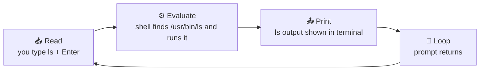
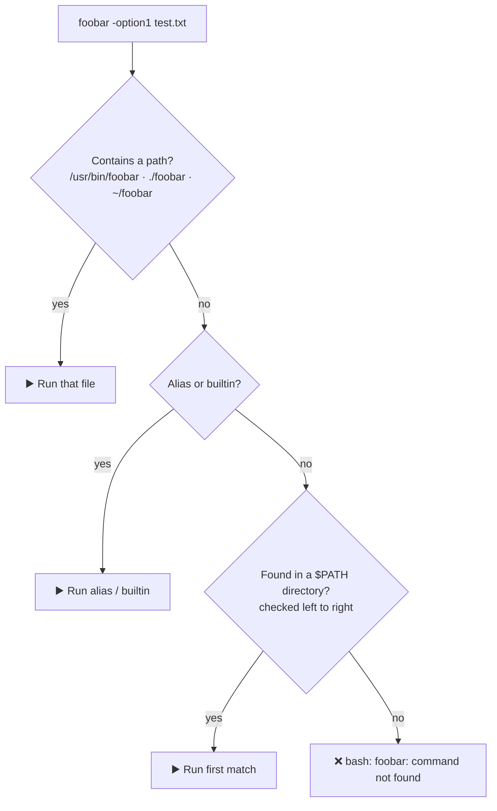
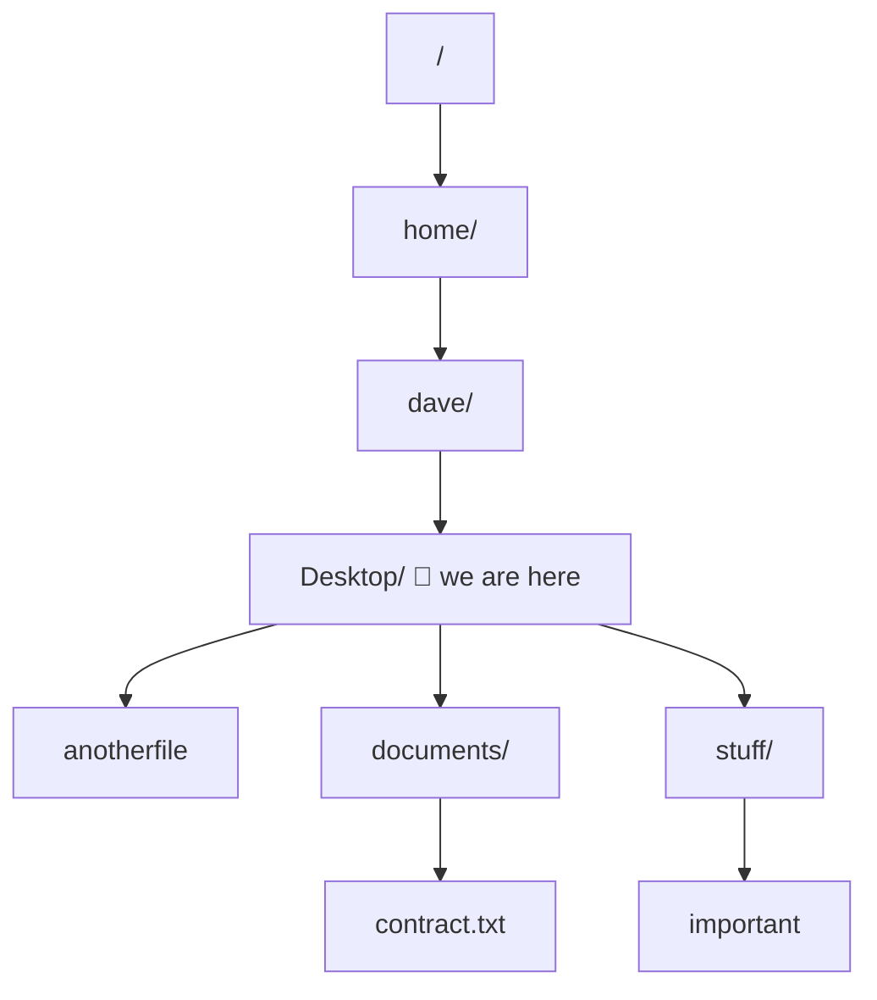

# 🐚 How the Command Line Works

[[Linux/The Software Developer’s Guide to Linux/README|🐧 SDGL]] · Ch.1 · pp. 1–20

📘 Merged into the Linux Handbook: [[Linux/Linux Handbook/1. The Shell and How Commands Run|1. The Shell and How Commands Run]] · [[Linux/Linux Handbook/2. Files and Directories|2. Files and Directories]]

> [!toc]- 📑 Contents
>
> - [[#🔁 The REPL]]
> - [[#✍️ Command Syntax (Read)]]
> - [[#🐚 Command Line vs. Shell]]
> - [[#🔎 How the Shell Finds a Command (Evaluate)]]
> - [[#📏 POSIX]]
> - [[#📁 Absolute vs. Relative Paths]]
> - [[#🧭 Looking Around and Moving]]
> - [[#🔍 Finding and Reading Files]]
> - [[#✏️ Making Changes]]
> - [[#📖 Getting Help with man]]
> - [[#⇥ Tab Completion]]
> - [[#🔨 Hands-On Practice]]
> - [[#📋 Quick Reference]]

What actually happens between typing a command and seeing its output, and which basic commands do we need to move around a Linux system?

---

## 🔁 The REPL

A **command-line interface** is a loop: it **R**eads input, **E**valuates it, **P**rints the result, and **L**oops back. That's a **REPL**, the same idea as `python3`, `irb`, or `node` with no script.



In code, the whole idea fits in one line:

```text
while (true) { print(eval(read())) }
```

A real shell such as Bash is far bigger, but it follows exactly this loop.

> 💡 **Real-World Example**
>
> When we run `go version` in the terminal:
>
> - 📥 **Read:** the shell receives `go version`.
>
> - ⚙️ **Evaluate:** it finds the `go` binary and starts it with the argument `version`.
>
> - 📤 **Print:** `go` writes `go version go1.23 linux/amd64`, and the shell shows it.
>
> - 🔁 **Loop:** `go` exits, and the prompt comes back.

---

## ✍️ Command Syntax (Read)

Every command has the same basic shape:

```text
command [options] [arguments]
```

Think of it as a function call: the **command** is the function name and everything after it is the argument list.

- 🧩 **Each program defines its own options.**

    - The shell can't check whether `-x` is valid for a command. It only checks that the command exists. The program itself rejects bad flags.

- 🏳️ **Short vs. long flags**

    - `-l` and `--long` often mean the same thing, but only if the program's author implemented both.

    - Short flags can usually be combined: `ls -l -h` = `ls -lh`.

- ␣ **Spaces separate arguments.**

    - An argument that contains a space must be quoted: `mkdir "my project"`. Without quotes, that's two directories.

### 📖 Reading the syntax in documentation

Man pages and `--help` output use a shared convention:

```text
command [-flags] [--example=foobar] [even_more_options ...]
```

| Notation | Meaning |
|---|---|
| `[ ... ]` | Optional |
| `...` | Zero or more of the previous item |
| `-f` | Short flag |
| `--flag=value` | Long flag with a value |

---

## 🐚 Command Line vs. Shell

These two terms are often used as if they were the same, but they aren't.

- 💬 **Command line:** the *general idea*. A text-based REPL for talking to a system.

- 🐚 **Shell:** a *specific program* that implements a command line.

Many programs are shells for different things:

| Shell | Talks to |
|---|---|
| `bash`, `zsh` | The operating system |
| `psql`, `mysql`, `redis-cli` | A database |
| `python3`, `irb` | A language interpreter |

In this book, "the shell" means a **Unix shell** (usually Bash) for working with the OS.

> 💡 The shell is itself just a running program, a process. We'll see what that means in [[2. Working with Processes]].

---

## 🔎 How the Shell Finds a Command (Evaluate)

When we press Enter on `foobar -option1 test.txt`, the shell has to decide *which program* `foobar` is. It checks in this order:



1. 📁 **A path was given.**

   `/usr/bin/foobar`, `./foobar` (`.` = current directory), `$HOME/foobar`, or `~/foobar`. The shell runs exactly that file.

2. 🐚 **An alias or builtin.**

   **Aliases** are shortcuts we define (`alias ll='ls -lh'`). **Builtins** live inside the shell itself (`cd`, `echo`, `type`).

3. 🔎 **Search `$PATH`.**

   `$PATH` is a colon-separated list of directories. The shell checks them in order and runs the **first** match.

   ```bash
   echo $PATH
   ```

   Illustrative output:

   ```text
   /home/ryan/.local/bin:/usr/local/go/bin:/usr/local/bin:/usr/bin:/bin
   ```

   Tools like Go installs, Python virtualenvs, and version managers work by **adding directories to the front** of `$PATH`.

Once found, the shell runs the program and passes `-option1` and `test.txt` as arguments, in that order.

> ⚠️ Running a script in the current directory needs `./script.sh`. The current directory isn't in `$PATH` by default, so `script.sh` alone gives "command not found".

### 💻 Which program will actually run?

When the wrong version runs, ask the shell:

```bash
which go          # path of the binary (not always installed)
command -v go     # POSIX version, works everywhere
type ls           # Bash/zsh: also says if it's an alias or builtin
```

Illustrative output:

```text
/usr/local/go/bin/go
/usr/local/go/bin/go
ls is aliased to `ls --color=auto'
```

- 💡 **Prefer `command -v` in scripts**, because it's part of POSIX and always present.

- 🔭 **Beyond the book:** `type -a go` lists *every* match in `$PATH`, which shows when two versions are installed.

---

## 📏 POSIX

**POSIX** is a family of standards that defines what Unix-like systems should share: basic commands, their behavior, and shell syntax.

For example, POSIX says a system must have `ls`, and must have a way to check whether a command exists (`command -v`).

- ✅ **Sticking to POSIX makes scripts portable** across Linux distros, macOS, and BSD.

- ⚠️ **It isn't a guarantee.** Many distros differ from POSIX in small ways, such as GNU vs. BSD flags.

---

### 🧪 Interview Q&A

**Q1:** What's the difference between a shell and the command line?

**Q2:** We run `deploy.sh` in the folder that contains it and get "command not found". Why, and what are two fixes?

**Q3:** Two Go versions are installed. How do we find out which one `go` runs, and why that one?

**Q4:** Why can't the shell tell us that `ls --colour-me` is an invalid flag before running it?

> [!answer]- 📋 Answers
>
> **A1:** The command line is the general idea of a text-based REPL. A shell is a specific program, such as Bash or `psql`, that implements one.
>
> **A2:** The current directory isn't in `$PATH`, and there's no path in the command. Run `./deploy.sh`, or move it into a `$PATH` directory such as `~/.local/bin`.
>
> **A3:** `command -v go` (or `type -a go` to see all). The shell runs the first match in `$PATH`, so whichever directory comes earlier wins.
>
> **A4:** Each program defines its own options. The shell only finds the executable; `ls` itself parses and rejects the flag.

---

## 📁 Absolute vs. Relative Paths

Most "No such file or directory" errors come from mixing these two up.

- 📍 **Absolute path:** starts with `/` (the root). It works from anywhere.

    - `/home/dave/Desktop/documents/contract.txt`

- 🧭 **Relative path:** no leading `/`. It starts from the **current directory**.

    - `documents/contract.txt`

A relative path is just the absolute path with the current directory cut off the front.



From `/home/dave/Desktop`, both of these list the same file:

```bash
ls /home/dave/Desktop/documents/contract.txt   # absolute: works from anywhere
ls documents/contract.txt                      # relative: only works from Desktop
```

If we `cd ..` up to `/home/dave`, the absolute path still works, but `documents/contract.txt` now points to `/home/dave/documents/contract.txt`, which doesn't exist.

- 🔤 **Path shortcuts:** `.` = current directory, `..` = parent directory, `~` = our home directory.

---

## 🧭 Looking Around and Moving

### 💻 `pwd`: where am I?

```bash
pwd
```

```text
/home/dave
```

New shells start in the **home directory**: `/home/<user>` on Linux, `/Users/<user>` on macOS.

### 💻 `ls`: what's here?

```bash
ls                 # current directory
ls /var/log        # a specific directory
ls -lh /usr/local  # long + human-readable sizes
```

A **long listing** (`-l`) has one line per file:

```text
-rw-r--r--  1 dcohen  wheel  0 Jul  5 09:27 foobar.txt
```

- 🔐 **`-rw-r--r--`** → file type (first character) + permissions for owner, group, and others.

- 🔗 **`1`** → number of hard links.

- 👤 **`dcohen`** → owning user.

- 👥 **`wheel`** → owning group.

- 📦 **`0`** → size. `-h` shows `4.0K`, `12M` instead of raw bytes.

- 🕒 **`Jul 5 09:27`** → last modification time.

- 📄 **`foobar.txt`** → name.

Users, groups, and permissions get their own chapters (7 and 8).

### 💻 `cd`: go somewhere

```bash
cd /etc/ssl        # absolute
cd certs           # relative → /etc/ssl/certs
cd ..              # up one level
cd                 # back to home
cd -               # back to the previous directory
```

After `cd`, `pwd` shows the new location.

---

## 🔍 Finding and Reading Files

### 💻 `find`: search by name or type

```bash
find / -type d -name home
```

- 📁 **`/`** → where to start searching (here, the whole system).

- 🗂️ **`-type d`** → directories only (`f` = regular files).

- 🔤 **`-name home`** → exact name match.

As a normal user we'll see `Permission denied` lines for directories we can't read. They're noise, not failures.

`find` is unusual: its long options use **one dash** (`-name`, not `--name`).

| Pattern | Finds |
|---|---|
| `find . -name "app*"` | Names starting with `app` |
| `find . -name "*.log"` | Names ending in `.log` |
| `find . -iname readme.md` | Case-insensitive match |

Quote the pattern so the shell doesn't expand `*` before `find` sees it.

#### ▶️ Running a command on each result

```bash
find . -name "*.log" -exec echo {} \;   # run echo once per file
find . -name "*.log" -exec echo {} +    # run echo once with all files as arguments
```

- `{}` → replaced by the found path.

- `\;` → ends the command; one run per file.

- `+` → collects files into one run, which is faster for many files.

### 💻 `less`: read a file page by page

```bash
less /var/log/syslog
```

| Key | Action |
|---|---|
| `↑` / `↓` | One line |
| `Space` | Next page |
| `/text` + Enter | Search |
| `n` / `N` | Next / previous match |
| `q` | Quit |

The same keys work inside `man`, because `man` opens its pages in a pager.

---

## ✏️ Making Changes

### 💻 `touch`: create an empty file or update its time

```bash
touch notes.txt
```

- 📄 **File doesn't exist** → creates it, empty.

- 🕒 **File exists** → updates its access and modification times. `-a` or `-m` updates only one of them.

### 💻 `mkdir`: create directories

```bash
mkdir foo bar baz                 # several at once
mkdir -p ~/sdgl-lab/logs/error    # create missing parents too
```

`-p` creates every missing directory in the path and **doesn't fail if they exist**. Running it twice is safe (it's **idempotent**), so scripts and Dockerfiles use it.

### 💻 `rmdir` and `rm`: remove

```bash
rmdir emptydir          # only removes EMPTY directories
rm file.txt             # remove a file
rm -r olddir            # remove a directory and everything in it
rm -rf olddir           # same, without asking
```

- `-r` → recursive, into subdirectories.

- `-f` → force, no prompts and no error if missing.

> ⚠️ `rm` has no trash bin. `rm -rf` with a wrong path, or an empty variable like `rm -rf "$DIR/"`, can delete far more than intended. Check the path with `ls` first, and be careful pasting commands from the internet.

### 💻 `mv`: move or rename

Same command, two jobs:

```bash
mv foobar.txt foobarbaz.txt          # rename in place
mv foobarbaz.txt targetdir/          # move into a directory
mv foobarbaz.txt targetdir/new.txt   # move and rename at once
```

> ⚠️ `mv` silently **overwrites** an existing file with the target name. `mv -i` asks first.

---

## 📖 Getting Help with man

```bash
man ls
```

A man page has a **NAME**, a **SYNOPSIS** (syntax in the `[optional] ...` notation), and a **DESCRIPTION** listing every option. Navigate it like `less`.

### 📚 Sections

Man pages are grouped into numbered sections. `ls(1)` means "`ls`, section 1".

| Section | Contains |
|---|---|
| **1** | User commands (`ls`, `grep`) |
| 2 | System calls (`fork`, `open`) |
| 3 | C library functions |
| 4 | Devices in `/dev` |
| **5** | File formats and config files (`passwd`, `crontab`) |
| 6 | Games |
| 7 | Miscellaneous (`signal`, `regex`) |
| **8** | Admin commands and daemons (`useradd`, `sshd`) |

When a name exists in several sections, give the number:

```bash
man 1 crontab   # the crontab command
man 5 crontab   # the crontab file format
```

For developers, sections **1, 5, and 8** are the useful ones.

### 🔎 Don't know the name?

```bash
apropos compress   # same as: man -k compress
```

This lists every man page whose description mentions the keyword.

---

## ⇥ Tab Completion

In an interactive shell, press **Tab** to complete file names, directories, and commands.

```text
~ cd D<Tab>
Desktop/  Documents/  Downloads/
~ cd Do<Tab>
Documents/  Downloads/
~ cd Doc<Tab>
~ cd Documents/
```

Each extra letter narrows the matches. When only one is left, Tab completes it. Pressing Tab again continues completing *inside* that directory.

Beyond saving keystrokes, Tab completion **prevents typos in paths**: if Tab doesn't complete, the path probably doesn't exist.

---

### 🧪 Interview Q&A

**Q1:** We're in `/home/dave` and run `cat Desktop/notes.txt`. What absolute path does the shell use?

**Q2:** Why is `mkdir -p` preferred in scripts and Dockerfiles?

**Q3:** What's the difference between `find . -exec cmd {} \;` and `find . -exec cmd {} +`?

**Q4:** `man crontab` shows the command, but we need the file format. What do we run?

**Q5:** What does the `1` mean in `ls(1)`?

> [!answer]- 📋 Answers
>
> **A1:** `/home/dave/Desktop/notes.txt`: the current directory plus the relative path.
>
> **A2:** It creates missing parents and doesn't fail if the directory exists, so the script can run any number of times.
>
> **A3:** `\;` runs the command once per file. `+` passes many files to a single run, which is faster.
>
> **A4:** `man 5 crontab`. Section 5 holds file formats.
>
> **A5:** Section 1 of the manual: user commands.

---

## 🔨 Hands-On Practice

Run these in a scratch directory.

1. 🔎 **Trace how commands resolve.**

   ```bash
   type cd ls go
   command -v go
   echo $PATH | tr ':' '\n'
   foobar
   ```

   ✅ `cd` is a builtin, `ls` is probably an alias, `go` is a file in a `$PATH` directory, and `foobar` gives "command not found".

2. 🧭 **Absolute vs. relative paths.**

   ```bash
   mkdir -p ~/sdgl-lab/documents && cd ~/sdgl-lab
   touch documents/contract.txt
   ls documents/contract.txt
   cd ~ && ls documents/contract.txt
   ls ~/sdgl-lab/documents/contract.txt
   ```

   ✅ The relative path fails from `~`, but the absolute path works.

3. ✏️ **Create, rename, move, find.**

   ```bash
   cd ~/sdgl-lab
   touch app.log && mv app.log old.log
   mkdir archive && mv old.log archive/2026.log
   find . -name "*.log"
   ```

   ✅ `find` prints `./archive/2026.log`.

4. 🧹 **Clean up.**

   ```bash
   rm -r ~/sdgl-lab
   ```

---

## 📋 Quick Reference

| Command | Purpose |
|---|---|
| `type cmd` / `command -v cmd` | What will run, and from where |
| `echo $PATH` | Where the shell looks for commands |
| `pwd` | Current directory |
| `ls -lh [dir]` | Long listing with readable sizes |
| `cd dir` · `cd ..` · `cd -` · `cd` | Move · up · previous · home |
| `find dir -type f -name "*.go"` | Find files by name |
| `less file` | Read a file (`/` search, `q` quit) |
| `touch file` | Create empty file / update time |
| `mkdir -p a/b/c` | Create nested directories safely |
| `rm -r dir` | Delete a directory tree |
| `mv src dst` | Move or rename |
| `man [section] cmd` · `apropos word` | Help · search help |

## 🧠 Things to Remember

- The shell is a **REPL**: read → evaluate → print → loop.

- **Command lookup order:** explicit path → alias/builtin → `$PATH` (first match wins) → "command not found".

- The **shell** is one program; the **command line** is the general idea.

- **Absolute** paths start with `/`; **relative** paths start from the current directory.

- `rm` and `mv` don't ask before deleting or overwriting.

## 💡 Pro Tips

- **Debug "wrong version" problems with `type -a`**: it shows every match in `$PATH` in order.

- **Use `command -v` in scripts** to check that a tool is installed: `command -v jq >/dev/null || echo "install jq"`.

- **Use `cd -`** to jump between two directories, such as a project and `/var/log`.

- **Rely on Tab completion for paths**: if it won't complete, the path is wrong.

## 🔗 Related Topics

- ➡️ Next: [[2. Working with Processes]]

- [[Linux/Scatterd Learning/Alias]]

- [[Linux/Abedini/CH 01/2.Man|man]] · [[Linux/Abedini/CH 01/10.Hash|hash]] (how Bash caches `$PATH` lookups)

- [[Linux/File & Directory/File & Directory Commands]] · [[Linux/File & Directory/Search]]
