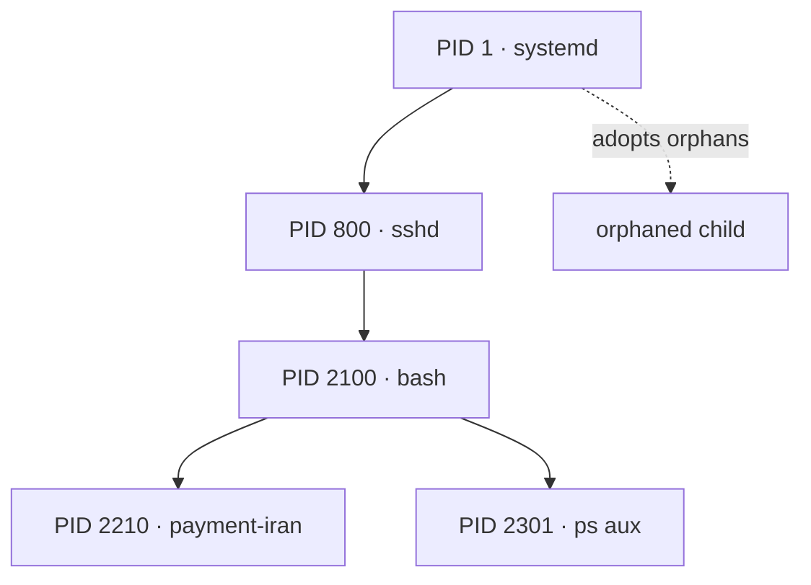
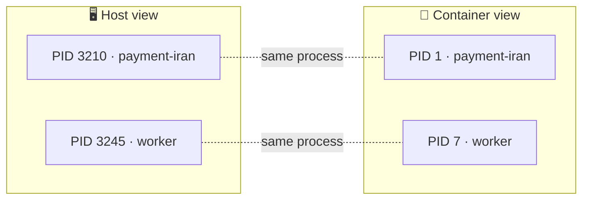
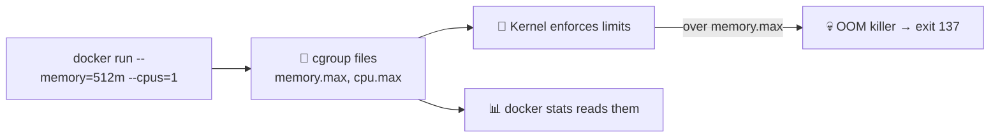
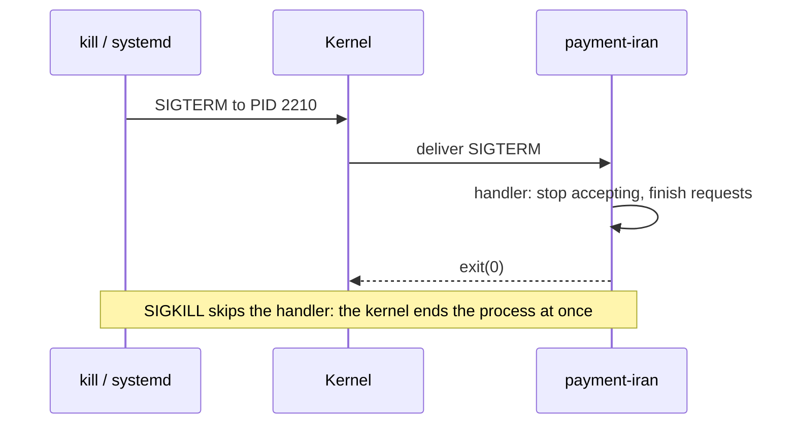
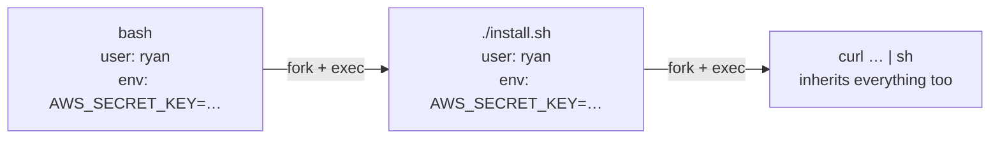
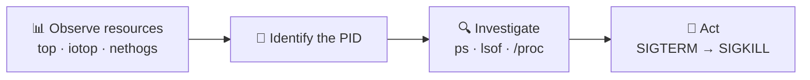

# ⚙️ Working with Processes

[[Linux/The Software Developer’s Guide to Linux/README|🐧 SDGL]] · Ch.2 · pp. 21–36

📘 Merged into the Linux Handbook: [[Linux/Linux Handbook/10. Processes and Signals|10. Processes and Signals]] · [[Linux/Linux Handbook/6. Environment Variables and Shell Startup|6. Environment Variables and Shell Startup]]

> [!toc]- 📑 Contents
>
> - [[#⚙️ What a Process Is]]
> - [[#🧬 Process Attributes]]
> - [[#💻 Commands for Inspecting Processes]]
> - [[#📡 Signals]]
> - [[#🔫 The kill Command]]
> - [[#🗂️ /proc and lsof]]
> - [[#🧬 Inheritance (fork)]]
> - [[#🚑 Troubleshooting Session]]
> - [[#🔨 Hands-On Practice]]
> - [[#📋 Quick Reference]]

When our code runs, Linux hides its variables and threads behind one abstraction: the **process**. This chapter covers what a process carries, how to find and inspect one, and how to stop it safely.

---

## ⚙️ What a Process Is

A **program** is a file on disk. A **process** is that program while it runs: the kernel's record of it.

Everything that does work on Linux is a process: `ls`, nginx, our Go service, and the shell we type into.

The kernel tracks, for each process:

- 🧠 **Memory** it uses.

- ⏱️ **CPU time** it has used.

- 💾 **Other resources**: open files, disk and network I/O.

- 📡 **Communication** with other processes (signals, pipes).

- 👪 **Related processes** it started.

As developers we lose the inside view (variables, functions) and get an outside set of gauges instead: PID, state, CPU, and memory.

```bash
ps aux
```

Illustrative output:

```text
USER   PID %CPU %MEM    VSZ   RSS TTY   STAT START  TIME COMMAND
root     1  0.0  0.1 168000 12000 ?     Ss   09:00  0:02 /sbin/init
ryan  2210  0.3  0.6 712000 48000 ?     Sl   09:15  0:05 ./payment-iran
ryan  2301  0.0  0.0  10000  3500 pts/0 R+   09:20  0:00 ps aux
```

`ps aux` lists every process we're allowed to see. The columns are the attributes below.

---

## 🧬 Process Attributes

### 🔢 PID: process ID

Every process gets a unique integer when it starts, the next free number. Like a primary key in a database table, the **PID** is how we refer to a process in every command.

- 🌱 **PID 1 is init**, the first process the kernel starts. It boots the rest of the system and is the ancestor of every other process.

    - On most Linux distros, init is **systemd**. macOS uses `launchd`; older systems used SysV init.

    - Init can't be killed, not even by root.

### 👪 PPID: parent process ID

Every process (except init) was started by a parent.

- 👶 **Orphan:** if the parent dies first, the child is **re-parented to PID 1**.

- 🧟 **Zombie:** a child that has *finished* but whose parent hasn't collected its exit status yet. It uses no CPU or memory, only a PID entry. Fix the parent, not the zombie.



### 🚦 STAT: process state

From `man ps`:

| Code | State |
|---|---|
| `R` | Running or ready to run |
| `S` | Sleeping, waiting for an event (most processes) |
| `D` | Uninterruptible sleep, usually waiting on disk I/O |
| `T` | Stopped (e.g. `Ctrl+Z`) |
| `t` | Stopped by a debugger |
| `I` | Idle kernel thread |
| `Z` | Zombie: finished, not yet reaped by its parent |
| `X` | Dead (should never be seen) |

Extra characters add detail: `s` = session leader, `l` = multithreaded, `+` = foreground, `<` / `N` = high / low priority.

> 💡 Many processes stuck in `D` usually point to slow disks or a hung network mount, not a CPU problem.

### 🔐 EUID and EGID: who the process runs as

The **effective user and group** decide what the process may do.

If file permissions are a lock, the process's user and group are the key. A process running as `www-data` can only read files `www-data` is allowed to read. This shows up as the `USER` column in `ps`.

### 🌿 Environment variables

The environment that starts a process passes it key–value settings, such as `LOG_LEVEL=debug` or `DATABASE_URL=...`.

In Go:

```go
home := os.Getenv("HOME")
fmt.Println("Home directory:", home)
```

```text
Home directory: /home/ryan
```

### 📁 Working directory

Every process has a **current working directory**, just like the shell (which is a process too). Relative paths inside the program resolve from it.

> ⚠️ A service started by systemd usually runs with `/` as its working directory. Code that opens `config.yaml` by relative path works in our terminal but fails as a service. Use absolute paths or a flag.

### 🎚️ Also tracked

- **Niceness:** priority; how willing the process is to let others go first.

- **Memory map** and **resource usage:** `VSZ` (virtual memory reserved) and `RSS` (physical memory actually in use).

### 🐳 PIDs inside containers

Containers use **PID namespaces**. Inside the container, our app sees itself as PID 1. On the host, the same process has an ordinary PID, such as 3210.



The host can see container processes; the container can't see the host's.

---

### 🧪 Interview Q&A

**Q1:** What's the difference between a program and a process?

**Q2:** What happens to a child process when its parent dies?

**Q3:** A server shows dozens of `Z` processes. Is it safe to `kill -9` them?

**Q4:** Our Go service reads `./config.yaml` fine in the terminal but fails under systemd. Why?

> [!answer]- 📋 Answers
>
> **A1:** A program is an executable file on disk. A process is a running instance of it, with a PID, memory, an owner, and an environment.
>
> **A2:** It becomes an orphan and is re-parented to init (PID 1).
>
> **A3:** It won't help: zombies are already dead. Their parent isn't reaping them. Fix or restart the parent, and init will reap them.
>
> **A4:** The working directory differs. Under systemd it's usually `/`, so the relative path points to `/config.yaml`.

---

## 💻 Commands for Inspecting Processes

### 📋 `ps`: snapshot of processes

```bash
ps aux | head -n 10    # first 10 lines
ps -ejH                # tree: children indented under parents
ps -eLf                # one line per thread
```

- 🔭 **Beyond the book:** `ps -ef --forest` and `pstree -p` draw the parent/child tree more clearly.

### 🔎 `pgrep`: find PIDs by name

```bash
pgrep payment          # PIDs whose name matches (regex)
pgrep -a payment       # PIDs plus full command line
pgrep -u www-data      # all processes of a user
```

`pgrep` replaces the old `ps aux | grep name` habit, which also matches the `grep` process itself.

### 📊 `top`: live resource view

```bash
top
```

Updates every second, sorted by CPU by default.

- 📈 **Header** → load average, total CPU and memory.

- 🔝 **First rows** → the biggest consumers.

- ⌨️ **Keys** → `M` sort by memory, `P` by CPU, `k` send a signal, `q` quit.

- 🔭 **Beyond the book:** `htop` is a friendlier version with colors and a tree view.

### 💾 `iotop` and 🌐 `nethogs`

| Tool | Like `top`, but for | Install |
|---|---|---|
| `iotop` | Disk I/O per process | `sudo apt install iotop` |
| `nethogs` | Network traffic per process | `sudo apt install nethogs` |

Both usually need `sudo`.

### 🐳 Resources used by a container

🔭 **Beyond the book.** A container isn't a VM. Its processes are ordinary host processes, isolated with **namespaces** (what it can *see*) and limited by **cgroups** (what it can *use*). So we can check its resources at three levels:

**1. The container tool (everyday way)**

```bash
docker stats                    # live: CPU %, memory/limit, net I/O, block I/O, PIDs
docker stats --no-stream        # one snapshot, then exit (good for scripts)
docker stats <name>             # one container
docker top <name>               # processes inside it, like ps
```

Podman has the same commands (`podman stats`, `podman top`).

**2. Normal process tools from the host**

```bash
docker inspect --format '{{.State.Pid}}' <name>   # host PID of the container's PID 1
top -p <pid>                                      # watch just that process
grep VmRSS /proc/<pid>/status                     # real memory in use
```

**3. The source: cgroups** (what `docker stats` reads underneath)

```bash
systemd-cgtop    # live view of every cgroup, containers included
```

Raw files (cgroup v2) live under `/sys/fs/cgroup/system.slice/docker-<full-id>.scope/`:

| File | What it tells us |
|---|---|
| `memory.current` | Memory in use right now (bytes) |
| `memory.max` | Memory limit (`max` = no limit) |
| `cpu.stat` | CPU time used and how often it was throttled |
| `pids.current` | Number of processes |



> ⚠️ `top` or `free` **inside** a container usually shows the **host's** total memory and CPUs, not the container's limit, because `/proc/meminfo` isn't namespaced. Check the cgroup files or `docker stats` from outside.

---

## 📡 Signals

**Signals** are small numbered messages sent to a process. They're how we ask a process to stop, reload its config, or die immediately.

Common uses:

- 🛑 **Graceful shutdown:** "finish your writes, close files, then exit."

- 🔄 **Reload:** "re-read your config file" without restarting.

- 💥 **Errors:** the kernel sends `SIGSEGV` on a segmentation fault.

- 🤝 **Coordination:** one process tells another it's done with a task.

### 🪤 Trapping

A process can **trap** (catch) most signals and run a handler, like catching an exception. That's how a server cleans up on shutdown.

```go
sig := make(chan os.Signal, 1)
signal.Notify(sig, syscall.SIGTERM, syscall.SIGINT)

<-sig                // block until a signal arrives
server.Shutdown(ctx) // finish in-flight requests, then exit
```



### 🧾 Signals to know

| Signal | No. | Meaning | Trappable |
|---|---|---|---|
| `SIGHUP` | 1 | "Hang up". Many daemons treat it as **reload config** (nginx) | ✅ |
| `SIGINT` | 2 | Interrupt. What `Ctrl+C` sends | ✅ |
| `SIGKILL` | 9 | **Kill now.** No cleanup | ❌ |
| `SIGUSR1` / `SIGUSR2` | 10 / 12 | App-defined. nginx uses `USR1` to **reopen log files** after rotation | ✅ |
| `SIGTERM` | 15 | **Please terminate.** Default for `kill` | ✅ |
| `SIGSTOP` / `SIGCONT` | 19 / 18 | Pause / resume (`Ctrl+Z` sends the trappable `SIGTSTP`) | ❌ / ✅ |

Signal numbers above are for Linux on x86/ARM; macOS uses different numbers for some (such as `USR1` = 30). Use **names** to avoid confusion.

```bash
kill -l          # list all signals with their numbers
man 7 signal     # full descriptions
```

---

## 🔫 The kill Command

Despite its name, `kill` **sends any signal**. By default it sends `SIGTERM` (15), a polite request.

```bash
kill 2600              # SIGTERM: please exit cleanly
kill -HUP 2600         # reload config (same as kill -1)
kill -9 2600           # SIGKILL: last resort
pkill payment-iran     # by name instead of PID
```

The safe order:

1. 🙏 **Send `SIGTERM`** and wait a few seconds.

2. 🔎 **Check** with `pgrep` whether it's still running.

3. 💥 **Only then `SIGKILL`.**

> ⚠️ `SIGKILL` gives the process no chance to flush writes or close files, so it can corrupt data. Use it only when `SIGTERM` didn't work.

> 💡 `docker stop` and `systemctl stop` follow the same pattern: `SIGTERM`, a timeout, then `SIGKILL`.

---

## 🗂️ /proc and lsof

### 📂 `/proc`: live process data as files

`/proc` is a **virtual filesystem**. Nothing in it is stored on disk; the kernel generates the contents when we read them. Each process has a directory `/proc/<PID>/`.

```bash
cat /proc/2210/cmdline | tr '\0' ' '   # full command line
ls -l /proc/2210/cwd                   # working directory
tr '\0' '\n' < /proc/2210/environ      # environment variables
ls -l /proc/2210/fd                    # open file descriptors
```

`ps`, `top`, and friends read their data from `/proc` and show only part of it.

### 📎 `lsof`: list open files

A **file handle** (file descriptor) is a process's reference to an open file. Leaking handles causes "too many open files" errors and odd behavior.

```bash
sudo lsof -p 2210
```

For an nginx process, the list includes:

- 📁 **`cwd`** → its working directory.

- ⚙️ **Its own binary** (`/usr/sbin/nginx`) and shared libraries in `/usr/lib/`.

- 📝 **Log files** it writes to.

- 🌐 **Sockets** (Unix, IPv4, IPv6) it listens on.

On Linux, **network sockets are files too**, so the same tools work for both.

- 🔭 **Beyond the book:** `sudo lsof -i :8080` shows which process holds port 8080, the fastest fix for "address already in use".

---

## 🧬 Inheritance (fork)

Every process except init is created by a parent that **copies itself** (`fork`) and then usually loads a new program (`exec`).

The child **inherits** the parent's user, environment variables, and working directory.



That's convenient, but it's also a security risk:

- 🔐 **Run something with `sudo`**, and every child it spawns also runs as root.

- 🌿 **Secrets in env vars** are passed down to every child.

> 💡 **Real-World Example**
>
> A web server starts as root to bind port 80, with cloud keys in its environment. Its worker processes need neither.
>
> Well-behaved servers (nginx, for example) **drop privileges** to a normal user and **clear sensitive variables** before starting workers.

---

## 🚑 Troubleshooting Session

**Symptom:** a server is suddenly very slow.

1. 📊 **Look at resource usage.**

   ```bash
   top
   ```

   The first row shows `bzip2`, PID `1763`, at 94% CPU. So the problem is **CPU**, and we have a PID.

2. 🙏 **Ask it to stop.**

   ```bash
   kill 1763
   ```

3. 🔎 **Check after a few seconds.**

   ```bash
   pgrep bzip2
   ```

   It still prints `1763`, so the process ignored or is still handling `SIGTERM`.

4. 💥 **Force it.**

   ```bash
   kill -9 1763
   ```

   ✅ `pgrep bzip2` prints nothing, and load drops.

This is the most common troubleshooting pattern:



Pick the observation tool that matches the resource: `top` for CPU and memory, `iotop` for disk, `nethogs` for network.

---

### 🧪 Interview Q&A

**Q1:** What's the difference between `SIGTERM` and `SIGKILL`?

**Q2:** Which signal does `kill 1234` send?

**Q3:** How does nginx reload its configuration without dropping connections?

**Q4:** "Address already in use" on port 8080. How do we find the culprit?

**Q5:** Why is running an installer with `sudo` riskier than it looks?

> [!answer]- 📋 Answers
>
> **A1:** `SIGTERM` (15) asks the process to exit and can be trapped for cleanup. `SIGKILL` (9) can't be trapped; the kernel ends the process immediately.
>
> **A2:** `SIGTERM` (15).
>
> **A3:** It traps `SIGHUP`, re-reads its config, and starts new workers while old ones finish their requests.
>
> **A4:** `sudo lsof -i :8080` (or `ss -ltnp`), then signal that PID.
>
> **A5:** Every child process inherits root privileges and the environment, including anything the installer downloads and runs.

---

## 🔨 Hands-On Practice

1. 🌳 **See your own process tree.**

   ```bash
   echo $$                  # PID of the current shell
   ps -ejH | less           # find it, and its parent
   ```

   ✅ The shell's parent is the terminal or `sshd`, and the chain ends at PID 1.

2. 📡 **Trap a signal.**

   ```bash
   bash -c 'trap "echo got TERM; exit 0" TERM; while true; do sleep 1; done' &
   kill %1            # sends SIGTERM to the background job
   ```

   ✅ It prints `got TERM` and exits. Repeat with `kill -9 %1`: no message, because `SIGKILL` can't be trapped.

3. 🗂️ **Explore `/proc` and `lsof`.**

   ```bash
   sleep 300 &
   PID=$!
   ls -l /proc/$PID/cwd
   tr '\0' '\n' < /proc/$PID/environ | head
   lsof -p $PID
   kill $PID
   ```

   ✅ The `cwd` and environment match the shell that started `sleep`, which shows inheritance.

4. 🐳 **Optional: container PIDs.**

   ```bash
   docker run -d --name pidtest alpine sleep 300
   docker exec pidtest ps
   ps aux | grep "sleep 300"
   docker rm -f pidtest
   ```

   ✅ Inside, `sleep` is PID 1; on the host, it has a normal PID.

---

## 📋 Quick Reference

| Command | Purpose |
|---|---|
| `ps aux` | All processes, with user, CPU, memory, state |
| `ps -ejH` · `pstree -p` | Parent/child tree |
| `pgrep -a name` | Find PIDs by name |
| `top` · `htop` | Live CPU and memory view |
| `sudo iotop` · `sudo nethogs` | Live disk / network per process |
| `kill PID` | `SIGTERM`: ask to exit |
| `kill -HUP PID` | Reload config (for many daemons) |
| `kill -9 PID` | `SIGKILL`: last resort |
| `pkill name` | Signal by name |
| `kill -l` · `man 7 signal` | List signals |
| `ls -l /proc/PID/{cwd,fd}` | Working dir, open files |
| `sudo lsof -p PID` · `sudo lsof -i :PORT` | Open files · who holds a port |

## 🧠 Things to Remember

- A **process** is a running program, identified by its **PID**. PID 1 is init (systemd).

- Orphans go to PID 1. **Zombies** are finished processes whose parent hasn't reaped them.

- **`kill` sends `SIGTERM` by default**. `SIGKILL` can't be trapped and skips cleanup.

- Children **inherit** user, environment, and working directory from their parent.

- **`/proc`** is the source of truth that `ps`, `top`, and `lsof` read from.

## 💡 Pro Tips

- **Always handle `SIGTERM` in services.** Docker, Kubernetes, and systemd all send it first; a Go service that ignores it gets `SIGKILL`ed mid-request.

- **Use signal names, not numbers** (`kill -HUP`), because numbers differ across platforms.

- **Use `pgrep -a` instead of `ps aux | grep`**: it's shorter and doesn't match itself.

- **Check for `D` states before blaming CPU**: high load with idle CPU often means stuck I/O.

## 🔗 Related Topics

- ⬅️ Previous: [[1. How the Command Line Works]]

- ➡️ Next: [[3. Service Management with systemd]] (PID 1 and long-running services)

- [[DevOps/NaNa/Docker/1. Container]]

- [[DevOps/Server Administration/6. Memory Swap and Resource Limits]]
