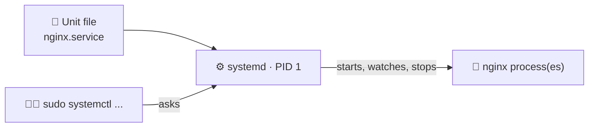
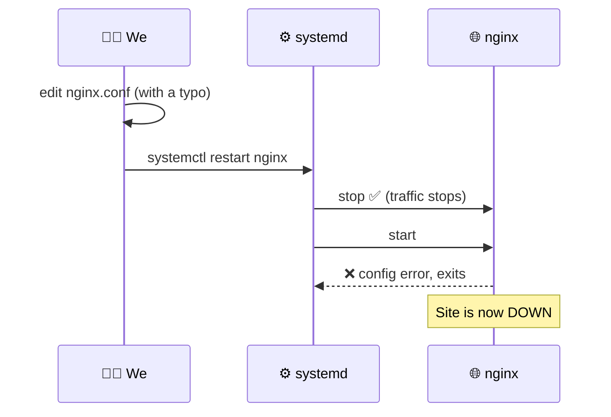
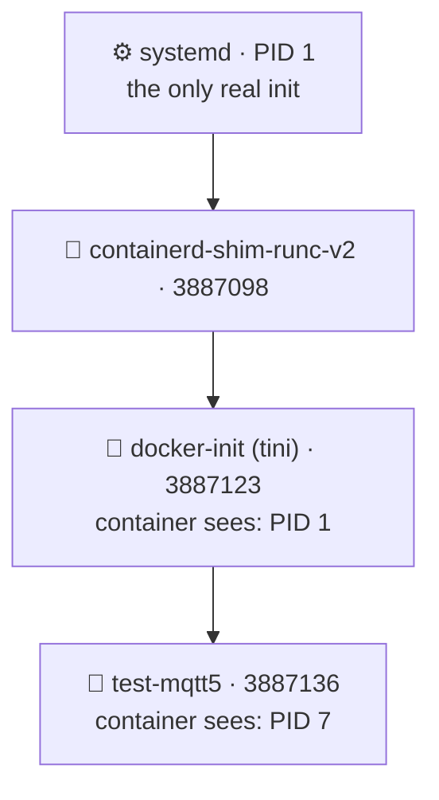

# 🛠️ Service Management with systemd

[[Linux/The Software Developer’s Guide to Linux/README|🐧 SDGL]] · Ch.3 · pp. 37–44

📘 Merged into the Linux Handbook: [[Linux/Linux Handbook/11. systemd, Services, and Timers|11. systemd, Services, and Timers]] · [[Linux/Linux Handbook/10. Processes and Signals|10. Processes and Signals]]

> [!toc]- 📑 Contents
>
> - [[#🌱 init: The First Process]]
> - [[#📦 Processes vs. Services]]
> - [[#🩺 systemctl status]]
> - [[#▶️ Start, Stop, Restart]]
> - [[#🔄 Reload: the Safer Restart]]
> - [[#⏰ Enable and Disable]]
> - [[#🐳 Containers and init]]
> - [[#🚑 Troubleshooting Session]]
> - [[#🔨 Hands-On Practice]]
> - [[#📋 Quick Reference]]

Some programs run, do their job, and exit. Others, such as nginx, Postgres, `sshd`, and our Go API, have to keep running in the background. This chapter answers: **who starts those long-running programs, keeps them alive, and lets us control them?** On most Linux systems, the answer is **systemd**, which we control with **`systemctl`**.

---

## 🌱 init: The First Process

A **service** (also called a **daemon**) is a long-running background process: a database, a web server, the network manager, our Go API.

Something has to start all of them at boot. That's **init**, short for *initialization*:

- 🥇 It's the **first process** the kernel starts, so it's always **PID 1**.

- 🚀 It runs the boot process and starts every service configured to run.

- 👶 It **adopts orphans**: when a process's parent dies, the process is re-parented to PID 1 (see [[2. Working with Processes#👪 PPID: parent process ID]]).

"init" is a role, not one program. Several **init systems** can fill it, and only one runs at a time:

| Init system | Where we'll see it |
|---|---|
| **systemd** | Ubuntu, Debian, Fedora, RHEL, Arch: almost every modern distro |
| **SysV init** | Older Linux and many traditional Unix systems |
| **OpenRC** | Alpine and Gentoo (on a real boot, not in a container) |

The init system decides how services are defined and managed, so everything in this note applies to **systemd only**.

```bash
ps -p 1 -o pid,comm
```

On our Ubuntu server this prints `1 systemd`.

systemd comes with two main tools:

- ⚙️ **`systemctl`**: controls services. Covered here.

- 📜 **`journalctl`**: reads logs. Covered in Ch.16.

> ⚠️ Managing **system** services changes the machine, so it needs root: prefix with `sudo`. Read-only commands like `systemctl status` work without it.

---

## 📦 Processes vs. Services

A **process** is a running program. A **service** is **packaging around that program**, so the system can manage it.

The packaging is a **unit file**, the service's recipe. In systemd's terms a service is one kind of **unit** (others include timers, sockets, and mounts). A unit file can:

- 🏷️ Give the program a **simple name** (`nginx`, `payment-iran`).

- 🔗 Declare **dependencies and startup order** ("start after the network is up").

- 🌿 Set **environment variables** and the **working directory**.

- 🔐 Choose the **user** it runs as and its **permissions**.

- 📏 Limit **resources** (memory, CPU).

- 🔁 Say what to do when it **crashes** (restart it, or not).



We don't run `nginx` ourselves. We ask systemd to run it, and systemd follows the unit file. We'll write our own unit file in Ch.10.

🔭 **Beyond the book:** to read the recipe of an existing service:

```bash
systemctl cat nginx
```

---

## 🩺 `systemctl status`

The first command to run when a service misbehaves:

```bash
systemctl status nginx
```

Illustrative output:

```text
● nginx.service - A high performance web server and a reverse proxy server
     Loaded: loaded (/lib/systemd/system/nginx.service; enabled; preset: enabled)
     Active: active (running) since Mon 2026-11-16 09:12:03 UTC; 1 day ago
       Docs: man:nginx(8)
   Main PID: 1042 (nginx)
      Tasks: 3 (limit: 4558)
     Memory: 6.1M
        CPU: 1.240s
     CGroup: /system.slice/nginx.service
             ├─1042 "nginx: master process /usr/sbin/nginx -g daemon on; master_process on;"
             ├─1043 "nginx: worker process"
             └─1044 "nginx: worker process"

Nov 16 09:12:03 web1 systemd[1]: Starting nginx.service - A high performance web server...
Nov 16 09:12:03 web1 systemd[1]: Started nginx.service - A high performance web server...
```

Line by line:

| Line | What it tells us |
|---|---|
| **● nginx.service** | The unit name. The dot is green when running, red when failed |
| **Loaded** | The unit file was found and parsed. Also shows its path and whether it's **enabled** at boot |
| **Active** | `active (running)`, `inactive (dead)`, or `failed`, and **for how long** |
| **Docs** | Where the documentation is |
| **Main PID** | The main process. Child processes are listed under CGroup |
| **Tasks / Memory / CPU** | Resource usage so far |
| **CGroup** | The **control group** holding every process of this service |
| **Log lines** | The last few log lines: often the error message itself |

Two things worth noticing:

- 🕐 **"since … ago" is a free clue.** If it says `3s ago` but we never restarted it, the service is crash-looping.

- 🧺 **The cgroup is how systemd tracks the whole service.** Even if nginx forks workers, systemd knows every process that belongs to it and can stop all of them. That's the same kernel feature Docker uses to limit container resources.

When a service has **failed**, `status` usually shows the exit code and the error. For more history: `journalctl -u nginx` (Ch.16).

---

## ▶️ Start, Stop, Restart

```bash
sudo systemctl start nginx     # start it now
sudo systemctl stop nginx      # stop it now
sudo systemctl restart nginx   # stop, then start
```

- ✅ **`start` and `stop` are idempotent.** Starting a running service, or stopping a stopped one, does nothing.

- 📡 **`stop` sends `SIGTERM` first**, then `SIGKILL` if the process doesn't exit in time (90 s by default). Same rule as `docker stop` and Kubernetes: a Go service should handle `SIGTERM` and shut down cleanly.

- 🔁 **`restart` = `stop` + `start`.**

### ⚠️ The restart trap



`restart` doesn't check the new config first. It stops a healthy service, then fails to start it again. **Validate the config before restarting:**

```bash
sudo nginx -t && sudo systemctl restart nginx
```

`nginx -t` tests the config on disk. The `&&` means the restart only runs if the test passes. Many programs have a similar check (`sshd -t`, `apachectl configtest`).

---

## 🔄 Reload: the Safer Restart

```bash
sudo systemctl reload nginx
```

A **reload** asks the running process to re-read its config **without stopping**. A well-implemented reload:

- 🔍 **Validates** the new config first.

- 🧠 **Loads it into memory** while the process keeps serving.

- 🛡️ Keeps the old config running if the new one is broken.

For nginx, `reload` sends **`SIGHUP`** to the master process, the same `kill -HUP` from [[2. Working with Processes#📡 Signals]].

Reload is a **convention, not a guarantee**. It depends on whoever wrote the unit file:

- ❌ Some services don't support `reload` at all, and the command fails.

- 🤷 Some skip the validation step.

- 🎲 Some do something unexpected.

**Rule:** after a config change, especially in production, **prefer `reload` over `restart`**.

🔭 **Beyond the book:** `sudo systemctl reload-or-restart nginx` reloads if the service supports it, and restarts otherwise.

> ⚠️ **Don't confuse it with `daemon-reload`.** `sudo systemctl daemon-reload` makes **systemd itself** re-read the **unit files**. Run it after editing a `.service` file. It doesn't touch the app's own config.

---

## ⏰ Enable and Disable

- **`start` / `stop`** affect the service **now**.

- **`enable` / `disable`** affect it at the **next boot**.

```bash
sudo systemctl enable nginx    # start automatically at boot
sudo systemctl disable nginx   # back to manual only
```

The classic mistake: **`enable` does not start the service.** To run nginx now *and* after every reboot, we need both:

```bash
sudo systemctl start nginx
sudo systemctl enable nginx

# or, in one command:
sudo systemctl enable --now nginx
```

`disable --now` also stops it.

| | Running now? | Starts at boot? |
|---|---|---|
| `start` | ✅ | unchanged |
| `enable` | unchanged | ✅ |
| `enable --now` | ✅ | ✅ |
| `stop` | ❌ | unchanged |
| `disable` | unchanged | ❌ |
| `disable --now` | ❌ | ❌ |

🔭 **Beyond the book:** quick yes/no checks, handy in scripts:

```bash
systemctl is-active nginx    # active / inactive / failed
systemctl is-enabled nginx   # enabled / disabled
```

---

## 🐳 Containers and init

The book says Alpine Linux uses **OpenRC**. But in an Alpine container on our server, `ps aux` shows no OpenRC at all:

```text
/ $ ps aux
PID   USER     TIME  COMMAND
    1 app       0:01 /sbin/docker-init -- /test-mqtt5 --config ...
    7 app       0:25 /test-mqtt5 --config ...
```

Both are true. **The init system belongs to a booted machine, and a container never boots.**

### 🖥️ Alpine the OS vs. 🐳 the Alpine image

| | Alpine on a VM / bare metal | `alpine` Docker image |
|---|---|---|
| **Kernel** | Its own | The host's kernel, shared |
| **Boot** | Kernel starts `/sbin/init`, which hands off to OpenRC | No boot at all |
| **PID 1** | OpenRC's init | Whatever `ENTRYPOINT` / `CMD` says |
| **OpenRC installed?** | ✅ Yes | ❌ No (~8 MB: busybox, musl, apk) |

As the book says, **the container is the process**. There's no boot, and the container can't reach the host's systemd. So we **don't run systemctl or any service manager inside containers**: one container, one process, and the container itself is the service package.

Because of the PID namespace (see [[2. Working with Processes#🐳 PIDs inside containers]]), the first process in the container is numbered PID 1. It isn't an init system unless we put one there.

### 🐣 What `docker-init` is

`/sbin/docker-init` is **tini**, a tiny init that Docker injects when the container runs with `--init` (or `init: true` in Compose).

PID 1 has two special jobs that a normal app like our Go service doesn't do:

- 🧟 **Reap zombies.** Orphaned processes are re-parented to PID 1, which must `wait()` on them. If it doesn't, finished processes pile up as zombies.

- 📡 **Handle signals.** The kernel does **not** apply default signal actions to PID 1. An app with no `SIGTERM` handler ignores `docker stop`, waits out the 10-second timeout, and then gets `SIGKILL`ed.

tini does both of these: it forwards signals to the app, reaps zombies, and does nothing else. It provides init's essential job, but it isn't a service manager.

### 🔎 The real process tree on the host

Checked on the Ubuntu server (trimmed):

```text
$ ps -ef --forest | grep -B2 test-mqtt5
root   3887098       1  ... /usr/bin/containerd-shim-runc-v2 -namespace moby -id 856727a018cf...
10001  3887123 3887098  ...  \_ /sbin/docker-init -- /test-mqtt5 ...
10001  3887136 3887123  ...      \_ /test-mqtt5 ...
```



What this shows:

- 🔢 **Two numberings, same processes.** Host PID 3887123 is the container's PID 1, and 3887136 is its PID 7.

- 👪 **The shim's parent is systemd, not containerd.** The shim daemonizes and is re-parented to PID 1. This is deliberate: we can restart `containerd` or `dockerd` (for an upgrade, say) without killing running containers.

- 🧩 **The chain of responsibility:** systemd manages `docker.service` and `containerd.service`. They manage the container, and tini looks after the one app inside it.

Verify the rest:

```bash
# Was the container started with --init?
sudo docker inspect --format '{{.HostConfig.Init}}' <container>   # → true

# Inside the container: it's Alpine, but there's no OpenRC
ls /sbin/openrc* ; cat /etc/alpine-release   # → No such file · 3.22.8
```

### 🔭 Beyond the book: users are numbers

The same process shows as **`10001`** on the host and as **`app`** inside the container.

- The kernel stores only the numeric **UID** (10001).

- `ps` turns that number into a name by reading `/etc/passwd`.

- The container has its own `/etc/passwd` (from its own filesystem) with `app:x:10001:...`. The host's has no entry for 10001, so it prints the number.

Names are only a lookup. This comes back in Ch.7, Users and Groups.

---

### 🧪 Interview Q&A

**Q1:** We ran `sudo systemctl enable nginx` on a fresh server, but the site is down. Why?

**Q2:** What's the difference between `systemctl reload nginx` and `systemctl daemon-reload`?

**Q3:** Why is `restart` risky right after editing a config file, and what do we do instead?

**Q4:** Alpine uses OpenRC. Why isn't OpenRC running in an Alpine container?

**Q5:** Why might a Go service in a container ignore `docker stop` and only die after 10 seconds?

**Q6:** We restart `containerd` on a host. Do the running containers die?

> [!answer]- 📋 Answers
>
> **A1:** `enable` only configures start-at-boot; it doesn't start anything now. Run `sudo systemctl start nginx`, or use `enable --now` from the start.
>
> **A2:** `reload nginx` tells the **nginx process** to re-read **nginx's config** (via `SIGHUP`). `daemon-reload` tells **systemd** to re-read **unit files** after we edit a `.service` file.
>
> **A3:** `restart` stops the healthy service before trying the new config. If the config is broken, the start fails and the service stays down. Validate first (`nginx -t && …`) and prefer `reload`, which keeps the old config running if the new one fails.
>
> **A4:** An init system runs when a machine boots. A container doesn't boot: it shares the host kernel and starts only the `ENTRYPOINT`/`CMD` process as its PID 1. The `alpine` image doesn't even include OpenRC.
>
> **A5:** As PID 1, it gets no default signal actions. Without a `SIGTERM` handler, the signal is ignored until Docker sends `SIGKILL`. Fix: handle `SIGTERM` in code (`signal.NotifyContext`) or run with `--init`.
>
> **A6:** No. Each container's `containerd-shim` is re-parented to systemd and keeps running independently of `containerd`.

---

## 🚑 Troubleshooting Session

**Situation:** after a deploy, our API on the Ubuntu server returns 502 from nginx.

1. 🩺 **Is the service running?**

   ```bash
   systemctl status payment-iran
   ```

   `Active: activating (auto-restart)` and `since 4s ago` → it's crash-looping.

2. 📜 **Why is it failing?** The log lines in `status` show `open ./config.yaml: no such file or directory`. For more lines: `journalctl -u payment-iran -n 50`.

3. 🧠 **Find the cause.** Under systemd, the working directory is `/` unless the unit file sets one, so `./config.yaml` resolves to `/config.yaml` (see Ch.2, Q4). `systemctl cat payment-iran` confirms there's no `WorkingDirectory=`.

4. 🔧 **Fix and apply.** Add `WorkingDirectory=/opt/payment-iran` to the unit file (or use an absolute path in the app), then:

   ```bash
   sudo systemctl daemon-reload        # the unit file changed
   sudo systemctl restart payment-iran
   systemctl status payment-iran       # active (running), and the timer keeps growing
   ```

---

## 🔨 Hands-On Practice

> ⚠️ Practice on a VM or a non-production server. Stopping `sshd` or networking on a remote machine can lock us out.

1. 🌱 **Find init.**

   ```bash
   ps -p 1 -o pid,comm
   systemctl list-units --type=service --state=running
   ```

   ✅ PID 1 is `systemd`, and the second command lists every running service it manages.

2. 🩺 **Read a real status.** Pick one from the list, such as `cron` or `ssh`:

   ```bash
   systemctl status cron
   systemctl cat cron
   ```

   ✅ Identify Loaded, Active, Main PID, and CGroup. Find the `ExecStart=` line in the unit file.

3. ⏰ **Enable vs. start.** On a VM, with nginx installed:

   ```bash
   sudo systemctl disable --now nginx
   sudo systemctl enable nginx
   systemctl is-enabled nginx; systemctl is-active nginx
   sudo systemctl start nginx
   systemctl is-active nginx
   ```

   ✅ After `enable`: `enabled` but `inactive`. After `start`: `active`.

4. 🔄 **Reload vs. a broken restart.**

   ```bash
   systemctl status nginx | grep Main     # note the PID
   sudo systemctl reload nginx
   systemctl status nginx | grep Main     # same PID: no restart
   sudo nginx -t                           # after a deliberate typo in a test config: fails
   ```

   ✅ `reload` keeps the main PID. `nginx -t` catches a broken config before we restart. Remove the typo afterwards.

5. 🐳 **Optional: init in a container.**

   ```bash
   docker run -d --name inittest alpine sleep 300
   docker run -d --name inittest2 --init alpine sleep 300
   docker exec inittest ps; docker exec inittest2 ps
   docker rm -f inittest inittest2
   ```

   ✅ Without `--init`, `sleep` is PID 1. With it, `docker-init` is PID 1 and `sleep` is its child. Note how `docker rm -f` is instant for both, but `docker stop inittest` takes 10 s.

---

## 📋 Quick Reference

| Command | Purpose |
|---|---|
| `ps -p 1 -o comm` | Which init system is running |
| `systemctl status SVC` | State, PID, cgroup, last log lines |
| `sudo systemctl start` · `stop` · `restart SVC` | Control it now |
| `sudo systemctl reload SVC` | Re-read config without stopping |
| `sudo systemctl reload-or-restart SVC` | Reload if supported, else restart |
| `sudo systemctl enable` · `disable SVC` | Start at boot, or not |
| `sudo systemctl enable --now SVC` | Enable **and** start |
| `systemctl is-active` · `is-enabled SVC` | Yes/no checks for scripts |
| `systemctl list-units --type=service` | Loaded services |
| `systemctl --failed` | Failed units |
| `systemctl cat SVC` | Show the unit file |
| `sudo systemctl daemon-reload` | Re-read unit files after editing them |
| `journalctl -u SVC` | Logs for a service (Ch.16) |

## 🧠 Things to Remember

- **init** is PID 1: it boots the system, starts services, and adopts orphans. On most distros it's **systemd**.

- A **service** is a program packaged by a **unit file**: name, dependencies, environment, user, limits, restart policy.

- **`start`/`stop`** act now; **`enable`/`disable`** act at boot. `enable --now` does both.

- **`restart` can take a healthy service down** with a bad config. Validate first, and **prefer `reload`**.

- **Containers don't boot**, so they have no init system. PID 1 is the app, or tini with `--init`. The host's systemd is the only real init.

## 💡 Pro Tips

- **Check "since … ago" in `status`.** A few seconds means a crash loop.

- **Pair config edits with their validator**: `nginx -t && sudo systemctl reload nginx`.

- **Edited a `.service` file? Run `daemon-reload`**, or systemd keeps using the old version.

- **Run containers with `--init`** (or handle `SIGTERM` in Go) so `docker stop` is instant and zombies get reaped.

## 🔗 Related Topics

- ⬅️ Previous: [[2. Working with Processes]]

- ➡️ Next: [[4. Using Shell History]]

- 🔜 Writing our own unit file: Ch.10, Configuring Software · Logs with `journalctl`: Ch.16

- [[DevOps/NaNa/Docker/1. Container]]
