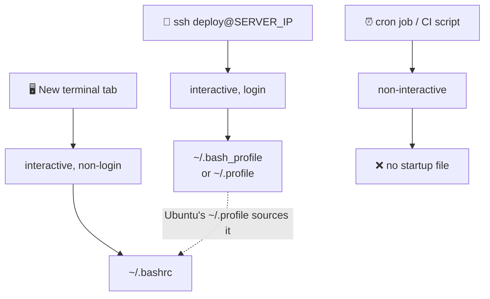

# 📜 Using Shell History

[[Linux/The Software Developer’s Guide to Linux/README|🐧 SDGL]] · Ch.4 · pp. 45–49

📘 Merged into the Linux Handbook: [[Linux/Linux Handbook/6. Environment Variables and Shell Startup|6. Environment Variables and Shell Startup]]

> [!toc]- 📑 Contents
>
> - [[#⬆️ Scrolling Through History]]
> - [[#⚙️ Shell Configuration Files]]
> - [[#💾 Where History Lives]]
> - [[#🔎 Searching with Ctrl-R]]
> - [[#🙈 Commands That Skip History]]
> - [[#❗ Rerunning Commands with !]]
> - [[#⌨️ Jumping Along the Line]]
> - [[#🧪 Q&A]]
> - [[#🔨 Hands-On Practice]]
> - [[#📋 Quick Reference]]

We type the same long commands again and again: `ssh` to the same server, `docker compose logs -f api`, soon `kubectl get pods -n payments`. This chapter answers: **how do we reuse what we already typed instead of typing it again?** The shell keeps a history, and a few keys make it fast.

---

## ⬆️ Scrolling Through History

- ⬆️ **Up** goes back one command, ⬇️ **Down** goes forward.

- ✏️ We can **edit** a recalled command with ⬅️ ➡️ before pressing Enter.

- ➕ The edited version is **added as a new entry** at the end. The original entry stays as it was.

---

## ⚙️ Shell Configuration Files

History settings live in the shell's startup file. The workflow for any change:

1. ✍️ Edit the file and save it.

2. 🆕 New terminals pick it up automatically.

3. 🔄 Terminals that are already open need `source ~/.zshrc` (or `~/.bashrc`).

| Shell | File | Read when |
|---|---|---|
| Bash | `~/.bashrc` | Every **interactive** shell: a new terminal tab, where a human types commands |
| Bash | `~/.bash_profile` (Ubuntu: `~/.profile`) | **Login** shells: a console login or an **SSH session** |
| zsh | `~/.zshrc` | Every interactive shell |

**Interactive** means a person is typing at a prompt. A script run by cron or a CI job is **not** interactive, so none of these settings apply to it.



> 💡 An alias missing after `ssh` usually has one of two causes. Either it lives only on our laptop (the server is another machine with its own home directory), or the login shell's file doesn't source `~/.bashrc` on that server.

---

## 💾 Where History Lives

While the shell runs, history is a list **in memory**. It's saved to a **history file** so the next session can use it.

```bash
echo $HISTFILE
```

- 🐚 **Bash:** `~/.bash_history` by default.

- 🐚 **zsh:** usually `~/.zsh_history`. On our machine it's set by oh-my-zsh.

Two limits stop history from growing forever. Both count **entries (lines)**, not bytes:

| Limit | Bash | zsh |
|---|---|---|
| Entries kept **in memory** for this session | `HISTSIZE` | `HISTSIZE` |
| Entries kept **in the file** between sessions | `HISTFILESIZE` | `SAVEHIST` |


To keep more history, raise **both** limits in the startup file:

```bash
# ~/.bashrc
HISTSIZE=10000
HISTFILESIZE=20000
```

- 🔎 **On our zsh,** `echo $HISTFILESIZE` prints nothing because zsh doesn't use that name. `echo $SAVEHIST` prints `10000`. oh-my-zsh's `lib/history.zsh` sets `HISTSIZE=50000` and `SAVEHIST=10000`.

- 🔭 **Beyond the book:** Bash writes the file only when the shell exits, and by default it **overwrites** the file. With two terminals open, the one that closes last wins. `shopt -s histappend` in `~/.bashrc` makes it append instead. zsh's `share_history` (on with oh-my-zsh) writes each command right away and shares it between open terminals.

---

## 🔎 Searching with `Ctrl-R`

Pressing ⬆️ two hundred times to find last week's `docker run` is slow. **Reverse search** finds it by typing part of it:

1. ⌨️ Press `Ctrl-R`. The prompt changes to `(reverse-i-search)` (zsh: `bck-i-search`).

2. 🔤 Type any part of the command: `compose logs`.

3. 🔁 Press `Ctrl-R` again to step to **older** matches.

4. ✅ `Enter` runs the match. `Esc` or `→` puts it on the line to edit first. `Ctrl-G` cancels.

5. ⏩ Went too far back? `Ctrl-S` searches **forward**. Many terminals freeze on `Ctrl-S` (an old flow-control feature: `Ctrl-Q` unfreezes), so add `stty -ixon` to the startup file to free that key.

> 💡 The match is the **most recent** command containing the text, anywhere in the line, not only at the start.

---

## 🙈 Commands That Skip History

Two kinds of command may not be saved:

- ❌ **Failed commands** (non-zero exit code), in some shells. Bash and zsh keep them by default.

- ␣ **Commands starting with a space**, when the shell is set up for it:
    - Bash: `HISTCONTROL=ignorespace` (Ubuntu's default `ignoreboth` includes it).
    - zsh: `setopt hist_ignore_space` (on with oh-my-zsh).

Either way, ⬆️ right away still recalls it. It's only dropped once we run the next command.

The leading space is a **security feature**: it keeps secrets out of the history file.

```bash
 export GITHUB_TOKEN=ghp_xxx    # leading space → not saved
```

> 🔒 **Isn't that a way to hide what we did?** Yes, but history was never an audit log. It's a file **we own**: `unset HISTFILE`, `history -c`, or editing the file also leave no trail. Real auditing happens where a user can't edit it: `sudo` logs (`journalctl _COMM=sudo`), `auditd` rules on `execve`, and logs shipped to another server (Ch.16).

---

## ❗ Rerunning Commands with `!`

`!` starts **history expansion**: the shell replaces `!…` with text from history **before** running the line. It's the same idea as `$VAR` or `*` expansion from Ch.1: the program never sees the `!`.

| Type | Becomes | Example |
|---|---|---|
| `!!` | The whole last command | `sudo !!` |
| `!ssh` | The last command **starting with** `ssh` | Reconnect to yesterday's server |
| `!$` | The **last argument** of the last command | `mkdir -p /opt/app/logs` then `cd !$` |

**The `sudo !!` classic:**

```bash
apt-get install nginx     # fails: permission denied
sudo !!                   # runs: sudo apt-get install nginx
```

> ⚠️ Don't make `sudo !!` a reflex. First ask **why** the command needs root, and whether we trust it to do anything on the system. For editing a root-owned file, `sudoedit` is safer than `sudo vim` (Ch.6).

**What we see after pressing Enter:**

- 🐚 **Bash** prints the expanded command, then runs it.

- 🐚 **zsh with `hist_verify`** (on with oh-my-zsh) **doesn't run it**. It puts the expanded command on the line, `cd /var/log`, and waits for us to check it and press Enter again. That's the "mysterious" `cd /var/log` from our session.

> 💡 `!ssh` runs whatever the last `ssh…` line was. If that's not the server we meant, we just connected somewhere else. `hist_verify` protects us here, and in Bash `!ssh:p` prints the match without running it.

🔭 **Beyond the book:** `Alt-.` inserts the last argument **as we type**, so we can see it before pressing Enter. Pressing it again cycles to older last arguments.

---

## ⌨️ Jumping Along the Line

| Key | Does |
|---|---|
| `Ctrl-A` | Jump to the **start** of the line (fix `sudo`, a typo in the command name) |
| `Ctrl-E` | Jump to the **end** of the line (add a flag) |

🔭 **Beyond the book:** `Ctrl-W` deletes the word before the cursor, and `Ctrl-U` deletes everything before it. These keys come from Emacs, Bash's default editing mode, and work in zsh, `psql`, `python`, and most other prompts. If we use tmux with a `Ctrl-A` prefix, press `Ctrl-A a` to send the key through.

---

## 🧪 Q&A

**Q1:** An alias works in our laptop terminal but not after `ssh deploy@SERVER_IP`. Name two possible causes.

**Q2:** What's the difference between `HISTSIZE` and `HISTFILESIZE`? Why does `echo $HISTFILESIZE` print nothing in our zsh?

**Q3:** We ran `ls /var/log`, then `cd !$`. zsh showed `cd /var/log` and didn't run it. What happened?

**Q4:** Commands starting with a space aren't saved. Is that a security hole?

**Q5:** Two Bash terminals are open. We close A, then B. Whose commands are in `~/.bash_history`?

> [!answer]- 📋 Answers
>
> **A1:** The alias exists only in the laptop's `~/.bashrc`/`~/.zshrc`, and the server is a separate machine with its own files. Or it's in the server's `~/.bashrc`, but SSH starts a **login** shell that reads `~/.bash_profile`/`~/.profile`, and that file doesn't source `~/.bashrc`.
>
> **A2:** `HISTSIZE` is how many entries stay in memory for the current session. `HISTFILESIZE` is how many are kept in the history file between sessions. Both count entries, not bytes. zsh calls the file limit `SAVEHIST`, so `HISTFILESIZE` isn't set.
>
> **A3:** `!$` is history expansion: it became the last argument of the previous command, `/var/log`. oh-my-zsh turns on `hist_verify`, so zsh shows the expanded line for us to check, and waits for Enter.
>
> **A4:** No. History is a convenience file that the user owns and can already clear or turn off. Accountability comes from `sudo` logs, `auditd`, and remote logging, which the user can't edit. The space trick keeps tokens out of a plaintext file.
>
> **A5:** Mostly only B's. By default Bash overwrites the file on exit, so the last shell to close wins. `shopt -s histappend` makes each shell append instead.

---

## 🔨 Hands-On Practice

1. 💾 **Find our history setup.**

   ```bash
   echo $HISTFILE; echo $HISTSIZE; echo $SAVEHIST
   setopt | grep -i hist
   ```

   ✅ The file path, `50000`, `10000`, and options like `histignorespace`, `histverify`, `sharehistory`.

2. 🔎 **Search.** Press `Ctrl-R`, type `docker`, and press `Ctrl-R` a few more times. Press `→` to edit the match instead of running it.

   ✅ We step back through older `docker` commands.

3. ❗ **Expansion.**

   ```bash
   mkdir -p ~/sdgl-lab/ch4
   cd !$
   echo one two three
   echo !$
   ```

   ✅ zsh shows `cd ~/sdgl-lab/ch4`, then `echo three`, each waiting for Enter.

4. 🙈 **Leading space.** Run ` echo secret` (with a space), then `echo visible`. Then `history | tail -3`.

   ✅ `echo visible` is listed and `echo secret` isn't.

5. ⌨️ **Line editing.** Type `apt list --installed`, press `Ctrl-A`, type `sudo `, and press `Ctrl-E`.

---

## 📋 Quick Reference

| Key / command | Purpose |
|---|---|
| ⬆️ ⬇️ | Previous / next command |
| `Ctrl-R` · `Ctrl-S` | Search history backward · forward (`stty -ixon` first) |
| `!!` | The whole last command (`sudo !!`) |
| `!str` | The last command starting with `str` |
| `!$` · `Alt-.` | The last argument of the previous command |
| `Ctrl-A` · `Ctrl-E` | Start · end of the line |
| `Ctrl-W` · `Ctrl-U` | Delete the previous word · the line before the cursor |
| `echo $HISTFILE` | Where history is saved |
| `HISTSIZE` | Entries in memory |
| `HISTFILESIZE` (Bash) · `SAVEHIST` (zsh) | Entries in the file |
| ` command` (leading space) | Keep it out of history |
| `history` | List history |

## 🧠 Things to Remember

- History is a list **in memory**, saved to **`$HISTFILE`**. Both its limits count entries, not bytes.

- **`~/.bashrc`** is for interactive shells, **`~/.bash_profile`/`~/.profile`** for login shells such as SSH. Scripts and cron read neither.

- **`!` expansion happens before the command runs**, like `$VAR` and `*`. `hist_verify` lets us check it first.

- **`sudo !!` is fast but blind.** Know why root is needed.

- **History isn't an audit log.** A leading space keeps secrets out of it. Real auditing lives in `sudo` logs and `auditd`.

## 💡 Pro Tips

- **Prefix commands that contain a token with a space.** Check it worked: `history | tail -1`.

- **Use `Ctrl-R` with a distinctive word,** such as a namespace or a hostname, rather than the command name.

- **Turn on `histappend` in Bash** on servers, so parallel SSH sessions don't overwrite each other's history.

- 🔭 Optional: **`fzf`** replaces `Ctrl-R` with a fuzzy, full-screen search. Worth it once `kubectl` commands pile up.

## 🔗 Related Topics

- ⬅️ Previous: [[3. Service Management with systemd]]

- ➡️ Next: `5. Introducing Files`

- 📘 [[Linux/Linux Handbook/6. Environment Variables and Shell Startup|Handbook 6: Environment Variables and Shell Startup]] (startup files, `source`)

- [[1. How the Command Line Works]] (shell expansion)

- 🔜 `sudoedit` and `$EDITOR`: Ch.6 · Logs and auditing: Ch.16
