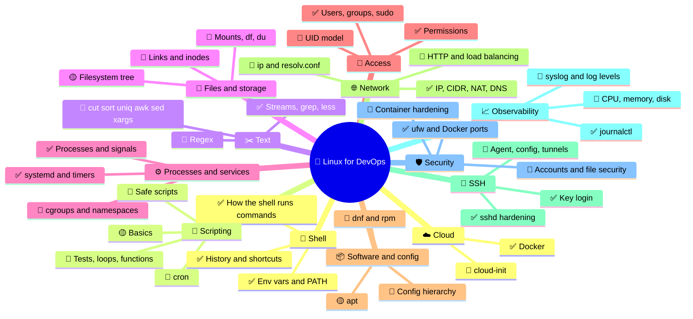

# 🐧 The Software Developer's Guide to Linux

> David Cohen & Christian Sturm · Packt · 17 chapters
>
> Studied with Claude, one chapter at a time. Rules: [[Linux/The Software Developer’s Guide to Linux/AI Prompt - SDGL|AI Prompt - SDGL]] · Note style: [[Linux/The Software Developer’s Guide to Linux/AI Prompt - linux beginner|AI Prompt - linux beginner]]
>
> 📘 **Unified notes:** every concept you study here is merged into the [[Linux/Linux Handbook/0. Linux Handbook|Linux Handbook]].
>
> 🎯 **Why this book:** Linux depth for the [[DevOps/NaNa/0. Nana DevOps Table of Contents|Nana DevOps course]]. Watched up to ep 106. Next is Kubernetes (eps 124–148); AWS is skipped for now. Read only what the [[#🧭 DevOps Linux Map|DevOps Linux Map]] lists.

> [!toc]- 📑 Contents
>
> - [[#📊 Progress|📊 Progress]]
> - [[#🗂️ Chapters|🗂️ Chapters]]
> - [[#🧭 DevOps Linux Map|🧭 DevOps Linux Map]]
> - [[#✅ What You Already Know|✅ What You Already Know]]
> - [[#📖 What to Learn|📖 What to Learn]]
> - [[#🐚 Shell Scripting Track|🐚 Shell Scripting Track]]
> - [[#🎯 What Each Nana Module Needs|🎯 What Each Nana Module Needs]]
> - [[#⏭️ Don't Read|⏭️ Don't Read]]
> - [[#📚 Books and Page Numbers|📚 Books and Page Numbers]]
> - [[#🗓️ Session Log|🗓️ Session Log]]
> - [[#❓ Open Questions|❓ Open Questions]]

---

## 📊 Progress

**Plan:** <progress value="49" max="174"></progress> `49 / 174 planned SDGL pages · 28%`

**Whole book:** `49 / 242 pages · 20%`. The plan skips 68 pages your Nana notes already cover.

**📍 Current position:** Ch.5, start (p. 51)

---

## 📖 Current Chapter: Ch.5 Introducing Files

<progress value="0" max="14"></progress> `0 / 14 planned pages` · 📖 51–53, 59–69 · skim 54–58 (not counted)

- [ ] Files on Linux: the absolute basics: p. 52
    - [ ] Plaintext files · What is a binary file?: p. 52
    - [ ] Line endings: p. 53
- [ ] The filesystem tree: p. 53
- [ ] _Skim:_ Basic filesystem operations (`ls`, `cd`, `touch`, `less`, `tail`, `mv`, `cp`, `mkdir`, `rm`): pp. 54–58
- [ ] Editing files: p. 59
- [ ] File types: p. 60
    - [ ] Symbolic links: p. 61
    - [ ] Hard links · The `file` command: p. 62
- [ ] Advanced file operations: p. 63
    - [ ] Searching file content with `grep`: p. 63
    - [ ] Finding files with `find`: p. 64
    - [ ] Copying files with `rsync`: p. 65
    - [ ] Combining `find`, `grep`, and `rsync`: p. 66
- [ ] Advanced filesystem knowledge for the real world: p. 67
    - [ ] FUSE: p. 68
- [ ] Conclusion: p. 69

---

## 🗂️ Chapters

Page numbers are the book's **printed** pages; add 31 for the PDF page. Progress counts only the **planned** pages.

**Plan:** 📖 read · ✂️ only the listed pages · ⏭️ skip (reasons in [[#⏭️ Don't Read|Don't Read]])

| # | Chapter | Pages | Plan | Progress | Note |
|---|---|---|---|---|---|
| 1 | How the Command Line Works | 1–20 | ✅ Done | <progress value="20" max="20"></progress> 20/20 ✅ | [[1. How the Command Line Works\|📝]] |
| 2 | Working with Processes | 21–36 | ✅ Done | <progress value="16" max="16"></progress> 16/16 ✅ | [[2. Working with Processes\|📝]] |
| 3 | Service Management with systemd | 37–44 | ✅ Done | <progress value="8" max="8"></progress> 8/8 ✅ | [[3. Service Management with systemd\|📝]] |
| 4 | Using Shell History | 45–49 | ✅ Done | <progress value="5" max="5"></progress> 5/5 ✅ | [[4. Using Shell History\|📝]] |
| 5 | Introducing Files | 51–69 | 📖 51–53, 59–69 · skim 54–58 | <progress value="0" max="14"></progress> 0/14 | |
| 6 | Editing Files on the Command Line | 71–80 | ✂️ 79–80 | <progress value="0" max="2"></progress> 0/2 | |
| 7 | Users and Groups | 81–91 | ✂️ 88–90 | <progress value="0" max="3"></progress> 0/3 | |
| 8 | Ownership and Permissions | 93–102 | ⏭️ Skip | — | |
| 9 | Managing Installed Software | 103–113 | ✂️ 103–107 | <progress value="0" max="5"></progress> 0/5 | |
| 10 | Configuring Software | 115–125 | 📖 All | <progress value="0" max="11"></progress> 0/11 | |
| 11 | Pipes and Redirection | 127–149 | 📖 All · L3 | <progress value="0" max="23"></progress> 0/23 | |
| 12 | Automating Tasks with Shell Scripts | 151–166 | 📖 All · L3 + 🐚 track | <progress value="0" max="16"></progress> 0/16 | |
| 13 | Secure Remote Access with SSH | 167–184 | 📖 167–171, 175–183 | <progress value="0" max="14"></progress> 0/14 | |
| 14 | Version Control with Git | 185–201 | ⏭️ Skip | — | |
| 15 | Containerizing Applications with Docker | 203–221 | ✂️ 203–205, 216–221 | <progress value="0" max="9"></progress> 0/9 | |
| 16 | Monitoring Application Logs | 223–233 | 📖 All · L3 | <progress value="0" max="11"></progress> 0/11 | |
| 17 | Load Balancing and HTTP | 235–251 | 📖 All | <progress value="0" max="17"></progress> 0/17 | |

---

## 🧭 DevOps Linux Map

What a DevOps engineer needs from Linux, and where you stand on each part.

**Legend:** ✅ you know it · 🟡 you know a little · 📖 to learn (see [[#📖 What to Learn|What to Learn]])

---

## ✅ What You Already Know

📘 All of this, merged and ordered, is in the [[Linux/Linux Handbook/0. Linux Handbook|Linux Handbook]].

| Area | What you know | From |
|---|---|---|
| 🐚 Command line | REPL, how the shell evaluates and finds a command, POSIX, paths, navigation, `man` | SDGL Ch.1 · Nana eps 10–11 |
| ⚙️ Processes | PID and PPID, EUID, environment, working directory, signals, `trap`, `kill`, `lsof`, inheritance, PID 1 in containers | SDGL Ch.2 |
| 🧩 systemd | init, units, `systemctl`, start vs. enable, `journalctl`, your own service, overrides, timers | SDGL Ch.3 · [[DevOps/NaNa/Linux/8. systemd and Services\|systemd note]] |
| ✂️ Streams | stdin, stdout, stderr, pipes, `grep`, `less`, `>`, `>>`, `2>&1` | [[DevOps/NaNa/Linux/1. Linux Pipes, `grep`, `less`, and Output Redirection\|Pipes note]] |
| ✏️ Vim | Modes, movement, editing, search and replace | [[DevOps/NaNa/Linux/2. Vim Cheat Sheet\|Vim note]] |
| 🌱 Environment | `export`, `~/.bashrc`, `source`, `PATH` | [[DevOps/NaNa/Linux/3. Environment Variables\|Env vars note]] |
| 👥 Users and groups | `/etc/passwd`, `useradd`, `usermod`, groups, `su` vs. `sudo` | [[DevOps/NaNa/Linux/4. Users and Groups\|Users note]] |
| 🔐 Permissions | `ls -l`, `chmod` symbolic and octal, `chown`, `umask`, special bits | [[DevOps/NaNa/Linux/5. Ownership and Permissions\|Permissions note]] |
| 🌐 Networking | IP, CIDR, gateway, NAT, ports, sockets, firewall, port forwarding, DNS | [[DevOps/NaNa/Linux/6. Networking Fundamentals\|Networking note]] |
| 🖥️ Server setup | No root logins, an admin with `sudo`, one user per service, SSH key login | [[DevOps/NaNa/Linux/7. Server Configuration\|Server note]] |
| 🛡️ Server hardening | Reading an audit by severity, how `sshd` reads its config, keys only and no root, `StrictModes` and key file permissions, fail2ban, attack surface, why Docker bypasses `ufw`, auditing exposed ports | [[DevOps/Server Administration/1. Develop Server Audit 2026-11-11\|Audit]] · [[DevOps/Server Administration/2. SSH Hardening and Brute Force\|SSH Hardening]] · [[DevOps/Server Administration/3. Firewalls and Docker Port Publishing\|Firewalls]] |
| 🐳 Beyond Linux | Docker and Compose, Git, Jenkins, Nexus and Gitea | Nana modules 3–8 |

**🟡 You know a little:**

- 📜 **Shell scripting:** Nana eps 17–19, no note yet. See the [[#🐚 Shell Scripting Track|Shell Scripting Track]].

- 📦 **Package manager (`apt`):** Nana ep 12 · [[Linux/Scatterd Learning/Package Manager]]

- 📁 **Filesystem tree (FHS):** Nana ep 9, no note.

- 🔑 **SSH on the client side:** key login and server hardening are ✅, but `ssh-agent`, `~/.ssh/config` and tunnels are not. Nana ep 22 · [[Linux/Scatterd Learning/SSH]]

---

## 📖 What to Learn

Work from top to bottom. SDGL is the spine. **C6** (CompTIA 6th ed.) and **B** (Linux Bible) items sit beside the chapter they extend.

Pages are printed pages, with the PDF page in brackets for C6 and B. ☸️ 📈 🏗️ 🤖 mark the Nana module the reading prepares you for.

📖 **Learn from the books, then 🛠️ apply.** The Server Administration notes are fix guides for your develop server, not lessons. Each 🛠️ line points to the one that puts that reading to work, once you understand the topic.

### 🅰️ Stage A: Alongside Kubernetes (now)

- [x] **SDGL Ch.4 Shell history** · pp. 45–49
    - `Ctrl-R`, `!!`, `!$`, `sudo !!`: faster everyday terminal work.

- [ ] **SDGL Ch.5 Files** · pp. 51–53, 59–69
    - Symlinks vs. hard links, inodes, `find`, `rsync`, FUSE.
    - ☸️ ConfigMap and Secret volumes update their files by swapping a symlink.
    - [ ] 🔭 C6 Ch.4 *Linking Files* · pp. 125–129 [PDF 141–145]: inode diagrams.

- [ ] **SDGL Ch.6, 7, 9: the short parts**
    - [ ] Ch.6 · pp. 79–80: `sudoedit` and `$EDITOR`. `kubectl edit` opens `KUBE_EDITOR` or `EDITOR`.
    - [ ] Ch.7 · pp. 88–90: a user is just a UID. ☸️ This is why `runAsUser: 1000` and `fsGroup` work with no matching user in `/etc/passwd`.
    - [ ] Ch.9 · pp. 103–107: the `apt` lifecycle and the risk of `curl | bash`. Helm's installer is one.

- [ ] **SDGL Ch.10 Configuring software** · pp. 115–125
    - Defaults → config file → env vars → command-line flags.
    - ☸️ The same layers become ConfigMaps, Secrets, `env:`, and `command`/`args` in a Pod spec.

- [ ] **SDGL Ch.11 Pipes and redirection** · pp. 127–149 · L3
    - `cut`, `sort`, `uniq`, `wc`, `tee`, `awk`, `sed`, `xargs`, file descriptors.
    - ☸️ `kubectl get pods | awk … | xargs kubectl delete pod`, and log triage.
    - [ ] 🔭 C6 Ch.7 *Pipes* · pp. 263–272 [PDF 279–288]: more `sed`, `awk`, `tr` and `xargs` examples.
    - [ ] 🔭 C6 Ch.3 *Regular Expressions* and *grep* · pp. 90–93 [PDF 106–109].

- [ ] **SDGL Ch.12 Shell scripts** · pp. 151–166 · L3
    - Then continue with the [[#🐚 Shell Scripting Track|Shell Scripting Track]].

- [ ] **SDGL Ch.13 SSH** · pp. 167–171, 175–183
    - Public-key crypto, `ssh-agent`, `-v` debugging, `scp` and `sftp`, tunnels, `~/.ssh/config`.
    - ☸️ A local tunnel is the same idea as `kubectl port-forward`. 🤖 Ansible does everything over SSH.

- [ ] **SDGL Ch.15 Docker, theory parts** · pp. 203–205, 216–221
    - Containers vs. VMs, image size, glibc vs. musl, namespacing, operating containers.
    - [ ] 🔭 B Ch.27 *Understanding Linux Containers* and *Namespaces* · pp. 664–666 [PDF 684–686]
    - [ ] 🔭 B Ch.6 *Limiting Processes with cgroups* · pp. 142–143 [PDF 174–175]
    - ☸️ `resources.limits` sets a cgroup. A container that goes over its memory limit is `OOMKilled`.
    - 🛠️ Apply: [[DevOps/Server Administration/4. Docker Daemon and Container Hardening|Docker Daemon and Container Hardening]]

- [ ] **SDGL Ch.16 Logs** · pp. 223–233 · L3
    - journald, syslog facilities and severity, Docker logging, structured logs.
    - ☸️ `kubectl logs` reads the container's stdout. On a node you run `journalctl -u kubelet`.
    - [ ] 🔭 C6 Ch.10 *Log File Administration* · pp. 399–408 [PDF 415–424]: rsyslog, journald storage, log rotation.

- [ ] **SDGL Ch.17 HTTP and load balancing** · pp. 235–251
    - 502, 503, 504, headers, HTTP versions, balancing methods, sticky sessions, `curl`.
    - ☸️ Services and Ingress are load balancers. A 503 from Ingress usually means no ready Pods.
    - 💡 If you reach eps 133–134 (Services, Ingress) first, read this chapter then.
    - 🛠️ Apply: [[DevOps/Server Administration/10. TLS HTTPS and Reverse Proxy Exposure|TLS, HTTPS and Reverse Proxy Exposure]]

### 🅱️ Stage B: Disks, performance, networking (before 📈 Prometheus, module 16)

- [ ] **Mounts:** B Ch.12 *Mounting Filesystems* · pp. 289–298 [PDF 319–328]
    - `mount`, `/etc/fstab`, swap. ☸️ A PersistentVolume is a mount on the node.
    - [ ] Optional: B Ch.12 *Logical Volume Manager* · pp. 284–289 [PDF 314–319]

- [ ] **Disk usage:** C6 Ch.5 *Monitoring Filesystems* · pp. 197–199 [PDF 213–215]
    - `df`, `du`, and running out of inodes before running out of space.
    - 🛠️ Apply: [[DevOps/Server Administration/7. Logs and Disk Space|Logs and Disk Space]]

- [ ] **CPU, memory, load:** C6 Ch.14 *Performance Monitoring* · pp. 618–627 [PDF 634–643]
    - `free`, `vmstat`, `iostat`, `mpstat`, `sar`, load average.
    - 📈 node-exporter turns these same numbers into Prometheus metrics.
    - 🛠️ Apply: [[DevOps/Server Administration/11. Monitoring and Health Checks|Monitoring and Health Checks]]

- [ ] **Memory problems:** B Ch.21 *Troubleshooting Memory* · pp. 525–531 [PDF 551–557]
    - Page cache, swap, the OOM killer.
    - 🛠️ Apply: [[DevOps/Server Administration/6. Memory Swap and Resource Limits|Memory, Swap, and Resource Limits]]

- [ ] **Network from the command line:** B Ch.14 · pp. 345–352 [PDF 373–380] and pp. 356–358 [PDF 384–386]
    - `ip addr`, `ip route`, `/etc/hosts`, `/etc/resolv.conf`, `/etc/nsswitch.conf`.
    - ☸️ Every Pod gets its own `/etc/resolv.conf` that points at the cluster DNS.

- [ ] **Network troubleshooting:** B Ch.21 *Troubleshooting Networking* · pp. 520–525 [PDF 546–551]
    - A checklist for outgoing and incoming connections.

### 🅲 Stage C: Automation and provisioning (before 🏗️ Terraform, 🐍 Python, 🤖 Ansible: modules 12–15)

- [ ] **Packages on every distro:** C6 Ch.11 *RPM*, *Debian Package Manager*, *Shared Libraries* · pp. 459–471 [PDF 475–487]
    - `dnf`/`rpm` vs. `apt`/`dpkg`. Amazon Linux and RHEL use `yum`/`dnf`, and Ansible has separate `apt` and `dnf` modules.
    - 🛠️ Apply: [[DevOps/Server Administration/5. Patching Reboots and Kernel Updates|Patching, Reboots and Kernel Updates]]

- [ ] **Scheduling:** C6 Ch.9 *Scheduling Commands* (`at`, `cron`) · pp. 376–383 [PDF 392–399]
    - You know systemd timers. Cron syntax is still everywhere, including Kubernetes CronJobs.

- [ ] **cloud-init:** B Ch.29 · pp. 699–704 [PDF 718–723]
    - 🏗️ Terraform's `user_data` is a script that cloud-init runs on the server's first boot.

- [ ] Optional: **Archives and backups:** C6 Ch.11 *Compression* and *tar* · pp. 432–447 [PDF 448–463]
    - 🛠️ Apply: [[DevOps/Server Administration/8. Backups and Restore|Backups and Restore]]

### 🅳 Stage D: Security (before Kubernetes RBAC and security, eps 143 and 146)

You already know SSH hardening and `ufw` with Docker from the Server Administration notes 1–3.

- [ ] **Accounts and files:** B Ch.23 *Securing user accounts* to *Managing software and services* · pp. 549–562 [PDF 573–586]
    - Locking and expiring accounts, password hashes, dangerous permissions (world-writable, SUID), updates.
    - 🛠️ Apply: [[DevOps/Server Administration/9. Secrets and File Permissions|Secrets and File Permissions]]

- [ ] Optional: **Firewalls on RHEL:** B Ch.26 *Working with Firewalls* · pp. 649–658 [PDF 671–680]
    - You know `ufw`. This adds `firewalld`, the default on Fedora and RHEL servers.

- [ ] Optional: C6 Ch.14 *Securing the Local Computer* · pp. 583–591 [PDF 599–607]

- [ ] 🏁 **Capstone:** 🛠️ [[DevOps/Server Administration/12. Production Readiness Checklist|Production Readiness Checklist]]: check your develop server against it once Stages A–D are done.

### 🧺 Later, if needed

- C6 Ch.8 *The Boot Process* and systemd initialization · pp. 323–343 [PDF 339–359]

- C6 Ch.4 *Access Control Lists* · pp. 143–144 [PDF 159–160]

---

## 🐚 Shell Scripting Track

You know a little from Nana eps 17–19. The goal is a script you would trust in a Jenkins `sh` step or as a container entrypoint. Read in this order, then work through the practice ladder.

### 📚 Read

1. [ ] **SDGL Ch.12** · pp. 151–166: variables, shebang, `set` options, `[[ ]]`, `(( ))`, loops, functions, `${}`.

2. [ ] **C6 Ch.7** *Shell Variables* and *Shell Scripts* · pp. 272–299 [PDF 288–315]: `read`, `case`, `&&` and `||`, special variables (`$?`, `$#`, `$@`), functions.
    - [ ] Its Review Questions and Hands-On Projects · pp. 309–322 [PDF 325–338].

3. [ ] **B Ch.7** *Writing Simple Shell Scripts* · pp. 145–162 [PDF 177–194]: more examples, and exercises at the end.

4. [ ] 🔭 **Beyond the books:** [BashPitfalls](https://mywiki.wooledge.org/BashPitfalls), and run `shellcheck` on every script you write.

### 🔨 Practice ladder

Practise in `~/sdgl-lab`, a VM or a container. Every script starts with `set -euo pipefail` and must pass `shellcheck`.

| # | Script | You practise | DevOps link |
|---|---|---|---|
| 1 | `sysinfo.sh`: hostname, uptime, disk use %, free memory, top 5 processes by memory | Variables, `$( )`, pipes | Server health at a glance |
| 2 | `healthcheck.sh URL [RETRIES]`: `curl` the URL, retry with a growing wait, exit 0 or 1 | Arguments, `if`, loops, exit codes | Jenkins smoke test, Kubernetes probes. Run it from a systemd timer |
| 3 | `logstats.sh access.log`: top 10 IPs, 4xx and 5xx counts, requests per hour | `awk`, `sort`, `uniq -c` | Log triage, thinking in metrics |
| 4 | `backup.sh SRC DEST`: timestamped `tar.gz`, keep the last 7, log with `logger` | Functions, `trap`, `find -mtime` | cron and timers, backups |
| 5 | `entrypoint.sh` for a Go service image: check required env vars, wait for the DB, then `exec "$@"` | `${VAR:?}`, `until` loops, `exec` | PID 1 and SIGTERM (SDGL Ch.2) in Docker and Kubernetes |
| 6 | `deploy.sh TAG`: pull, `docker compose up -d`, health check, roll back to the previous tag on failure | `set -e`, `trap`, functions | A Jenkins deploy stage |
| 7 | `bootstrap.sh`: create a user, install packages, add an sshd drop-in file; safe to run twice | Idempotency, `id`, `command -v` | Shows why Ansible exists (module 15) |
| 8 | `kclean.sh NAMESPACE`: list Pods that aren't `Running`, confirm, delete; add a `--dry-run` flag | `getopts`, `read`, `kubectl` output | During the Kubernetes module |

> ⚠️ Run scripts 6 and 7 against a local VM, not your develop server.

---

## 🎯 What Each Nana Module Needs

| Module | Eps | Linux it leans on | Read first |
|---|---|---|---|
| ☸️ 10 Kubernetes | 124–148 | Signals and PID 1 ✅, systemd ✅, DNS ✅, config layers, links and mounts, UIDs, text processing, logs, HTTP and load balancing, cgroups and namespaces | Stage A |
| ☁️ 9 AWS (later) | 109–123 | SSH key files (`chmod 400`), CIDR ✅, `~/.aws/config` and env vars, `user_data` | SDGL Ch.10, 12, 13 · B Ch.29 |
| ☸️ 11 EKS (later) | 149–159 | `~/.kube/config` and `KUBECONFIG`, scripted pipeline steps | SDGL Ch.10, 12 |
| 🏗️ 12 Terraform | 160–186 | `TF_VAR_*` env vars ✅, SSH keys, `user_data` scripts, provisioners over SSH | SDGL Ch.12, 13 · B Ch.29 |
| 🐍 13–14 Python | 187–225 | Shebang and `/usr/bin/env`, exit codes, `pip` and `PATH`, scheduled tasks, restarting services and servers | SDGL Ch.9, 12 · C6 Ch.9 |
| 🤖 15 Ansible | 226–250 | SSH agent, `known_hosts`, `~/.ssh/config`, `sudo` (become), `apt` vs. `dnf`, systemd ✅, permissions ✅, config files in `/etc` | SDGL Ch.10, 13 · C6 Ch.11 |
| 📈 16 Prometheus | 251–267 | What CPU, memory, disk and load numbers mean, HTTP `/metrics`, reload on `SIGHUP` ✅, logs | Stage B · SDGL Ch.16, 17 |

---

## ⏭️ Don't Read

- **SDGL:**
    - Ch.8: your [[DevOps/NaNa/Linux/5. Ownership and Permissions|Permissions note]] covers all of it and more (umask, special bits).
    - Ch.14: your [[DevOps/NaNa/Git NANA/0. Git Learning Path|Git notes]] go deeper.
    - Ch.6 nano and Vim (pp. 71–78), Ch.7 basics (pp. 81–87), Ch.9 compiling htop (pp. 108–112), Ch.13 key setup and SSH2 conversion (pp. 172–174), Ch.15 Docker crash course (pp. 206–215).

- **Linux Bible:** the desktop (Ch.2), installing (Ch.9), print, web, FTP, Samba and NFS servers (Ch.16–20), the AI chatbot (Ch.22), SELinux (Ch.25), building a small cloud (Ch.28). Skip Ansible (Ch.30) and Kubernetes (Ch.31) too: Nana goes deeper.

- **CompTIA 6th ed.:** intro and installing (Ch.1–2), server hardware, RAID and SAN (Ch.6), X Windows and localization (Ch.8), printers (Ch.10), DHCP, Samba, FTP and email services (Ch.13).

---

## 📚 Books and Page Numbers

| Short | Book | File in `Book/` | PDF page |
|---|---|---|---|
| **SDGL** | *The Software Developer's Guide to Linux* (Packt) | `SDGL/Packt.The.Software.Developers.Guide.to.Linux.pdf` | printed + 31 |
| **C6** | *CompTIA Linux+ and LPIC-1 Guide to Linux Certification*, 6th ed. (Eckert, 2024) | `CompTIA Linux+ and LPIC-1 Guide to Linux Certification 6th ed - Eckert.pdf` | printed + 16 |
| **B** | *Linux Bible*, 11th ed. (2026) | `Linux BIBLE 11th 2026.pdf` | varies by chapter (+19 to +36); use the PDF page given |

The old `CompTIA Linux+ Guide to Linux Certification ( PDFDrive ).pdf` is the 4th edition (2016). Don't use it.

---

## 🗓️ Session Log

| # | Date | Covered | Next |
|---|---|---|---|
| 0 | 2026-11-17 | Set up the study method, prompts, and tracker | Ch.1 preview, then read from p. 1 |
| 1 | 2026-11-17 | Ch.1–2 already read before setup. Rewrote both notes in the Nana style for review | Recall on Ch.1–2, then Ch.3 preview and read from p. 37 |
| 2 | 2026-11-17 | Read Ch.3. Side trip: why an Alpine container has no OpenRC (tini as PID 1, host process tree, shim re-parenting). Wrote the Ch.3 note | Recall on Ch.3, then Ch.4 preview and read from p. 45 |
| 3 | 2026-11-17 | Planned the reading against the Nana course. Compared SDGL with the Nana Linux notes, Linux Bible 11th ed. and CompTIA 6th ed. Added the DevOps Linux Map, reading path and scripting track. You have studied Server Administration notes 1–3; you no longer remember the Abedini notes, so they count as unknown | Recall on Ch.3, then Ch.4 preview and read from p. 45 |
| 4 | 2026-11-18 | Ch.3 recall done (answered on 2026-11-17, right after finishing Ch.3): reload vs. restart, enable vs. start (`--now`), PID 1 on the host (systemd) vs. in a container (docker-init). Ch.4 previewed. Side trip: created `~/.vimrc` with `set clipboard=unnamedplus`. Q while reading: is leaving space-prefixed commands out of history a security hole? (No: history is a convenience, not an audit log; auditing is auditd, sudo logs, remote logging. Goes in the Ch.4 note Q&A). Finished reading Ch.4 (pp. 45–49). Explain-back: right on `sudo !!` and the two history limits. Corrected: SSH starts a login shell (`~/.bash_profile`/`~/.profile`); zsh uses `SAVEHIST`, not `HISTFILESIZE`; the "mysterious" `cd /var/log` was `hist_verify` from oh-my-zsh. Wrote the Ch.4 note and merged it into Handbook note 6 | Recall on Ch.4, then Ch.5 preview and read from p. 51 |

---

## ❓ Open Questions

Questions that came up while reading, to answer in a later session or chapter.

- _(none yet)_
